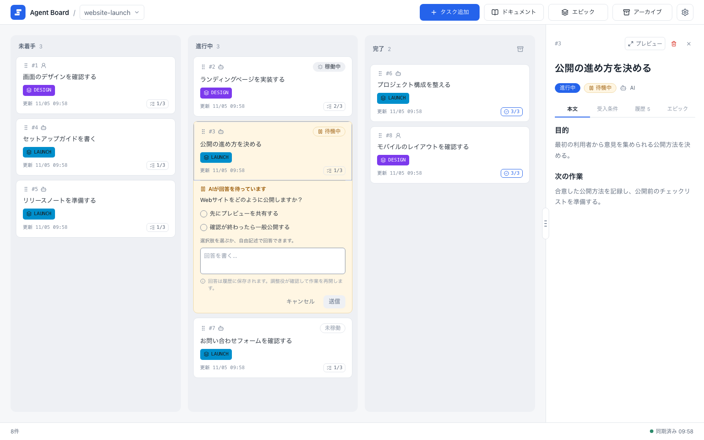
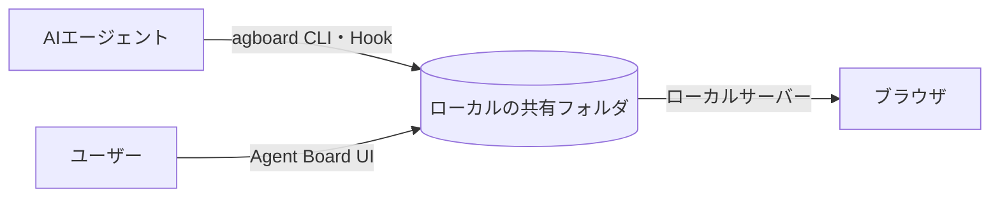
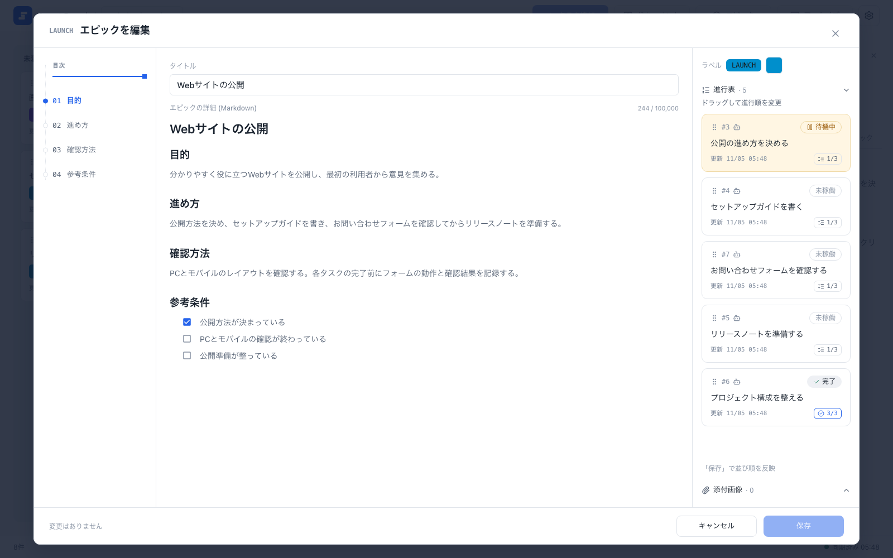
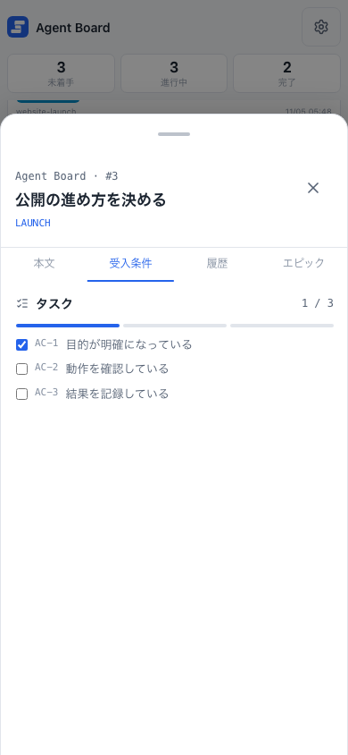

<div align="center">


# Agent Board

**人とAIが、同じボードで仕事を進める。**

エージェントが何をしていて、何に答えを待っているか。タスク・質問・受入条件をひとつのボードで共有し、PCでもスマホでも返答できます。

```sh
brew install fooqoo/tap/agboard
```

[English](README.md) · [使い方](https://fooqoo.github.io/agent-board/ja/guide/) · [開発に参加する](CONTRIBUTING.ja.md) · [GitHubリポジトリ](https://github.com/FooQoo/agent-board)




</div>

## Agent Boardとは

エージェントに長い仕事を任せると、進み具合も質問もターミナルの中に埋もれます。Agent Boardは、それを履歴付きの共有ボードに出します。エージェントが質問し、あなたがPCかスマホでタスクの上から答えると、エージェントは作業を再開します。受入条件がすべてそろうと、タスクは自動で完了へ移ります。



## 特徴

**1. 人とAIが同じボードで作業を進める。** Todo・Doing・Doneの3列で進捗を管理し、稼働中・待機中の状態でAIの動きを確認できます。PCやスマホから、タスクに表示された質問へ回答でき、判断と状態変更の理由が履歴に残ります。

**2. 一つのAIセッションでタスクを順番に進める。** エピックでタスクの進行順を決め、`agboard progress`で今進められる作業と計画・タスクのファイルパスを取得できます。`agboard --project "My project" wait --until task --idle-timeout 300 --json`で、次の対象タスクを明示的に待ち受けられます。一件を処理してから同じセッションで次を待ち、リッスン前からTodoにあるタスクに加え、agentStatusがIdleのままDoingにあるAIタスクも対象です。指定した待機時間に対象がなければ正常終了します。作業フォルダからのプロジェクト選択とHookで必要な情報を渡し、自動完了の対象となるAI担当タスクは、すべての受入条件を満たすとDoneの列へ移ります。完了した作業はAIから変更できません。

**3. 計画と結果をローカルのMarkdownで管理する。** エピックの詳細は`EPIC.md`、タスクは`TASK.md`に保存し、画像も同じフォルダで管理します。データはすべてローカルにあり、アカウントやクラウドサービスは不要です。

タスクの計画と検証結果は`TASK.md`の本文に、受入条件と履歴はfrontmatterに保存します。現在の状態などのメタデータは`task.json`で管理します。履歴の各項目は、日時の`at`と内容の`reason`だけです。AIが自動で記録した進捗も、画面やCLIからの操作も同じ履歴に残ります。操作理由は任意で、空欄の場合は現在の状態に応じた文言をAgent Boardが生成します。

編集・画像添付・アーカイブ・設定の詳細は[使い方ガイド](https://fooqoo.github.io/agent-board/ja/guide/)を参照してください。

<details>
<summary>エピックの進行表とモバイルの画面を見る</summary>





</details>

## インストール

Agent Boardは、macOS 15以降のApple SiliconとIntelで動作します。[Homebrew](https://brew.sh)でインストールします。RustやNode.jsは不要で、ビルドもしません。

```sh
brew install fooqoo/tap/agboard
agboard --version
```

Homebrew自体にも、環境によってはCommand Line Toolsなどの前提があります。詳しくはHomebrewのドキュメントを参照してください。ソースからビルドする場合は、[開発者ガイド](https://fooqoo.github.io/agent-board/ja/dev/getting-started/setup)を参照してください。

## 連携する

作業フォルダにプロジェクトを作成し、エージェントをつなぎます。

```sh
cd my-project
agboard project create "My project"
agboard connect
```

`project create`は、現在のフォルダをプロジェクトにbindします。既存のプロジェクトを使うときは`agboard project bind "My project"`を実行します。`connect`は、設定するエージェント（Claude Code、Codex、または両方）と、置き場所を尋ねます。Skillに1つ、Hookに1つ、GlobalかProjectのスコープを選びます。書き込む前にすべての変更を表示し、バックアップを残し、あなたの編集を上書きしません。終わったら、エージェントの`/hooks`でHookを確認してください。詳しくは[エージェントとの連携](https://fooqoo.github.io/agent-board/ja/guide/automation/agents#connect-your-agent)を参照してください。

## 使い始める

```sh
agboard serve
```

[http://127.0.0.1:7420/](http://127.0.0.1:7420/)を開き、プロジェクトを選んでタスクを追加します。`agboard progress`とHookはカレントフォルダに最も近い登録済みプロジェクトを使います。別プロジェクトを対象にする場合は`--project NAME`で指定します。

スマホから進捗の確認や質問への回答をするには、**設定** → **モバイル接続**を開き、ngrokのauthtokenで接続します。スマホでは、ボードがコンピューターに表示する4桁の合言葉（接続を開始するたびに変わります）を入力します。ボード全体はあなたのコンピューターに残ります。環境変数`NGROK_AUTHTOKEN`を設定して`agboard serve --monitor ngrok`で起動することもでき、その場合は合言葉が表示されます。4桁の合言葉はアカウント認証より弱いため、URLは他の人に教えないでください。制限は[モバイルモニターのガイド](https://fooqoo.github.io/agent-board/ja/guide/operations/mobile-monitor)で説明しています。

## 更新する

更新は2段階です。先にコマンドを更新し、続けて`connect`が導入したSkillとHookを更新します。

```sh
brew upgrade fooqoo/tap/agboard
agboard update
```

`agboard update`は、変更内容を表示して、書き込む前に確認します。`agboard update --yes`が省くのは質問だけで、あなたの編集は上書きしません。更新したら、`agboard serve`を再起動してください。

## 機能の提供段階

v1.0.0には、一般提供（GA）の機能と、パブリックプレビューの機能が混在しています。Docs、`connect`と`update`、タスクの受け取り、モバイルモニター、初回の案内はパブリックプレビューで、今後変わる可能性があります。GAは、何も変わらないことや、不具合がないことを約束するものではありません。詳しくは[機能の提供段階](https://fooqoo.github.io/agent-board/ja/guide/feature-stages)を参照してください。

## ライセンス

Agent Boardは、[MITライセンス](LICENSE)で公開しています。同梱する第三者コンポーネントには、それぞれのライセンスが適用されます。詳細は[LICENSE](LICENSE)と[THIRD_PARTY_NOTICES.txt](THIRD_PARTY_NOTICES.txt)を参照してください。

## ドキュメント

- [使い方ガイド](https://fooqoo.github.io/agent-board/ja/guide/) — ブラウザ操作、CLIの例、エージェントの作業手順、共有ファイル、バックアップ。
- [モバイルモニター](https://fooqoo.github.io/agent-board/ja/guide/operations/mobile-monitor) — ngrokと合言葉によるスマホの接続、モニターの表示内容、確認方法。
- [リリースノート](https://fooqoo.github.io/agent-board/ja/releases) — 公開した各版の変更点。
- [Claude Code・Codexとの連携（英語）](integrations/README.md) — `connect`が導入するものと、Hookの仕組み。
- [開発に参加する](CONTRIBUTING.ja.md) — 開発と検証。
