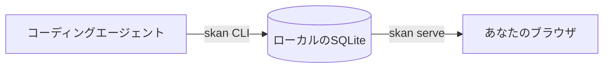

<div align="center">


# SimpleKanban

**コーディングエージェントの進捗が見えるカンバンボード。**

カードを動かすのはエージェント。あなたはボードを眺めるだけ。

[English](README.md) · [開発に参加する](CONTRIBUTING.ja.md)


</div>

## SimpleKanbanとは

コーディングエージェントに長い作業を任せると、いま何をしているのか、あなたの返事を待って止まっていないのかが分かりません。SimpleKanbanはその状況を見えるようにします。

- **エージェントはコマンドで報告します。** カードを追加し、Todo・Doing・Doneの間で動かし、*running*(作業中)か*pending*(待機中)かを伝えます。
- **あなたはブラウザで見るだけです。** ボードは自動で更新されるので、どのカードが進行中で、なぜ待っているのかがいつでも分かります。
- **データはマシンの外へ出ません。** カードはローカルのSQLiteに保存され、Web画面は`127.0.0.1`だけで待ち受けます。



## 特徴

**いまの状況が一目で分かります。** Doing列のカードには稼働状態(Idle・Running・Pending)が表示されます。Pendingのカードには待っている理由も出ます。

**判断は人間の手元に残ります。** カードの削除とボードの置き換えは人間だけができます。エージェントはその判断をあなたに任せるしかありません。

**あえてシンプルにしています。** 列は3つ、ボードはローカルに1つだけ。アカウントもクラウドも要りません。

**日本語と英語に対応しています。** ヘッダーの地球ボタンでWeb画面の言語を切り替えられます。

## はじめかた

```sh
skan init --name my-board          # ボードを作成
skan add "Write the setup guide"   # Todo列にカードを追加
skan serve --port 7420             # http://127.0.0.1:7420/ で表示
```

あとはエージェントが作業しながら`skan mv 1 doing`や`skan state 1 running`を実行します。ソースからのビルド方法は[CONTRIBUTING.ja.md](CONTRIBUTING.ja.md)を見てください。

<details>
<summary><strong>コマンド一覧</strong></summary>

```sh
skan mv 1 doing                    # カード#1をDoingへ移動
skan state 1 running               # カード#1を実行中として報告
skan state 1 pending --reason "Waiting for review"
skan ls                            # 列ごとにカードを表示
skan ls --column doing --state running
```

その他のコマンド: `edit`、`show`、`rm`、`export`、`import`。詳しくは`skan --help`または`skan <command> --help`を実行してください。どのコマンドにも`--json`を付けると、機械処理向けの出力になります。

カードの削除(`rm`)、既存ボードへの`init`の再実行、既存ボードへの`import`では、人間に確認を求めます。エージェントはこれらを実行できません。

</details>

<details>
<summary><strong>エージェント向けルール</strong></summary>

同じ進め方とルールは`skan --help`にも表示されます。コマンドの出力は英語のままです。

```text
Workflow for agents:
  skan ls --json                             # read the board first; a human may have moved cards
  skan mv <id> doing                         # you start a card
  skan state <id> running                    # you are working on it
  skan state <id> pending --reason "<text>"  # you are waiting for a human or an external result
  skan state <id> running                    # the wait is over
  skan mv <id> done                          # you are finished (the card returns to idle)
Do not leave a card running when you stop: finish it, or run `skan state <id> idle`.

Rules for agents:
  - Move a card to doing before you report running or pending.
  - Report pending with --reason when you are waiting for something.
  - Moving a card to todo or done resets it to idle.
  - You cannot delete cards or replace the board. Ask a human to do it.
  - Add --json to any command for machine-readable output.
```

</details>

<details>
<summary><strong>表示言語</strong></summary>

Web画面は英語で開きます。ヘッダーの地球ボタンからEnglishまたは日本語を選べます。選択した言語はブラウザに保存されます。ブラウザやOSの言語設定から表示言語を自動選択することはありません。CLI、helpとエラーメッセージ、APIとJSONの値は英語のままです。入力したカードの内容は翻訳されません。

</details>
