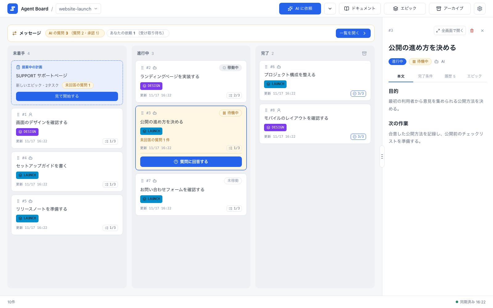
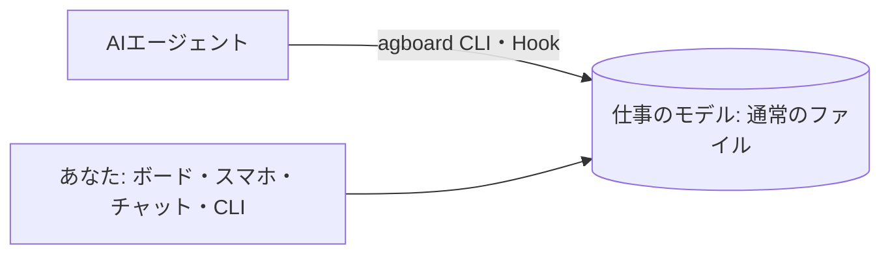
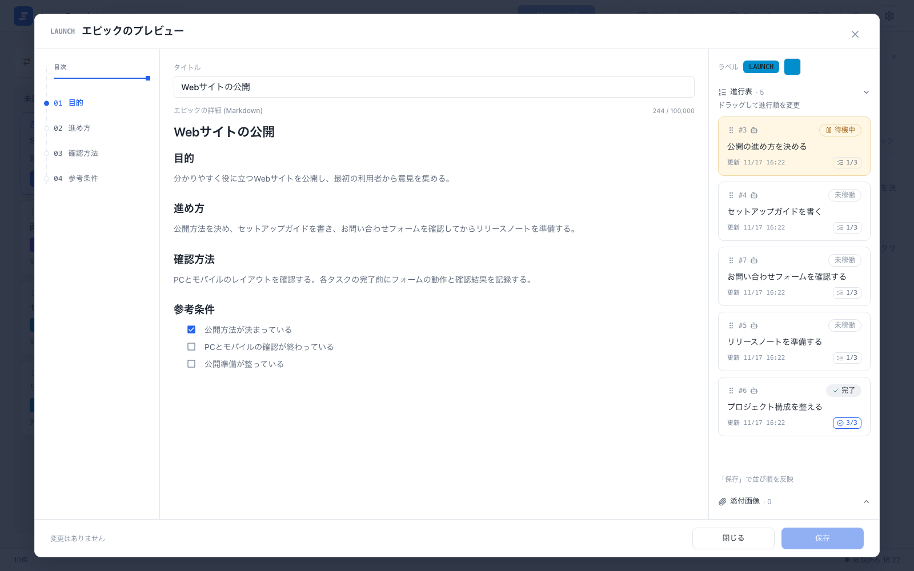
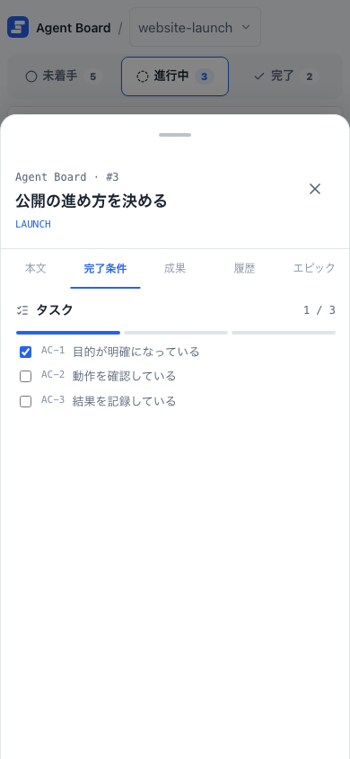

<div align="center">


# Agent Board

[](https://github.com/FooQoo/agent-board/actions/workflows/ci.yml) [](https://codecov.io/gh/FooQoo/agent-board)

**頼むだけで、計画から完了までAIが進めてくれる。**

Agent Boardは、AIエージェントが計画し報告し、あなたが答える共有の作業場です。依頼を完了条件つきの計画に直し、質問への回答がそろったら自分で始め、止まってあなたに聞くのは必要なときだけ。見守るのも答えるのも、PCでもスマホでもチャットでもできます。

```sh
brew install fooqoo/tap/agboard
```

[English](README.md) · [デモを試す](https://fooqoo.github.io/agent-board/demo/) · [使い方](https://fooqoo.github.io/agent-board/ja/guide/) · [開発に参加する](CONTRIBUTING.ja.md) · [GitHubリポジトリ](https://github.com/FooQoo/agent-board)




</div>

## Agent Boardとは

大きな仕事をAIエージェントに渡しても、誰かが見張っていないと、最後まで進まないことが多くあります。依頼を計画に直す、止まっていないかを見る、ログに埋もれた質問を拾う、次のセッションで経緯を説明し直す、終わりに本当に終わったかを確かめる。

Agent Boardは、Claude CodeやCodexのようなエージェントのそばに置く**共有の作業場**で、エージェントが計画し報告し、あなたが答えます。エージェントを動かすのではなく、仕事を一か所にまとめて持ち、あなたとエージェントが同じものを読み書きします。持つのは、計画（順序つきのエピックとタスク）、各タスクがいつ終わりかを示す完了条件、エージェントが止まって聞く質問、何がなぜ起きたかの履歴です。これらは手元の通常のファイルに保存され、アカウントやクラウドサービスは要りません。



実際に触ってみたい場合は、[デモ](https://fooqoo.github.io/agent-board/demo/)をブラウザで試せます。インストールは不要です。サンプルデータで初回の案内が始まり、ページを再読み込みすると最初からやり直せます。

## 任せる流れ

1. **要望。** やりたいことを、普通の言葉でエージェントに伝えます。
2. **計画。** エージェントが、完了条件つきのエピックとタスクをAI下書きとしてボードに置き、自分では決められないことを質問します。
3. **回答のあとで開始。** あなたが答えます。質問への回答がそろい、計画が清書されると、エージェントが自分で開始します。そのタスクに紐づく質問が未回答のあいだは始まりません。
4. **順に作業。** エージェントはタスクを進め、あなたのために止まるのは、意図が分からない、好みで決まる、取り返しがつかない、頼んだ範囲を超えて広がる、のときだけです。
5. **自動で完了。** エージェントがタスクのすべての完了条件を確かめ、あなたを待つものがなくなると、タスクは自動で完了に移ります。

関わり方は二つあります。エージェントが止まって聞くときは、答えやすい場所で答えれば、回答は一度だけ記録されます（Human-in-the-Loop）。作業の間は、止めずに見守り、カードを戻す、条件にチェックを付ける、計画を書き換える、ができて、エージェントは変更に従います（Human-on-the-Loop）。[仕事のモデル](https://fooqoo.github.io/agent-board/ja/guide/work-model)と[クイックスタート](https://fooqoo.github.io/agent-board/ja/guide/quickstart)を参照してください。

## 仕事を映すモニター

ボードは、仕事を見るモニターの一つです。見るだけでなく、答えて、介入する場所でもあります。

- **ボード。** 仕事が未着手・進行中・完了と進むのを見守れます。エージェントを止めずにカードへ介入でき、質問への回答も、タスクの上でそのまま行えます。[ボードの使い方](https://fooqoo.github.io/agent-board/ja/guide/watch/board)
- **エピックと進行表。** エピックが計画とタスクの順序を持ち、進行表が、いま進められる作業をエージェントに返します。[エピックと進行表](https://fooqoo.github.io/agent-board/ja/guide/watch/epics)
- **どこからでも確認。** 席を離れていても、リモートアクセスでスマホやタブレットから仕事を見守り、エージェントの質問に答えられます。[リモートアクセス](https://fooqoo.github.io/agent-board/ja/guide/watch/remote-access)
- **プロジェクトのドキュメント。** プロジェクトの`docs/`にある設計書や仕様を、ボードから開いて読めます。パブリックプレビューです。[プロジェクトのドキュメント](https://fooqoo.github.io/agent-board/ja/guide/watch/docs)

エージェントとのチャットで答えることもでき、`agboard`コマンドはエージェントやスクリプトが使う入口です。計画と結果は、手元のMarkdownファイル（`EPIC.md`と`TASK.md`）に残り、完了条件と履歴はfrontmatterに入ります。

編集・画像添付・アーカイブ・設定の詳細は[使い方ガイド](https://fooqoo.github.io/agent-board/ja/guide/)を参照してください。

<details>
<summary>エピックの進行表とモバイルの画面を見る</summary>





</details>

## インストール

Agent Boardは、macOS 15以降のApple SiliconとIntelで動作します。[Homebrew](https://brew.sh)でインストールします。RustやNode.jsは不要で、ビルドもしません。

```sh
brew install fooqoo/tap/agboard
agboard --version
```

Homebrew自体にも、環境によってはCommand Line Toolsなどの前提があります。詳しくはHomebrewのドキュメントを参照してください。ソースからビルドする場合は、[開発者ガイド](https://fooqoo.github.io/agent-board/ja/dev/getting-started/setup)を参照してください。

## セットアップする

最初に一度だけエージェントを設定し、作業フォルダにプロジェクトを作成します。

```sh
agboard setup
cd my-project
agboard project create "My project"
```

`setup`はデータフォルダを作成し、使うエージェント（Codex、Claude Code、または両方）を尋ねます。計画を表示し、`y`と答えると、各エージェント自身のプラグインコマンドでAgent Boardプラグイン（SkillとHook）を導入し、エージェントが共有フォルダを使えるようにします。Codexでは、プラグインのHookを信頼済みにします。どのフォルダでも実行でき、プロジェクトは不要です。`project create`は、現在のフォルダをプロジェクトに登録します。既存のプロジェクトを使うときは`agboard project bind "My project"`を実行します。詳しくは[エージェントとの連携](https://fooqoo.github.io/agent-board/ja/guide/delegate/agents#set-up-your-agents)を参照してください。

## 使い始める

```sh
agboard serve
```

[http://127.0.0.1:7420/](http://127.0.0.1:7420/)を開き、プロジェクトを選んで**AI に依頼**を選びます。エージェントのためにサーバーを動かし続ける必要はありません。あなたを待つコマンドとエージェントのHookが裏で起動し、30分使われないと自分で止まります。こうして起動したサーバーは、ボードのタブが開いていなければプロジェクトのボードをブラウザーで開きます。`agboard open`でいつでも開けます。`agboard progress`とHookはカレントフォルダに最も近い登録済みプロジェクトを使います。別プロジェクトを対象にする場合は`--project NAME`で指定します。

スマホから進捗の確認や質問への回答をするには、**設定** → **リモート接続**を開き、ngrokのauthtokenで接続します。スマホでは、ボードがコンピューターに表示する4桁の合言葉（接続を開始するたびに変わります）を入力します。ボード全体はあなたのコンピューターに残ります。環境変数`NGROK_AUTHTOKEN`を設定して`agboard serve --monitor ngrok`で起動することもでき、その場合は合言葉が表示されます。4桁の合言葉はアカウント認証より弱いため、URLは他の人に教えないでください。制限は[リモートアクセスのガイド](https://fooqoo.github.io/agent-board/ja/guide/watch/remote-access)で説明しています。

## 更新する

コマンドを更新します。Agent Boardプラグインはそれに追従します。

```sh
brew upgrade fooqoo/tap/agboard
```

プラグインは自分で更新されます。新しいエージェントのセッションが始まるとき、プラグインが`agboard`の同梱のものと違えば、バックグラウンドで入れ直し、次のセッションから有効になります。自動更新が終わらなかったとき（Codexが変更されたhookの定義を信頼し直す場合など）や、プラグインを直したいときだけ、自分で`agboard update`を実行してください。変更内容を表示して、実行する前に確認します。`agboard update --yes`は、その質問にあらかじめ答えます。更新したら、`agboard serve`を再起動してください。

## 機能の提供段階

Agent Boardには、一般提供（GA）の機能と、パブリックプレビューの機能が混在しています。ドキュメント、常駐エージェント、質問と依頼はパブリックプレビューで、今後変わる可能性があります。GAは、何も変わらないことや、不具合がないことを約束するものではありません。詳しくは[機能の提供段階](https://fooqoo.github.io/agent-board/ja/guide/feature-stages)を参照してください。

## ライセンス

Agent Boardは、[MITライセンス](LICENSE)で公開しています。同梱する第三者コンポーネントには、それぞれのライセンスが適用されます。詳細は[THIRD_PARTY_NOTICES.txt](THIRD_PARTY_NOTICES.txt)を参照してください。

## ドキュメント

- [使い方ガイド](https://fooqoo.github.io/agent-board/ja/guide/) — ブラウザ操作、CLIの例、エージェントの作業手順、共有ファイル、バックアップ。
- [リモートアクセス](https://fooqoo.github.io/agent-board/ja/guide/watch/remote-access) — ngrokと合言葉によるスマホの接続、モニターの表示内容、確認方法。
- [リリース](https://github.com/FooQoo/agent-board/releases) — 公開した各版の変更点。
- [Agent Boardプラグイン（英語）](plugins/agent-board/README.md) — `setup`がClaude CodeとCodexに導入するものと、Hookの仕組み。
- [開発に参加する](CONTRIBUTING.ja.md) — 開発と検証。
