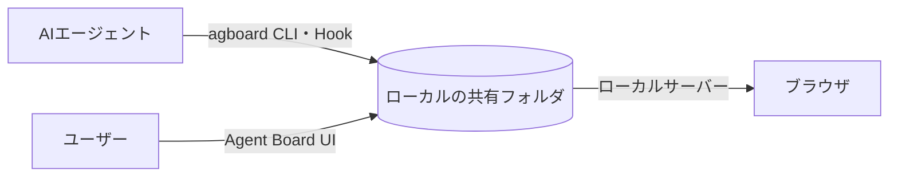

<div align="center">


# Agent Board

**ユーザーとAIが一緒に作業を進める共有ボード。**

AIが作業を登録し、ユーザーも状態の更新や判断への回答を行います。

[English](README.md) · [使い方（英語）](docs/usage.md) · [開発に参加する](CONTRIBUTING.ja.md) · [GitHubリポジトリ](https://github.com/FooQoo/agent-board)


</div>

## Agent Boardとは

エージェントに長い作業を任せると、どの作業が進み、何を待ち、何の返事が必要なのか分かりにくくなります。Agent Boardはユーザーとエージェントが同じ履歴つきボードを見て、作業の往復を続けられるようにします。

- **AIが人とAIの作業を登録します。** 担当はAIまたはユーザーに固定され、カードの列と状態で進み具合を示します。
- **ユーザーとAIが同じボードを更新します。** 状態変更には理由を残します。ユーザーが判断依頼に答えると、次のHookや`agboard snapshot`がその回答を含む全履歴をAIへ渡します。
- **すべてのコマンドが対象プロジェクトを指定します。** ボードには複数のプロジェクトがあり、コマンド・Hook・待機は`--project NAME`で対象を明示します。Web画面や別のエージェントの選択から推測することはありません。
- **計画と結果はプレーンファイルに置きます。** 各カードには`TASK.md`(作業内容・完了条件と確認結果・実行記録)、各エピックには`PLAN.md`があります。エージェントも人も直接編集でき、ボードは追加の操作なしにファイルの変更へ追従します。
- **データはマシンの外へ出ません。** カードはローカルの共有フォルダにあるファイルとして保存され、Web画面は`127.0.0.1`だけで待ち受けます。



## 特徴

**次に必要なことが分かります。** カードには担当と列が表示されます。進行中のAI担当カードにはIDLE・RUNNING・PENDINGを表示し、PENDINGの理由と履歴を確認できます。

**判断の経緯が残ります。** ユーザーは理由を添えてカードを移動し、判断依頼へ回答できます。AIは最大10件の選択肢を示せます。ユーザーは選択肢を1つ選ぶか、補足を書くか、その両方で答えます。AIは回答を読んで方針を見直し、作業を再開します。

**エピックで作業をまとめます。** エピックは計画と色を持ちます。カードは最大1つのエピックに所属し、ラベルで表示されます。計画・名前・色の編集と、エピックに含めるタスクの選択は、1つのダイアログで行えます。

**整形表示のMarkdownエディタで編集できます。** カードとエピックの本文を、見出し・タスクリスト・表・コードブロック・Mermaidの図・画像を含めて、その場で編集できます。完了条件はチェックボックスで操作できます。

**完了した作業をアーカイブできます。** カード単位、またはDoneの複数カードをまとめてアーカイブし、ボードを整理できます。必要になったカードはアーカイブから復元でき、完全削除もアーカイブ画面から行います。

**証跡と画像。** カードの画像とテキストの証跡を、カードのファイルの隣に保存します。本文中の画像とMermaidの図は、クリックで拡大できます。

**あえてシンプルにしています。** プロジェクトごとに列は3つ、データ領域はプレーンファイルでローカルに1つだけ。アカウントもクラウドも要りません。

**言語と配色を選べます。** ヘッダーの設定から、Web画面の言語(日本語/English)と、24種類のカラーテーマ(12色のライトとダーク)を切り替えられます。

## インストール

Git、Rust（edition 2024に対応したCargoを含む）、Node.js、pnpmを使い、ソースからビルドします。

```sh
git clone https://github.com/FooQoo/agent-board.git
cd agent-board
pnpm --dir web install
pnpm --dir web build
cargo install --path . --locked --force
```

`~/.cargo/bin`（または`$CARGO_HOME/bin`）を`PATH`に追加してください。`agboard`はWeb画面を含むため、先にWeb画面をビルドします。更新や導入確認は[使い方ガイド（英語）](docs/usage.md#installation-and-updates)を参照してください。

## はじめかた

```sh
agboard project create "My project"
agboard serve --port 7420
```

[http://127.0.0.1:7420/](http://127.0.0.1:7420/)を開き、プロジェクトを選んでカードを追加します。ボードを操作するCLIコマンドでは、`--project NAME`で対象を指定します。

## ドキュメント

- [使い方ガイド（英語）](docs/usage.md) — ブラウザ操作、CLIの例、エージェントの作業手順、共有ファイル、バックアップ。
- [Claude Code・Codexとの連携（英語）](integrations/README.md) — Hookとエージェントの設定。
- [開発に参加する](CONTRIBUTING.ja.md) — 開発と検証。

## LANまたはtailnetからモバイルモニターを見る

`agboard serve`の通常PCリスナーはloopbackだけで待ち受けます。信頼できるHTTPS proxyを用意するときだけ、専用remoteリスナーを追加してください。

```sh
agboard serve --port 7420 --remote-port 8040 \
  --remote-origin https://192.168.1.20:8443 \
  --remote-origin https://my-mac.example-tailnet.ts.net
```

実際に公開するoriginだけを指定します。remoteポートはproxy専用の2つ目のloopbackリスナーです。通常のPC用ポートをproxyしないでください。共通URLを開くと、幅768 CSS px未満ではモニター、それ以上ではPCボードが開きます。`/monitor/`と`/board/`の直接URLは幅に関係なく使えます。PCボードのremote書込guardは維持され、モニターAPIは読み取り専用です。

### CaddyでLAN内HTTPSを使う

[Caddy公式のダウンロード・インストール手順](https://caddyserver.com/docs/install)からCaddy 2.8以降を用意してください。標準buildで動作します。[`examples/monitor/Caddyfile`](examples/monitor/Caddyfile)は指定したLAN IPにbindし、Caddyのinternal HTTPS authorityを使い、全経路に[Basic認証](https://caddyserver.com/docs/caddyfile/directives/basic_auth)を適用します。専用remoteポートだけへ転送し、Agent Boardのguardが使うブラウザのHostとOriginを保ち、Authorizationと`X-Forwarded-Host`を取り除き、[SSEをすぐflush](https://caddyserver.com/docs/caddyfile/directives/reverse_proxy#streaming)します。admin APIとroot証明書の自動trustは無効にし、ローカル試験は一時CAの公開証明書を直接読みます。

自分の環境に合わせて値を設定し、パスワードhashを作ります。平文パスワードをshell履歴やCaddyfileに残さないでください。

```sh
export LAN_IP=192.168.1.20
export HTTPS_PORT=8443
export REMOTE_PORT=8040
export BASIC_AUTH_USER=board-reader
export BASIC_AUTH_HASH="$(caddy hash-password)"
```

一方のterminalで、実際のHTTPS originを指定してAgent Boardを起動します。

```sh
agboard serve --port 7420 --remote-port "$REMOTE_PORT" \
  --remote-origin "https://${LAN_IP}:${HTTPS_PORT}"
```

もう一方で設定を検証し、foregroundでproxyを起動します。

```sh
caddy validate --config examples/monitor/Caddyfile --adapter caddyfile
caddy run --config examples/monitor/Caddyfile --adapter caddyfile
```

信頼できる同じLAN上の端末で`https://<LAN_IP>:<HTTPS_PORT>/`を開き、Basic認証情報を入力します。`tls internal`の証明書はCaddyのローカルCAが署名するため、スマートフォンは既定で信頼しません。公開root証明書は`<Caddyのデータ領域>/pki/authorities/local/root.crt`にあります(`XDG_DATA_HOME`を設定した場合は`$XDG_DATA_HOME/caddy/pki/authorities/local/root.crt`。詳細は[Caddyのデータ領域規約](https://caddyserver.com/docs/conventions#data-directory)を参照)。この公開証明書だけを安全な方法でスマートフォンへコピーし、端末OSの手順で信頼させてください。CA秘密鍵はコピー・配布しないでください。Caddyのデータ領域は永続データなので、アクセスを制限してバックアップしてください。ルーターのport forwardingを設定したり、公開インターネットへ公開したりしないでください。

終了時は両方のforeground processでCtrl+Cを押します。PCがスリープしたときや、どちらかのprocessが停止したときは、再び起動するまでremoteから利用できません。

### Tailscale Serve

[Tailscale公式ダウンロード](https://tailscale.com/download)からOS向けのstandalone appを導入し、Tailscale CLI 1.52以降を使います。現行の[Serve CLI構文](https://tailscale.com/docs/reference/tailscale-cli/serve)は1.52で変わりました。PCとスマートフォンを既存tailnetへ追加し、管理画面のアクセス規則で自分のアカウントと対象端末だけに制限してください。[Serveにもtailnetのアクセス規則が適用されます](https://tailscale.com/docs/features/tailscale-serve)。ServeにはtailnetのHTTPS証明書が必要です。実行すると設定変更の同意を求められる場合があります。内容を確認してから承認してください。

Agent Boardを専用remoteポートで起動し、そのloopbackポートをServeします。

```sh
agboard serve --port 7420 --remote-port 8040 \
  --remote-origin https://<tailscaleが表示したorigin>
tailscale serve --bg http://127.0.0.1:8040
tailscale serve status
tailscale funnel status
```

`tailscale serve status`に表示されたHTTPS originを、Agent Board起動前に`--remote-origin`へ指定します。Serveがtailnet内だけに公開され、Funnelでインターネットへ公開されていないことを確認してください。HostやOriginを書き換える独自proxyは追加しないでください。ServeにもTailscaleのアクセス規則が適用され、Agent Boardもremote PC書込tokenと同一originのrequest headerを検証します。

Agent BoardはCtrl+Cで停止します。このServe routeだけを解除するには`tailscale serve --bg http://127.0.0.1:8040 off`を実行します。既存のServe設定を変更する前に`tailscale serve status`で内容を確認してください。backgroundのServe設定は再起動後も復帰しますが、PCがスリープ中、またはボードserverが停止中はアクセスできません。

ローカルproxy試験は実Caddy processと実Agent Board serverを起動し、一時CAを使います。Caddy 2.8以降とRust、Node.js、pnpmを用意して`python3 scripts/test-monitor-proxy.py`を実行してください。一時のデータ・設定・証明書領域とテスト用Basic認証情報を使い、HTTPSには8030–8039、Agent Boardのremote listenerには8040–8049を使います。`python3 scripts/test-monitor-proxy.py --static-only`はサービスを起動せずCaddyfileを静的確認します。このローカル試験は実LAN、スマートフォンの証明書信頼、Tailscale tailnetの検証にはなりません。
