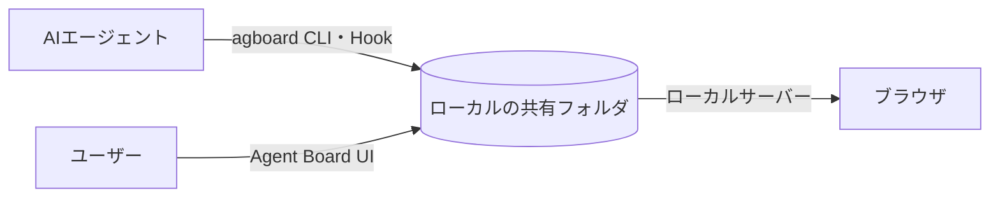

<div align="center">


# Agent Board

**ユーザーとAIが一緒に作業を進める共有ボード。**

AIが作業を登録し、ユーザーも状態の更新や判断への回答を行います。

[English](README.md) · [使い方（英語）](docs/usage.md) · [開発に参加する](CONTRIBUTING.ja.md) · [GitHubリポジトリ](https://github.com/FooQoo/agent-board)


</div>

## Agent Boardとは

エージェントに長い作業を任せると、どの作業が進み、何を待ち、何の返事が必要なのか分かりにくくなります。Agent Boardはユーザーとエージェントが同じ履歴つきボードを見て、作業の往復を続けられるようにします。

- **AIが人とAIの作業を登録します。** 担当はAIまたはユーザーに固定され、カードの列と状態で進み具合を示します。
- **ユーザーとAIが同じボードを更新します。** 状態変更には理由を残します。ユーザーが判断依頼に答えると、次のHookや`agboard snapshot`がその回答を含む全履歴をAIへ渡します。
- **すべてのコマンドが対象プロジェクトを指定します。** ボードには複数のプロジェクトがあり、コマンド・Hook・待機は`--project NAME`で対象を明示します。Web画面や別のエージェントの選択から推測することはありません。
- **計画と結果はプレーンファイルに置きます。** 各カードには`TASK.md`(作業内容・完了条件と確認結果・実行記録)、各エピックには`PLAN.md`があります。エージェントも人も直接編集でき、ボードは追加の操作なしにファイルの変更へ追従します。
- **データはマシンの外へ出ません。** カードはローカルの共有フォルダにあるファイルとして保存され、Web画面は`127.0.0.1`だけで待ち受けます。



## 特徴

**次に必要なことが分かります。** カードには担当と列が表示されます。進行中のAI担当カードにはIDLE・RUNNING・PENDINGを表示し、PENDINGの理由と履歴を確認できます。

**判断の経緯が残ります。** ユーザーは理由を添えてカードを移動し、判断依頼へ回答できます。AIは最大10件の選択肢を示せます。ユーザーは選択肢を1つ選ぶか、補足を書くか、その両方で答えます。AIは回答を読んで方針を見直し、作業を再開します。

**エピックで作業をまとめます。** エピックは計画と色を持ちます。カードは最大1つのエピックに所属し、ラベルで表示されます。計画・名前・色の編集と、エピックに含めるタスクの選択は、1つのダイアログで行えます。

**整形表示のMarkdownエディタで編集できます。** カードとエピックの本文を、見出し・タスクリスト・表・コードブロック・Mermaidの図・画像を含めて、その場で編集できます。完了条件はチェックボックスで操作できます。

**完了した作業をアーカイブできます。** カード単位、またはDoneの複数カードをまとめてアーカイブし、ボードを整理できます。必要になったカードはアーカイブから復元でき、完全削除もアーカイブ画面から行います。

**証跡と画像。** カードの画像とテキストの証跡を、カードのファイルの隣に保存します。本文中の画像とMermaidの図は、クリックで拡大できます。

**あえてシンプルにしています。** プロジェクトごとに列は3つ、データ領域はプレーンファイルでローカルに1つだけ。アカウントもクラウドも要りません。

**言語と配色を選べます。** ヘッダーの設定から、Web画面の言語(日本語/English)と、24種類のカラーテーマ(12色のライトとダーク)を切り替えられます。

## インストール

Git、Rust（edition 2024に対応したCargoを含む）、Node.js、pnpmを使い、ソースからビルドします。

```sh
git clone https://github.com/FooQoo/agent-board.git
cd agent-board
pnpm --dir web install
pnpm --dir web build
cargo install --path . --locked --force
```

`~/.cargo/bin`（または`$CARGO_HOME/bin`）を`PATH`に追加してください。`agboard`はWeb画面を含むため、先にWeb画面をビルドします。更新や導入確認は[使い方ガイド（英語）](docs/usage.md#installation-and-updates)を参照してください。

## はじめかた

```sh
agboard project create "My project"
agboard serve --port 7420
```

[http://127.0.0.1:7420/](http://127.0.0.1:7420/)を開き、プロジェクトを選んでカードを追加します。ボードを操作するCLIコマンドでは、`--project NAME`で対象を指定します。

## ドキュメント

- [使い方ガイド（英語）](docs/usage.md) — ブラウザ操作、CLIの例、エージェントの作業手順、共有ファイル、バックアップ。
- [モバイルモニター（英語）](docs/mobile-monitor.md) — LAN・Tailscale接続、HTTPS、スマホの証明書設定。
- [Claude Code・Codexとの連携（英語）](integrations/README.md) — Hookとエージェントの設定。
- [開発に参加する](CONTRIBUTING.ja.md) — 開発と検証。
