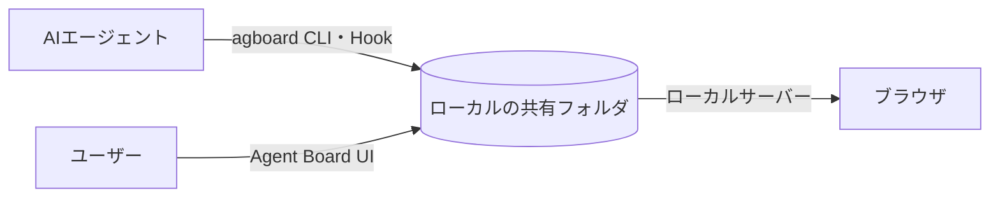

<div align="center">


# Agent Board

**ユーザーとAIが一緒に作業を進める共有ボード。**

AIが作業を登録し、ユーザーも状態の更新や判断への回答を行います。

[English](README.md) · [使い方（英語）](docs/usage.md) · [開発に参加する](CONTRIBUTING.ja.md) · [GitHubリポジトリ](https://github.com/FooQoo/agent-board)


</div>

## Agent Boardとは

エージェントに長い作業を任せると、どの作業が進み、何を待ち、何の返事が必要なのか分かりにくくなります。Agent Boardはユーザーとエージェントが同じ履歴つきボードを見て、作業の往復を続けられるようにします。

- **AIが人とAIの作業を登録します。** 担当はAIまたはユーザーに固定され、カードの列と状態で進み具合を示します。
- **ユーザーとAIが同じボードを更新します。** 状態変更には理由を残します。Hookは進行表を渡し、AIは必要に応じてカード本文や履歴を読みます。
- **プロジェクトは作業フォルダから解決できます。** `agboard progress`とHookは最も近い登録済みフォルダを使い、`--project NAME`で上書きできます。その他のコマンドではプロジェクトを明示します。
- **計画と結果はプレーンファイルに置きます。** 各カードには`TASK.md`、各エピックには`PLAN.md`があります。完了条件はファイル先頭のfrontmatterに書き、本文は自由なMarkdownです。対象となるAIカードは、すべての完了条件を達成すると自動でDoneになります。エージェントも人も直接編集でき、ボードは追加の操作なしにファイルの変更へ追従します。
- **ローカルで動きます。** カードはローカルの共有フォルダに保存され、サーバーは`127.0.0.1`で待ち受けます。スマホなどから使う場合は、自分のHTTPSプロキシを通して接続できます。アカウントやクラウドサービスは不要です。



## 特徴

**進行表から次の作業を選べます。** `agboard progress`は、エピックごとの進行順に作業をまとめ、必要な計画とタスクのファイルパスを返します。Done・アーカイブ・Pendingのカードを除き、AIが今進められる作業を選べるようにします。

**カードで判断依頼に回答できます。** Todo・Doingのカードに質問と回答欄を表示します。選択肢、補足、その両方で回答でき、回答を入力しながらカードの詳細を開いたり、移動したりできます。AIは回答と履歴を読み、作業を再開します。

判断依頼は回答または明示的な取り下げまでPendingのままです。`"wait": {}`を指定すると、AIは回答まで期限なしで待てます。待機コマンドの中断や接続切断は質問を失効させません。

**エピックで進行順を整えます。** エピックは計画・色・タスクの順序を持ちます。進行表でタスクをドラッグして保存すると、`PLAN.md`の`priority`へ反映します。状態と受け入れ条件の表示はボードのカードと共通です。添付画像を開くと進行表が畳まれ、進行表を開くと添付画像が畳まれます。所属エピックはカード編集またはCLIで変更します。

**本文と完了条件を読み分けられます。** カード詳細には本文・受け入れ条件・履歴・エピックの等幅4タブがあります。新規作成・編集画面では、受け入れ条件を本文のスクロールから分け、下部に畳んで固定表示します。本文は見出し・タスクリスト・表・コード・Mermaidの図・画像を含むMarkdownで編集できます。

**条件を満たしたAIの作業は自動で完了します。** サーバーの稼働中、下書きではないAI担当のTodo・Doingカードは、有効な条件が1件以上あり、すべて達成するとDoneになります。Pendingは回答まで維持し、ユーザー担当カードは自動完了しません。起動時にも既存カードを確認します。DoneのカードはAIから変更できません。

**スマホから確認・回答できます。** モバイルモニターも3レーンとカード内回答を使います。カードをタップすると本文・受け入れ条件・履歴・エピックの下部ドロワーを開き、左右スワイプでタブを切り替え、ハンドルを下へ引いて閉じられます。書き込みは判断依頼への回答に限定しています。

**完了した作業をアーカイブできます。** カード単位、またはDoneの複数カードをまとめてアーカイブし、ボードを整理できます。必要になったカードはアーカイブから復元でき、完全削除もアーカイブ画面から行います。

**証跡と画像。** カードの画像とテキストの証跡を、カードのファイルの隣に保存します。本文中の画像とMermaidの図は、クリックで拡大できます。

**あえてシンプルにしています。** プロジェクトごとに列は3つ、データ領域はプレーンファイルでローカルに1つだけ。アカウントもクラウドも要りません。

**言語と配色を選べます。** ヘッダーの設定から、Web画面の言語(日本語/English)と、24種類のカラーテーマ(12色のライトとダーク)を切り替えられます。

<details>
<summary>エピックの進行表とモバイルの画面を見る</summary>


</details>

## インストール

Git、Rust（edition 2024に対応したCargoを含む）、Node.js、pnpmを使い、ソースからビルドします。

```sh
git clone https://github.com/FooQoo/agent-board.git
cd agent-board
pnpm --dir web install
pnpm --dir web build
cargo install --path . --locked --force
```

`~/.cargo/bin`（または`$CARGO_HOME/bin`）を`PATH`に追加してください。`agboard`はWeb画面を含むため、先にWeb画面をビルドします。更新や導入確認は[使い方ガイド（英語）](docs/usage.md#installation-and-updates)を参照してください。

## はじめかた

```sh
agboard project create "My project"
agboard serve --port 7420
```

[http://127.0.0.1:7420/](http://127.0.0.1:7420/)を開き、プロジェクトを選んでカードを追加します。`agboard progress`とHookはカレントフォルダに最も近い登録済みプロジェクトを使います。別プロジェクトを対象にする場合は`--project NAME`で指定します。

## ドキュメント

- [使い方ガイド（英語）](docs/usage.md) — ブラウザ操作、CLIの例、エージェントの作業手順、共有ファイル、バックアップ。
- [モバイルモニター（英語）](docs/mobile-monitor.md) — LAN・Tailscale接続、HTTPS、スマホの証明書設定。
- [Claude Code・Codexとの連携（英語）](integrations/README.md) — Hookとエージェントの設定。
- [開発に参加する](CONTRIBUTING.ja.md) — 開発と検証。
