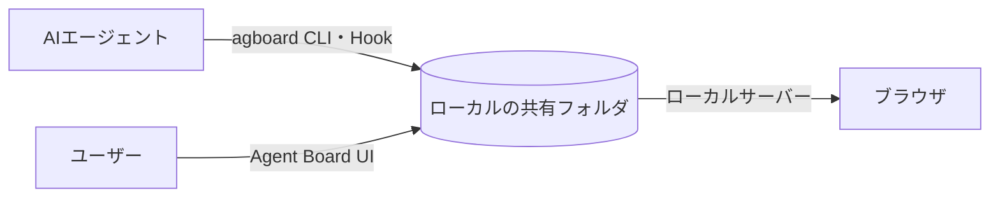

<div align="center">


# Agent Board

**ユーザーとAIが一緒に作業を進める共有ボード。**

AIが作業を登録し、ユーザーも状態の更新や判断への回答を行います。

[English](README.md) · [使い方](https://fooqoo.github.io/agent-board/ja/guide/) · [開発に参加する](CONTRIBUTING.ja.md) · [GitHubリポジトリ](https://github.com/FooQoo/agent-board)


</div>

## Agent Boardとは

エージェントに長い作業を任せると、どの作業が進み、何を待ち、何の返事が必要なのか分かりにくくなります。Agent Boardはユーザーとエージェントが同じ履歴つきボードを見て、作業の往復を続けられるようにします。



## 特徴

**1. 人とAIが同じボードで作業を進める。** Todo・Doing・Doneの3列で進捗を管理し、稼働中・待機中の状態でAIの動きを確認できます。PCやスマホのカード上で質問に回答でき、判断と状態変更の理由が履歴に残ります。

**2. 進行表と自動完了で、AIの管理操作を減らす。** エピックでタスクの進行順を決め、`agboard progress`で今進められる作業と計画・タスクのファイルパスを取得できます。作業フォルダからのプロジェクト選択とHookで必要な情報を渡し、すべての受け入れ条件を達成した対象のAIカードは自動でDoneになります。完了した作業はAIから変更できません。

**3. 計画・結果・証跡をローカルのMarkdownで管理する。** エピックの計画は`PLAN.md`、タスクは`TASK.md`に保存し、画像や証跡も隣に置きます。タスクの本文・受け入れ条件・操作履歴は`TASK.md`、現在の状態などのメタデータは`task.json`に保存します。画面やCLIから状態を変更すると`TASK.md`に記録され、画面の履歴にも表示されます。データはローカルに保存され、アカウントやクラウドサービスは不要です。

編集・画像添付・アーカイブ・設定の詳細は[使い方ガイド](https://fooqoo.github.io/agent-board/ja/guide/)を参照してください。

<details>
<summary>エピックの進行表とモバイルの画面を見る</summary>


</details>

## インストール

Git、Rust（edition 2024に対応したCargoを含む）、Node.js、pnpmを使い、ソースからビルドします。

```sh
git clone https://github.com/FooQoo/agent-board.git
cd agent-board
pnpm --dir web install
pnpm --dir web build
cargo install --path . --locked --force
```

`~/.cargo/bin`（または`$CARGO_HOME/bin`）を`PATH`に追加してください。`agboard`はWeb画面を含むため、先にWeb画面をビルドします。更新や導入確認は[使い方ガイド](https://fooqoo.github.io/agent-board/ja/guide/getting-started)を参照してください。

## はじめかた

```sh
agboard project create "My project"
agboard serve --port 7420
```

[http://127.0.0.1:7420/](http://127.0.0.1:7420/)を開き、プロジェクトを選んでカードを追加します。`agboard progress`とHookはカレントフォルダに最も近い登録済みプロジェクトを使います。別プロジェクトを対象にする場合は`--project NAME`で指定します。

## ドキュメント

- [使い方ガイド](https://fooqoo.github.io/agent-board/ja/guide/) — ブラウザ操作、CLIの例、エージェントの作業手順、共有ファイル、バックアップ。
- [モバイルモニター](https://fooqoo.github.io/agent-board/ja/guide/mobile-monitor) — LAN・Tailscale接続、HTTPS、スマホの証明書設定。
- [Claude Code・Codexとの連携（英語）](integrations/README.md) — Hookとエージェントの設定。
- [開発に参加する](CONTRIBUTING.ja.md) — 開発と検証。
