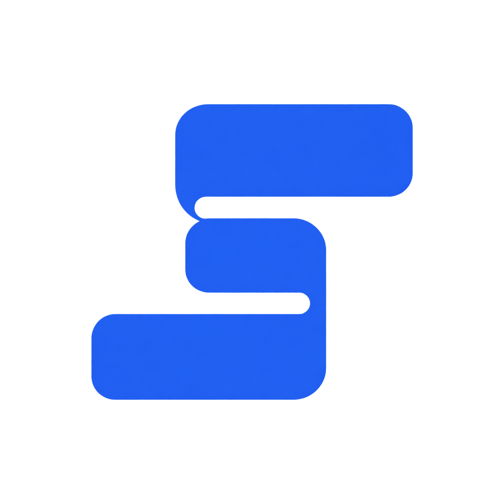
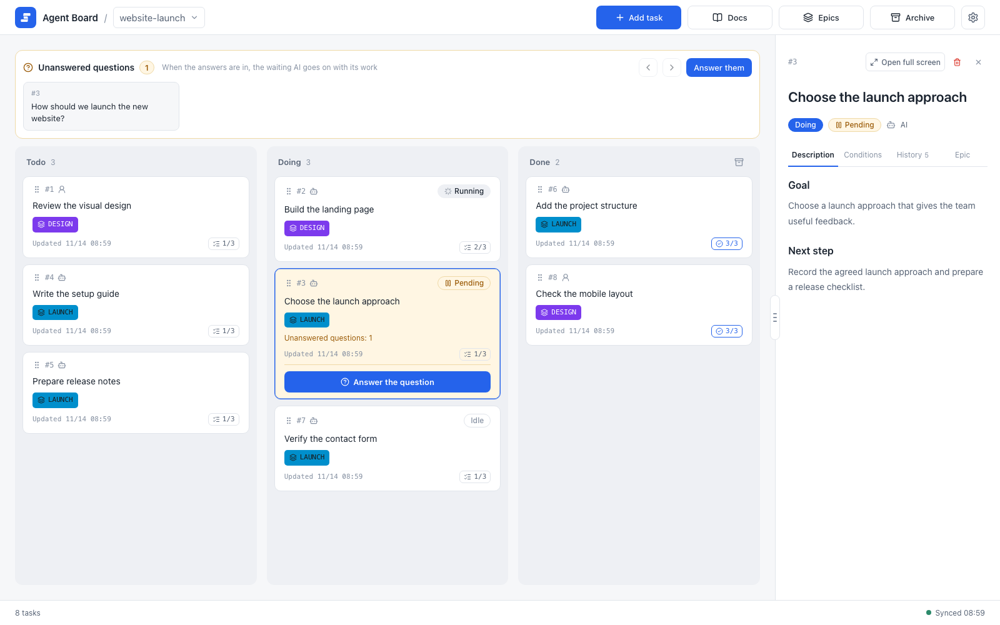
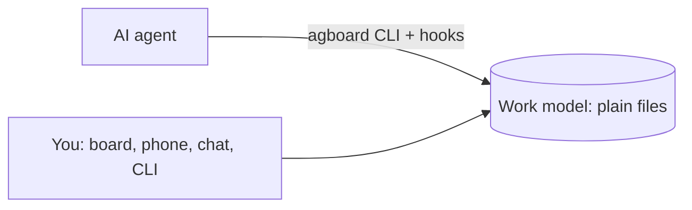
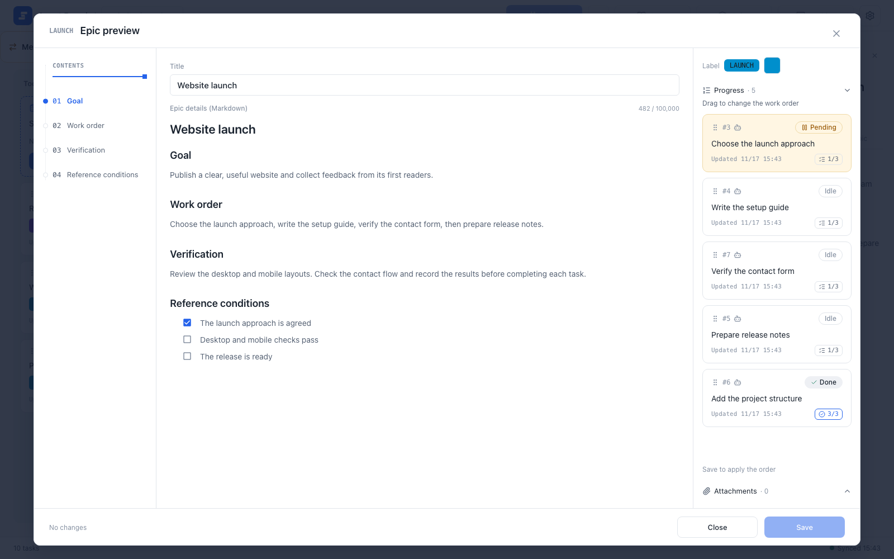
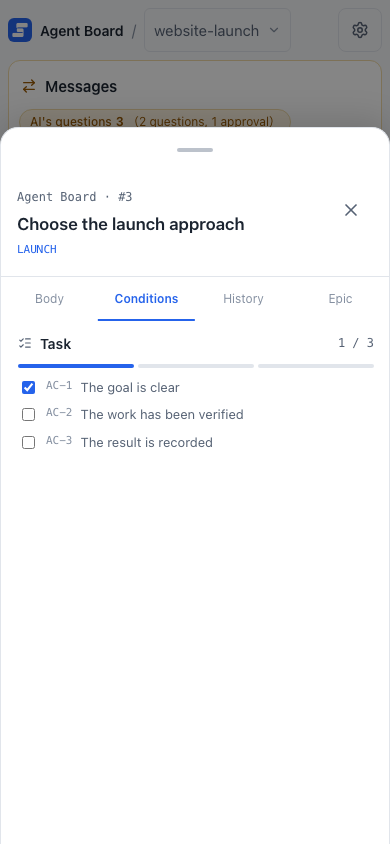

<div align="center">



# Agent Board

[](https://github.com/FooQoo/agent-board/actions/workflows/ci.yml) [](https://codecov.io/gh/FooQoo/agent-board)

**Delegate big work. Stop babysitting it.**

Agent Board is a work harness for your AI agent. It turns your request into a plan with acceptance conditions, starts after one approval, and stops for you only when it must. Watch and answer from your PC, your phone, or the chat.

```sh
brew install fooqoo/tap/agboard
```

[日本語](README.ja.md) · [Try the demo](https://fooqoo.github.io/agent-board/demo/) · [Usage guide](https://fooqoo.github.io/agent-board/guide/) · [Contributing](CONTRIBUTING.md) · [GitHub repository](https://github.com/FooQoo/agent-board)




</div>

## What is Agent Board?

You can hand big work to an AI agent, but it rarely finishes unless someone keeps watching: turning the request into a plan, noticing when it is stuck, catching a question buried in the log, explaining the work again in the next session, and checking at the end that it is really done.

Agent Board is a **work harness** that sits on top of your agent, such as Claude Code or Codex. It does not run the agent. It holds the work in one place that both of you read and write: a plan (epics and tasks in order), acceptance conditions that say when each task is done, questions the agent must stop for, and a history of what happened and why. It all lives in plain files on your machine, with no account or hosted service.



To see it for yourself, [try the demo](https://fooqoo.github.io/agent-board/demo/) in your browser, with nothing to install. It walks you through the first-run guide on sample data, and reloading the page starts it over.

## How delegation works

1. **Request.** Tell your agent what you want, in plain words.
2. **Provisional plan.** The agent puts an epic and its tasks on the board, each with acceptance conditions, and asks the questions it cannot settle itself.
3. **One start approval.** You answer, the agent revises the plan, and you approve the start once. Nothing starts before that.
4. **Work in order.** The agent works through the tasks and stops for you only when your intent is unclear, your preference decides it, an action cannot be undone, or the work grows beyond what you asked.
5. **Done on its own.** When the agent has verified every acceptance condition of a task and nothing is waiting on you, the task moves to Done by itself.

You take part in two ways. When the agent stops to ask, you answer wherever is easiest, and the answer is recorded once (human in the loop). While it works, you can watch, move a card back, check a condition, or rewrite a plan without stopping it, and the agent follows the change (human on the loop). See [The work model](https://fooqoo.github.io/agent-board/guide/work-model) and the [Quickstart](https://fooqoo.github.io/agent-board/guide/quickstart).

## Windows on the work

The board is one window onto the work, not the whole of it.

- **The board.** Watch the work move through Todo, Doing, and Done. Step in on a card without stopping the agent, and answer questions right on the task. [Using the board](https://fooqoo.github.io/agent-board/guide/watch/board)
- **Epics and progress.** An epic holds the plan and the order of its tasks, and the progress table returns the work that can move next to your agent. [Epics and progress](https://fooqoo.github.io/agent-board/guide/watch/epics)
- **Check from your phone.** Away from your desk, watch the work and answer the agent from the mobile monitor. In public preview. [Mobile monitor](https://fooqoo.github.io/agent-board/guide/watch/mobile-monitor)
- **Project docs.** Open the design notes and specs in your project's `docs/` folder right from the board. In public preview. [Project docs](https://fooqoo.github.io/agent-board/guide/watch/docs)

You can also answer in the chat with your agent, and the `agboard` command is what the agent and your scripts use. Plans and results are Markdown files on your machine (`EPIC.md` and `TASK.md`), with acceptance conditions and history in the frontmatter.

See the [usage guide](https://fooqoo.github.io/agent-board/guide/) for editing, attachments, archiving, and settings.

<details>
<summary>Epic progress and mobile drawer screenshots</summary>





</details>

## Install

Agent Board runs on macOS 15 or later, on Apple Silicon and Intel. Install it with [Homebrew](https://brew.sh). You do not need Rust or Node.js, and you do not build anything.

```sh
brew install fooqoo/tap/agboard
agboard --version
```

Homebrew has its own requirements, such as the Command Line Tools on some Macs; see its documentation. To build from source, see the [developer guide](https://fooqoo.github.io/agent-board/dev/getting-started/setup).

## Set up

Set up your agents once, then create a project for your working folder:

```sh
agboard setup
cd my-project
agboard project create "My project"
```

`setup` creates the data folder and asks which agents you use (Codex, Claude Code, or both). It shows the plan, and after you answer `y` it installs the Agent Board plugin (the Skill and the Hook) with each agent's own plugin command, lets the agents use the shared folder, and, for Codex, trusts the plugin's hooks. It works in any folder and needs no project. `project create` binds the current folder to a project; for an existing project, run `agboard project bind "My project"`. See [Working with agents](https://fooqoo.github.io/agent-board/guide/delegate/agents#set-up-your-agents).

## Start

```sh
agboard serve
```

Open [http://127.0.0.1:7420/](http://127.0.0.1:7420/), select your project, and add a task. Agents do not need you to keep it running: a command that waits for you, and the agent hook, start the server in the background, and it stops by itself after 30 minutes without use. A server started this way opens the project's board in your browser unless a board tab is already open, and `agboard open` opens it at any time. Most board commands use `--project NAME`; `agboard progress` and hooks resolve the project from the current folder unless explicitly overridden.

To check progress and answer questions from your phone, open **Settings** → **Mobile connection** and connect with your ngrok authtoken. The phone has to enter a 4-digit passcode that the board shows on your computer and that changes each time the connection starts; the full board stays on your computer. You can also start it with `NGROK_AUTHTOKEN` set and `agboard serve --monitor ngrok`, which prints the passcode. A 4-digit passcode is weaker than an account sign-in, so keep the address private; the [mobile monitor guide](https://fooqoo.github.io/agent-board/guide/watch/mobile-monitor) explains the limits.

## Update

Updating takes two steps. First update the command, then move the Agent Board plugin to the same version:

```sh
brew upgrade fooqoo/tap/agboard
agboard update
```

`agboard update` shows what will change and asks before it runs; `agboard update --yes` answers the question in advance. When the plugin and the command differ, a new agent session tells you to run `agboard update`. Restart `agboard serve` after an upgrade.

## Feature stages

Version 1.0.0 mixes generally available (GA) features and features in public preview. Docs, task listening, and the mobile monitor are in public preview and may change. GA is not a promise that nothing changes or that nothing is broken. See [Feature stages](https://fooqoo.github.io/agent-board/guide/feature-stages).

## License

Agent Board is licensed under the [MIT License](LICENSE).
Bundled third-party components retain their respective licenses;
see [Third-party notices](THIRD_PARTY_NOTICES.txt).

## Documentation

- [Usage guide](https://fooqoo.github.io/agent-board/guide/) — browser operations, CLI examples, agent workflow, shared files, and backups.
- [Mobile monitor](https://fooqoo.github.io/agent-board/guide/watch/mobile-monitor) — connect a phone with ngrok and a passcode, what the monitor shows, and how to check it.
- [Releases](https://github.com/FooQoo/agent-board/releases) — what each published version changes.
- [The Agent Board plugin](plugins/agent-board/README.md) — what `setup` installs for Claude Code and Codex, and how the hooks work.
- [Contributing](CONTRIBUTING.md) — development and verification.
