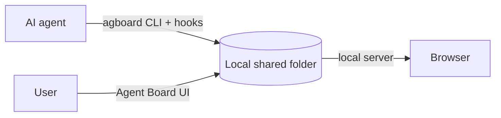

<div align="center">


# Agent Board

**A shared work board where users and AI agents keep work moving together.**

AI agents register work for themselves and users. Users update cards and answer decisions.

[日本語](README.ja.md) · [Usage guide](docs/usage.md) · [Contributing](CONTRIBUTING.md) · [GitHub repository](https://github.com/FooQoo/agent-board)


</div>

## What is Agent Board?

When an agent works for a long time, you need to see what is moving, what is waiting, and what response will unblock it. Agent Board gives users and agents one shared, history-backed board.

- **Agents register all work.** Cards have a fixed AI or User owner and a Todo, Doing, or Done lane. AI work can be Running in Doing or Pending in Todo or Doing.
- **Users and agents update the same board.** Every status change has a reason. Users can answer a pending decision in the browser; hooks pass the current progress table, and agents read card history when they need it.
- **Projects follow their folders.** `agboard progress` and hooks use the nearest registered project folder; `--project NAME` overrides it. Other project commands name their project explicitly.
- **Plans and results live in plain files.** Each card has a `TASK.md` and each epic has a `PLAN.md`. Their completion conditions sit in YAML frontmatter, and the body is free Markdown. When an eligible AI card has all acceptance conditions verified, the board moves it to Done automatically. Agents and people can edit the files directly; the board follows file changes without any extra step.
- **Local by default.** Cards are plain files in a local shared folder, and the server listens on `127.0.0.1`. Optional remote access uses your own HTTPS proxy; there is no hosted account or cloud service.



## Features

**Pick the next work from a progress table.** `agboard progress` groups active work by epic, follows the epic's task order, and returns the paths to the relevant plans and tasks. Done, archived, and Pending cards are omitted so agents can choose work they can advance.

**Answer directly on the card.** Todo and Doing cards show pending questions and answer controls. Pick an option, write a note, or do both. The card can still be opened or moved while an answer is being written. A question remains pending until answered or explicitly withdrawn. An agent may wait indefinitely with `"wait": {}`; stopping that wait does not expire the question.

**Order work in epics.** An epic holds a plan, a color, and a task order. Drag tasks in its progress panel and save to update the `priority` list in `PLAN.md`. The panel shows the same status and acceptance badges as board cards. Expand attachments to fold progress, or expand progress to fold attachments. Assign an epic from the card editor or CLI.

**Review text and completion conditions.** Card details have four equal-width tabs: Description, Conditions, History, and Epic. Create and edit dialogs keep acceptance conditions folded at the bottom, outside the body scroll. The rich Markdown editor supports headings, task lists, tables, code blocks, Mermaid diagrams, and images.

**Complete verified AI work automatically.** While the server is running, an AI-owned, non-draft Todo or Doing card with at least one valid condition moves to Done when every condition is checked. Pending cards wait for an answer, and User cards remain under user control. Existing eligible cards are also checked at server startup. Done cards are read-only for agents.

**Review and answer on your phone.** The mobile monitor uses the same three lanes and inline answer forms. Tap a card for a bottom drawer with Body, Conditions, History, and Epic tabs; swipe between tabs and drag the handle down to close it. Its only write operation is answering a question.

**Archive finished work.** Archive a card, or several Done cards at once, to keep the board focused. Restore cards from Archive when needed; permanent deletion is available there.

**Evidence and images.** Cards keep images and text evidence next to their files. Images in the text and Mermaid diagrams can be enlarged.

**Simple on purpose.** Three columns per project, one local data area of plain files, no accounts, no cloud.

**Your language and colors.** Open Settings in the header to switch the web view between English and Japanese and to pick one of 24 color themes (12 colors, each in light and dark).

<details>
<summary>Epic progress and mobile drawer screenshots</summary>


</details>

## Install

Build from source with Git, Rust (Cargo with edition 2024 support), Node.js, and pnpm:

```sh
git clone https://github.com/FooQoo/agent-board.git
cd agent-board
pnpm --dir web install
pnpm --dir web build
cargo install --path . --locked --force
```

Keep `~/.cargo/bin` (or `$CARGO_HOME/bin`) on your `PATH`. Build the web UI before installing: `agboard` embeds it. See the [usage guide](docs/usage.md#installation-and-updates) for updates and installation checks.

## Get started

```sh
agboard project create "My project"
agboard serve --port 7420
```

Open [http://127.0.0.1:7420/](http://127.0.0.1:7420/), select your project, and add a card. Most board commands use `--project NAME`; `agboard progress` and hooks resolve the project from the current folder unless explicitly overridden.

## Documentation

- [Usage guide](docs/usage.md) — browser operations, CLI examples, agent workflow, shared files, and backups.
- [Mobile monitor](docs/mobile-monitor.md) — LAN and Tailscale access, HTTPS, and phone certificate setup.
- [Claude Code and Codex integration](integrations/README.md) — hooks and agent setup.
- [Contributing](CONTRIBUTING.md) — development and verification.
