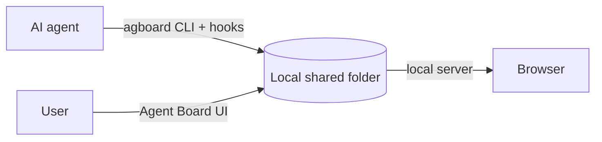

<div align="center">


# Agent Board

**A shared work board where users and AI agents keep work moving together.**

AI agents register work for themselves and users. Users update cards and answer decisions.

[日本語](README.ja.md) · [Contributing](CONTRIBUTING.md) · [GitHub repository](https://github.com/FooQoo/agent-board)


</div>

## What is Agent Board?

When an agent works for a long time, you need to see what is moving, what is waiting, and what response will unblock it. Agent Board gives users and agents one shared, history-backed board.

- **Agents register all work.** Cards have a fixed AI or User owner, a board lane, and (for AI work in Doing) an Idle, Running, or Pending state.
- **Users and agents update the same board.** Every status change has a reason. Users can answer a pending decision in the browser; the next hook or `agboard snapshot` gives the agent the complete history.
- **Every command names its project.** A board holds separate projects. Commands, hooks, and waits always say which project they act on with `--project NAME`; nothing is guessed from the web view or another agent.
- **Nothing leaves your machine.** Cards are plain files in a local shared folder, and the web view listens only on `127.0.0.1`.



## Features

**See what needs attention.** Cards show their owner and lane. AI-owned cards in Doing show Idle, Running, or Pending. A pending card shows its question and history.

**Keep decisions in context.** Users can move any card with a reason and answer a pending request. That response is recorded before the agent resumes.

**Simple on purpose.** Three columns per project, one local data area, no accounts, no cloud.

**Your language and colors.** Open Settings in the header to switch the web view between English and Japanese and to pick one of 24 color themes (12 colors, each in light and dark).

## Install

Agent Board is built from source. Install `agboard` onto your `PATH` so that agents and hooks can run it:

```sh
pnpm --dir web install
pnpm --dir web build
cargo install --path . --locked --force
```

Build the web UI first: the CLI embeds it. `cargo install` puts `agboard` in `~/.cargo/bin` (or `$CARGO_HOME/bin`), so that directory must be on your `PATH`. Check it:

```sh
command -v agboard
agboard --help
```

If `command -v agboard` prints nothing, add the directory, for example `export PATH="$HOME/.cargo/bin:$PATH"` in your shell profile, and open a new shell. To update after pulling changes, run the three install commands again. The `--force` flag replaces the installed version.

Hooks and the agent skill run `agboard` from `PATH`, so they use this installed version. A development build (`cargo build`, `cargo run`, `target/debug/agboard`) is a separate binary and does not change it; reinstall to make your changes visible to hooks.

## Get started

```sh
agboard project create "My project"
agboard serve --port 7420
```

`--project NAME` is required by every command except `project create`, `project ls`, `serve`, and the read-only `ls --all-projects`. Add cards in the browser or with `agboard --project "My project" add "Write the setup guide" --assignee ai --actor ai`. See [integrations](integrations/README.md) for Claude Code and Codex hooks. Build instructions are in [CONTRIBUTING.md](CONTRIBUTING.md).

Each project is a folder of plain files. `agboard --project "My project" workspace --json` prints its absolute path, its ID, and the entry point `README.md`. Read that README before you edit any file in the folder.

## Data and backups

The data folder is `skan/` in your OS application data folder: `~/Library/Application Support/skan/` on macOS and `%APPDATA%\skan\` on Windows. Set `SKAN_HOME` to use another folder. Agent Board keeps the projects in `shared/projects/<project-id>/` inside it. Each project folder holds `project.json`, `README.md`, a `tasks/` folder with one folder per card, and an `epics/` folder.

Back up a project by copying its whole folder. Find it with `agboard --project "My project" workspace --json` (the `folder` field). Stop `agboard serve` and the agents that work on the project before you copy, so that the copy is not taken in the middle of a change. Restore by putting the copied folder back in the same place while `agboard serve` is stopped.

Cards can also keep image attachments. The add command validates PNG, JPEG, WebP, and GIF files, records only metadata in snapshots and hooks, and stores the image bytes locally. `get` refuses to overwrite an existing output file:

```sh
agboard --project "My project" attachment add 12 --file diagram.png --actor ai
agboard --project "My project" attachment ls 12 --json
agboard --project "My project" attachment get 12 <attachment-id> --output diagram-copy.png
```

<details>
<summary><strong>Commands</strong></summary>

```sh
agboard project ls --json
agboard ls --all-projects --json
agboard --project "My project" snapshot --json
agboard --project "My project" mv 1 doing --actor ai --reason "Start implementation"
agboard --project "My project" state 1 running --actor ai --reason "Implementing the approved change"
agboard --project "My project" state 1 pending --actor ai --reason "Need a decision about the behavior"
agboard --project "My project" state 1 idle --actor human --request <request-id> --reason "Keep the current behavior"
agboard --project "My project" state 1 running --actor ai --reason "Resuming with the user's direction"
agboard --project "My project" mv 1 done --actor ai --reason "Implementation and checks are complete"
agboard --project "My project" wait --after <cursor>
agboard --project "My project" workspace --json
```

`ls --all-projects` reads every project's cards and full history in one consistent, read-only fetch (by project name; `--column` and `--state` apply to every project) and does not take `--project`. Other commands: `add`, `edit`, `show`, `rm`, `project rename`, `project rm`, and `hook`. Run `agboard --help` or `agboard <command> --help` for details. Add `--json` for machine-readable output. `<cursor>` is the `cursor` field of a snapshot of the same project (`<project-id>:<revision>`).

</details>

<details>
<summary><strong>Workflow for agents</strong></summary>

Use the project you were told to use; ask when none was given. Check that every snapshot and hook payload names the same `project` and `cursor` you expect before acting on it. Read the complete board before choosing work. Claim AI-owned cards with a reason, and review user-owned cards to understand the whole plan. Ask for a decision by moving an AI card to Pending with a clear reason. When no work can proceed, wait for a board change instead of polling. After a user answers, read the full snapshot and history, reconsider the plan, and resume with a reason. If the project is renamed, keep working on the same project with its new name and update the name in your hook commands. Get the project folder with `workspace --json`. Edit a card's `TASK.md` and an epic's `PLAN.md` only as the folder's README allows; never edit the `TASK.md` of a draft card, never edit `task.json`, `epic.json`, or `project.json` directly, and never delete a card or epic folder. Use the CLI for those changes. Descriptions are Markdown of up to 50,000 characters and always arrive in full; pass long ones with `--desc-file`. A card whose `isDraft` is `true` is a draft the user is still writing and is read-only for you: `edit`, `mv`, and `state` fail with `card_is_draft`, so work on other cards until the user finalizes it. The hook passes the snapshot only when it fits in 256 KiB. If the snapshot cannot be read (`AGBOARD_ERROR`, a missing project, or a timeout), stop making board-dependent changes and report it.

```text
agboard --project "<name>" snapshot --json   # read all cards and full history
agboard --project "<name>" mv <id> doing --actor ai --reason "<why>"
agboard --project "<name>" state <id> running --actor ai --reason "<why>"
agboard --project "<name>" state <id> pending --actor ai --reason "<what decision is needed>"
agboard --project "<name>" state <id> idle --actor human --request <id> --reason "<answer and direction>"
agboard --project "<name>" state <id> running --actor ai --reason "<how the answer changes the approach>"
agboard --project "<name>" mv <id> done --actor ai --reason "<what was completed>"
agboard --project "<name>" wait --after "<cursor>"   # when nothing can proceed
```

</details>

<details>
<summary><strong>Language and theme</strong></summary>

The web UI opens in English with the light blue theme. Open Settings in the header to choose English or Japanese and a color theme; changes apply immediately and are saved in your browser. Neither choice follows the browser or OS language or color scheme. The CLI, its help and errors, and API and JSON values remain in English. Card content is not translated.

</details>
