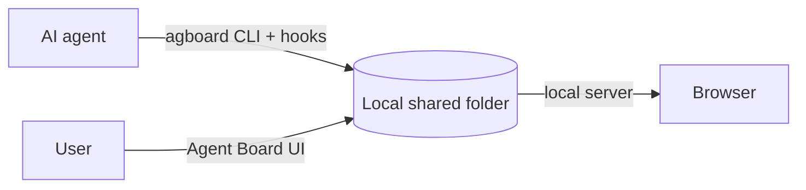

<div align="center">


# Agent Board

**A shared work board where users and AI agents keep work moving together.**

AI agents register work for themselves and users. Users update cards and answer decisions.

[日本語](README.ja.md) · [Usage guide](docs/usage.md) · [Contributing](CONTRIBUTING.md) · [GitHub repository](https://github.com/FooQoo/agent-board)


</div>

## What is Agent Board?

When an agent works for a long time, you need to see what is moving, what is waiting, and what response will unblock it. Agent Board gives users and agents one shared, history-backed board.

- **Agents register all work.** Cards have a fixed AI or User owner, a board lane, and (for AI work in Doing) an Idle, Running, or Pending state.
- **Users and agents update the same board.** Every status change has a reason. Users can answer a pending decision in the browser; the next hook or `agboard snapshot` gives the agent the complete history.
- **Every command names its project.** A board holds separate projects. Commands, hooks, and waits always say which project they act on with `--project NAME`; nothing is guessed from the web view or another agent.
- **Plans and results live in plain files.** Each card has a `TASK.md` (work, completion conditions with their results, execution log) and each epic has a `PLAN.md`. Agents and people can edit them directly; the board follows file changes without any extra step.
- **Nothing leaves your machine.** Cards are plain files in a local shared folder, and the web view listens only on `127.0.0.1`.



## Features

**See what needs attention.** Cards show their owner and lane. AI-owned cards in Doing show Idle, Running, or Pending. A pending card shows its question and history.

**Keep decisions in context.** Users can move any card with a reason and answer a pending request. An agent can offer up to 10 choices; the user picks one, writes a note, or both. That response is recorded before the agent resumes.

**Group work in epics.** An epic holds a plan and a color. A card belongs to at most one epic and shows its epic as a label. Edit an epic's plan, name, and color, and choose its tasks, in one dialog.

**Edit in a rich Markdown editor.** Card and epic text is edited in place, with headings, task lists, tables, code blocks, Mermaid diagrams, and images. Completion conditions are checkboxes you can tick.

**Archive finished work.** Archive a card, or several Done cards at once, to keep the board focused. Restore cards from Archive when needed; permanent deletion is available there.

**Evidence and images.** Cards keep images and text evidence next to their files. Images in the text and Mermaid diagrams can be enlarged.

**Simple on purpose.** Three columns per project, one local data area of plain files, no accounts, no cloud.

**Your language and colors.** Open Settings in the header to switch the web view between English and Japanese and to pick one of 24 color themes (12 colors, each in light and dark).

## Install

Build from source with Git, Rust (Cargo with edition 2024 support), Node.js, and pnpm:

```sh
git clone https://github.com/FooQoo/agent-board.git
cd agent-board
pnpm --dir web install
pnpm --dir web build
cargo install --path . --locked --force
```

Keep `~/.cargo/bin` (or `$CARGO_HOME/bin`) on your `PATH`. Build the web UI before installing: `agboard` embeds it. See the [usage guide](docs/usage.md#installation-and-updates) for updates and installation checks.

## Get started

```sh
agboard project create "My project"
agboard serve --port 7420
```

Open [http://127.0.0.1:7420/](http://127.0.0.1:7420/), select your project, and add a card. Board commands use `--project NAME` to select their project.

## Documentation

- [Usage guide](docs/usage.md) — browser operations, CLI examples, agent workflow, shared files, and backups.
- [Claude Code and Codex integration](integrations/README.md) — hooks and agent setup.
- [Contributing](CONTRIBUTING.md) — development and verification.
