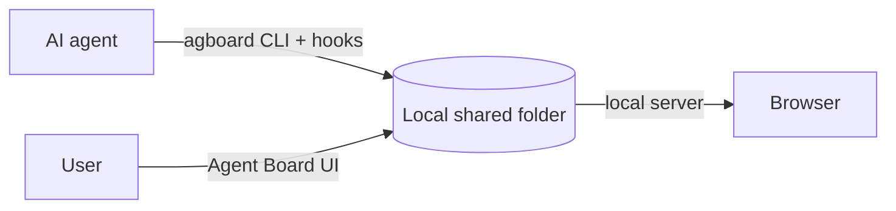

<div align="center">


# Agent Board

**A shared work board where users and AI agents keep work moving together.**

AI agents register work for themselves and users. Users update cards and answer decisions.

[日本語](README.ja.md) · [Usage guide](docs/usage.md) · [Contributing](CONTRIBUTING.md) · [GitHub repository](https://github.com/FooQoo/agent-board)


</div>

## What is Agent Board?

When an agent works for a long time, you need to see what is moving, what is waiting, and what response will unblock it. Agent Board gives users and agents one shared, history-backed board.

- **Agents register all work.** Cards have a fixed AI or User owner, a board lane, and (for AI work in Doing) an Idle, Running, or Pending state.
- **Users and agents update the same board.** Every status change has a reason. Users can answer a pending decision in the browser; the next hook or `agboard snapshot` gives the agent the complete history.
- **Every command names its project.** A board holds separate projects. Commands, hooks, and waits always say which project they act on with `--project NAME`; nothing is guessed from the web view or another agent.
- **Plans and results live in plain files.** Each card has a `TASK.md` (work, completion conditions with their results, execution log) and each epic has a `PLAN.md`. Agents and people can edit them directly; the board follows file changes without any extra step.
- **Nothing leaves your machine.** Cards are plain files in a local shared folder, and the web view listens only on `127.0.0.1`.



## Features

**See what needs attention.** Cards show their owner and lane. AI-owned cards in Doing show Idle, Running, or Pending. A pending card shows its question and history.

**Keep decisions in context.** Users can move any card with a reason and answer a pending request. An agent can offer up to 10 choices; the user picks one, writes a note, or both. That response is recorded before the agent resumes.

**Group work in epics.** An epic holds a plan and a color. A card belongs to at most one epic and shows its epic as a label. Edit an epic's plan, name, and color, and choose its tasks, in one dialog.

**Edit in a rich Markdown editor.** Card and epic text is edited in place, with headings, task lists, tables, code blocks, Mermaid diagrams, and images. Completion conditions are checkboxes you can tick.

**Archive finished work.** Archive a card, or several Done cards at once, to keep the board focused. Restore cards from Archive when needed; permanent deletion is available there.

**Evidence and images.** Cards keep images and text evidence next to their files. Images in the text and Mermaid diagrams can be enlarged.

**Simple on purpose.** Three columns per project, one local data area of plain files, no accounts, no cloud.

**Your language and colors.** Open Settings in the header to switch the web view between English and Japanese and to pick one of 24 color themes (12 colors, each in light and dark).

## Install

Build from source with Git, Rust (Cargo with edition 2024 support), Node.js, and pnpm:

```sh
git clone https://github.com/FooQoo/agent-board.git
cd agent-board
pnpm --dir web install
pnpm --dir web build
cargo install --path . --locked --force
```

Keep `~/.cargo/bin` (or `$CARGO_HOME/bin`) on your `PATH`. Build the web UI before installing: `agboard` embeds it. See the [usage guide](docs/usage.md#installation-and-updates) for updates and installation checks.

## Get started

```sh
agboard project create "My project"
agboard serve --port 7420
```

Open [http://127.0.0.1:7420/](http://127.0.0.1:7420/), select your project, and add a card. Board commands use `--project NAME` to select their project.

## Documentation

- [Usage guide](docs/usage.md) — browser operations, CLI examples, agent workflow, shared files, and backups.
- [Claude Code and Codex integration](integrations/README.md) — hooks and agent setup.
- [Contributing](CONTRIBUTING.md) — development and verification.

## Mobile monitor over your LAN or tailnet

`agboard serve` keeps the ordinary PC listener on loopback. Add a separate remote listener only when you put it behind a trusted HTTPS proxy:

```sh
agboard serve --port 7420 --remote-port 8040 \
  --remote-origin https://192.168.1.20:8443 \
  --remote-origin https://my-mac.example-tailnet.ts.net
```

Use only the origins you will actually publish. The remote port is a second loopback listener for the proxy; never proxy the local PC port. Opening the common URL selects the monitor below 768 CSS pixels and the PC board at wider sizes. Direct `/monitor/` and `/board/` URLs remain available regardless of width. The PC board retains its remote write guard, while the monitor API is read-only.

### LAN with Caddy

Install Caddy 2.8 or newer from the [official Caddy downloads and installation guide](https://caddyserver.com/docs/install). The standard build is enough. The Caddyfile at [`examples/monitor/Caddyfile`](examples/monitor/Caddyfile) binds to the chosen LAN IP, uses Caddy's internal HTTPS authority, and requires [Basic authentication](https://caddyserver.com/docs/caddyfile/directives/basic_auth) on every route. It forwards only to the dedicated remote port, preserves the browser's Host and Origin for Agent Board's guard, strips Authorization and `X-Forwarded-Host`, and [flushes SSE promptly](https://caddyserver.com/docs/caddyfile/directives/reverse_proxy#streaming). The example disables Caddy's admin API and automatic root-certificate installation; the local test reads the temporary public root directly.

Set the values for your machine and create a password hash. Keep the plaintext password out of shell history and the Caddyfile:

```sh
export LAN_IP=192.168.1.20
export HTTPS_PORT=8443
export REMOTE_PORT=8040
export BASIC_AUTH_USER=board-reader
export BASIC_AUTH_HASH="$(caddy hash-password)"
```

In one terminal, start Agent Board with the exact public HTTPS origin:

```sh
agboard serve --port 7420 --remote-port "$REMOTE_PORT" \
  --remote-origin "https://${LAN_IP}:${HTTPS_PORT}"
```

In another terminal, validate and run the proxy in the foreground:

```sh
caddy validate --config examples/monitor/Caddyfile --adapter caddyfile
caddy run --config examples/monitor/Caddyfile --adapter caddyfile
```

Open `https://<LAN_IP>:<HTTPS_PORT>/` on a device on the same trusted LAN and enter the Basic-auth credentials. Caddy's `tls internal` certificate is signed by its local CA, which phones do not trust by default. The public root certificate is `<Caddy data directory>/pki/authorities/local/root.crt` (for example, `$XDG_DATA_HOME/caddy/pki/authorities/local/root.crt` when `XDG_DATA_HOME` is set; see [Caddy's data-directory conventions](https://caddyserver.com/docs/conventions#data-directory)). Copy only that public certificate to the phone through a trusted channel and follow the phone OS's steps to trust it. Never copy or distribute Caddy's CA private key. Caddy's data directory is persistent; keep it private and back it up. Do not enable router port forwarding or expose this listener to the public Internet.

Stop both foreground processes with Ctrl+C. When the computer sleeps or either process stops, the remote service is unavailable until Agent Board and Caddy are running again.

### Tailscale Serve

Install the [Tailscale standalone app for your OS](https://tailscale.com/download) and use Tailscale CLI 1.52 or newer; the [current Serve CLI syntax](https://tailscale.com/docs/reference/tailscale-cli/serve) changed in 1.52. Add the computer and phone to your existing tailnet. In the tailnet admin controls, restrict access to your own account and the specific devices that should reach this board. Serve requires HTTPS certificates to be enabled for the tailnet; invoking Serve may ask you to approve that change. Review the consent page before accepting. [Tailnet access rules apply to Serve](https://tailscale.com/docs/features/tailscale-serve).

Start Agent Board on a dedicated remote port, then start Serve for that loopback port:

```sh
agboard serve --port 7420 --remote-port 8040 \
  --remote-origin https://<origin-shown-by-tailscale>
tailscale serve --bg http://127.0.0.1:8040
tailscale serve status
tailscale funnel status
```

Use the exact HTTPS origin shown by `tailscale serve status` as `--remote-origin` before starting Agent Board. Confirm Serve is active only within your tailnet and Funnel is not exposing the service publicly. Do not add a custom proxy that rewrites Host or Origin. Tailscale access rules apply to Serve, and Agent Board still checks the remote PC write token and same-origin request headers.

Stop Agent Board with Ctrl+C. To remove only this Serve route, use `tailscale serve --bg http://127.0.0.1:8040 off`; inspect `tailscale serve status` before changing an existing shared Serve configuration. The background Serve setting can resume after a reboot, but the board itself remains unavailable while the computer sleeps or its server is stopped.

The local proxy test uses a real Caddy process, the real Agent Board server, and a temporary CA. Run `python3 scripts/test-monitor-proxy.py` after installing Caddy 2.8+ and the Rust, Node.js, and pnpm build tools. It uses temporary data/config/certificate directories, fake Basic-auth credentials, HTTPS ports 8030–8039, and Agent Board remote ports 8040–8049. `python3 scripts/test-monitor-proxy.py --static-only` checks the Caddyfile without starting services. This local test does not verify a real LAN, phone certificate trust, or a Tailscale tailnet.
