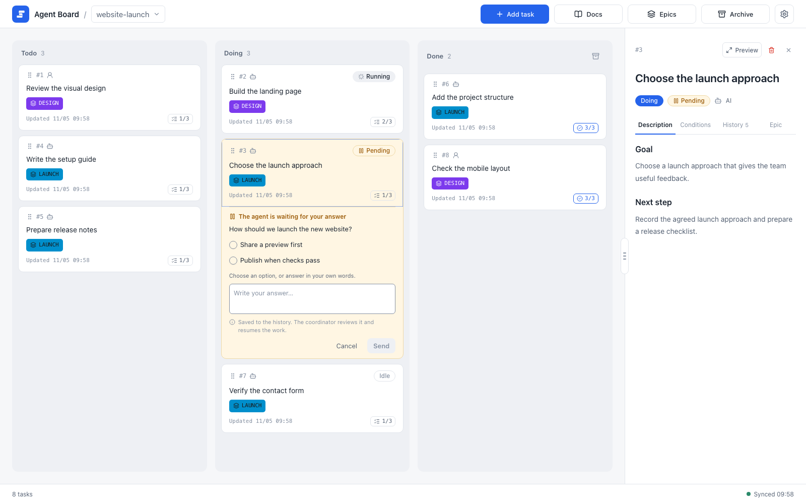
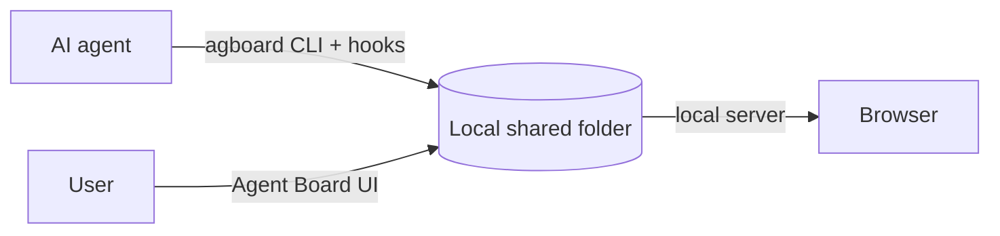
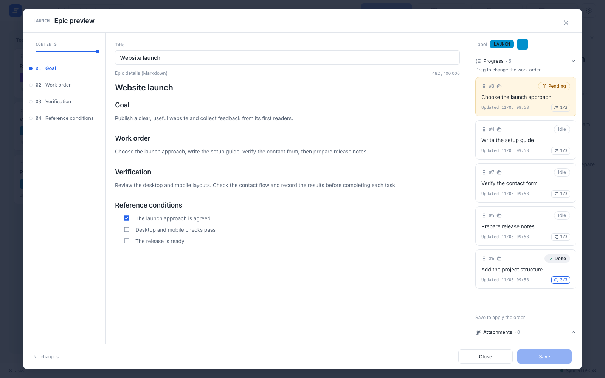
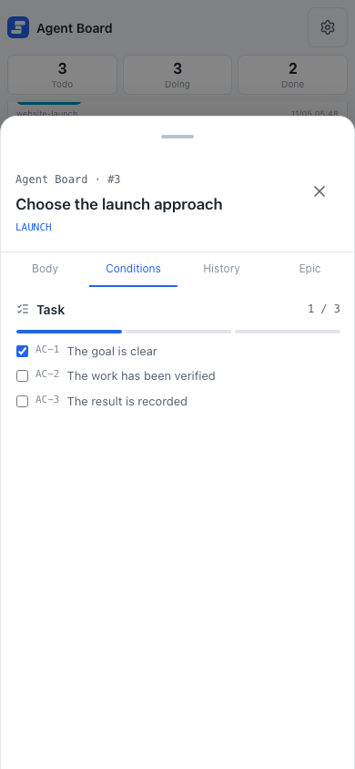

<div align="center">


# Agent Board

[](https://github.com/FooQoo/agent-board/actions/workflows/ci.yml) [](https://codecov.io/gh/FooQoo/agent-board)

**People and AI agents, working on one board.**

See what your agent is doing and what it is waiting on. Tasks, questions, and acceptance conditions share one board, and you can answer from your PC or your phone.

```sh
brew install fooqoo/tap/agboard
```

[日本語](README.ja.md) · [Try the demo](https://fooqoo.github.io/agent-board/demo/) · [Usage guide](https://fooqoo.github.io/agent-board/guide/) · [Contributing](CONTRIBUTING.md) · [GitHub repository](https://github.com/FooQoo/agent-board)




</div>

## What is Agent Board?

Hand off long work to an agent, and its progress and questions get buried in the terminal. Agent Board puts them on one shared, history-backed board. The agent asks, you answer on the task from your PC or phone, and the agent resumes. When every acceptance condition is met, the task moves to Done on its own.



## Features

- **The board.** Todo, Doing, and Done, with Running and Pending states on top. Answer questions right on the task. [Using the board](https://fooqoo.github.io/agent-board/guide/use/board)
- **Epics and progress.** Order tasks in an epic, and the progress table returns the work that can move next to your agent. [Epics and progress](https://fooqoo.github.io/agent-board/guide/use/epics)
- **Check from your phone.** Away from your desk, check the status and answer questions from the mobile monitor. In public preview. [Mobile monitor](https://fooqoo.github.io/agent-board/guide/operations/mobile-monitor)
- **Project docs.** Open the design notes and specs in your project's `docs/` folder right from the board. In public preview. [Project docs](https://fooqoo.github.io/agent-board/guide/use/docs)

Plans and results are Markdown files on your machine (`EPIC.md` and `TASK.md`), with acceptance conditions and history in the frontmatter. No account or hosted service is needed.

See the [usage guide](https://fooqoo.github.io/agent-board/guide/) for editing, attachments, archiving, and settings.

<details>
<summary>Epic progress and mobile drawer screenshots</summary>





</details>

## Install

Agent Board runs on macOS 15 or later, on Apple Silicon and Intel. Install it with [Homebrew](https://brew.sh). You do not need Rust or Node.js, and you do not build anything.

```sh
brew install fooqoo/tap/agboard
agboard --version
```

Homebrew has its own requirements, such as the Command Line Tools on some Macs; see its documentation. To build from source, see the [developer guide](https://fooqoo.github.io/agent-board/dev/getting-started/setup).

## Connect

Create a project for your working folder, then connect your agents:

```sh
cd my-project
agboard project create "My project"
agboard connect
```

`project create` binds the current folder to the project; for an existing project, run `agboard project bind "My project"`. `connect` asks which agents to set up (Claude Code, Codex, or both) and where: one scope for the Skill and one for the Hook, Global or Project. It shows every change before it writes, keeps backups, and never overwrites your own edits. Afterwards, review the Hook with `/hooks` in your agent. See [Working with agents](https://fooqoo.github.io/agent-board/guide/automation/agents#connect-your-agent).

## Start

```sh
agboard serve
```

Open [http://127.0.0.1:7420/](http://127.0.0.1:7420/), select your project, and add a task. Most board commands use `--project NAME`; `agboard progress` and hooks resolve the project from the current folder unless explicitly overridden.

To check progress and answer questions from your phone, open **Settings** → **Mobile connection** and connect with your ngrok authtoken. The phone has to enter a 4-digit passcode that the board shows on your computer and that changes each time the connection starts; the full board stays on your computer. You can also start it with `NGROK_AUTHTOKEN` set and `agboard serve --monitor ngrok`, which prints the passcode. A 4-digit passcode is weaker than an account sign-in, so keep the address private; the [mobile monitor guide](https://fooqoo.github.io/agent-board/guide/operations/mobile-monitor) explains the limits.

## Update

Updating takes two steps. First update the command, then update the Skill and Hook that `connect` installed:

```sh
brew upgrade fooqoo/tap/agboard
agboard update
```

`agboard update` shows what will change and asks before it writes; `agboard update --yes` skips only the question and never overwrites your own edits. Restart `agboard serve` after an upgrade.

## Feature stages

Version 1.0.0 mixes generally available (GA) features and features in public preview. Docs, task listening, and the mobile monitor are in public preview and may change. GA is not a promise that nothing changes or that nothing is broken. See [Feature stages](https://fooqoo.github.io/agent-board/guide/feature-stages).

## License

Agent Board is licensed under the [MIT License](LICENSE).
Bundled third-party components retain their respective licenses;
see [Third-party notices](THIRD_PARTY_NOTICES.txt).

## Documentation

- [Usage guide](https://fooqoo.github.io/agent-board/guide/) — browser operations, CLI examples, agent workflow, shared files, and backups.
- [Mobile monitor](https://fooqoo.github.io/agent-board/guide/operations/mobile-monitor) — connect a phone with ngrok and a passcode, what the monitor shows, and how to check it.
- [Releases](https://github.com/FooQoo/agent-board/releases) — what each published version changes.
- [Claude Code and Codex integration](integrations/README.md) — what `connect` installs and how the hooks work.
- [Contributing](CONTRIBUTING.md) — development and verification.
