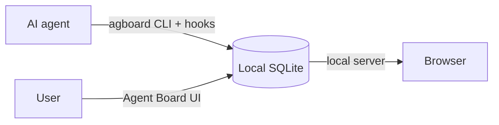

<div align="center">


# Agent Board

**A shared work board where users and AI agents keep work moving together.**

AI agents register work for themselves and users. Users update cards and answer decisions.

[日本語](README.ja.md) · [Contributing](CONTRIBUTING.md) · [GitHub repository](https://github.com/FooQoo/agent-board)


</div>

## What is Agent Board?

When an agent works for a long time, you need to see what is moving, what is waiting, and what response will unblock it. Agent Board gives users and agents one shared, history-backed board.

- **Agents register all work.** Cards have a fixed AI or User owner, a board lane, and (for AI work in Doing) an Idle, Running, or Pending state.
- **Users and agents update the same board.** Every status change has a reason. Users can answer a pending decision in the browser; the next hook or `agboard snapshot` gives the agent the complete history.
- **Nothing leaves your machine.** Cards live in a local SQLite database, and the web view listens only on `127.0.0.1`.



## Features

**See what needs attention.** Cards show their owner and lane. AI-owned cards in Doing show Idle, Running, or Pending. A pending card shows its question and history.

**Keep decisions in context.** Users can move any card with a reason and answer a pending request. That response is recorded before the agent resumes.

**Simple on purpose.** Three columns, one local board, no accounts, no cloud.

**Your language and colors.** Open Settings in the header to switch the web view between English and Japanese and to pick one of 24 color themes (12 colors, each in light and dark).

## Get started

```sh
agboard init --name agent-board
agboard serve --port 7420
```

Add cards in the browser or with `agboard add "Write the setup guide" --assignee ai --actor ai`. See [integrations](integrations/README.md) for Claude Code and Codex hooks. Build instructions are in [CONTRIBUTING.md](CONTRIBUTING.md).

<details>
<summary><strong>Commands</strong></summary>

```sh
agboard snapshot --json
agboard mv 1 doing --actor ai --reason "Start implementation"
agboard state 1 running --actor ai --reason "Implementing the approved change"
agboard state 1 pending --actor ai --reason "Need a decision about the behavior"
agboard state 1 idle --actor human --request <request-id> --reason "Keep the current behavior"
agboard state 1 running --actor ai --reason "Resuming with the user's direction"
agboard mv 1 done --actor ai --reason "Implementation and checks are complete"
agboard wait --after <revision>
```

Other commands: `add`, `edit`, `show`, `rm`, `export`, `import`, and `hook`. Run `agboard --help` or `agboard <command> --help` for details. Add `--json` for machine-readable output.

</details>

<details>
<summary><strong>Workflow for agents</strong></summary>

Read the complete board before choosing work. Claim AI-owned cards with a reason, and review user-owned cards to understand the whole plan. Ask for a decision by moving an AI card to Pending with a clear reason. When no work can proceed, wait for a board change instead of polling. After a user answers, read the full snapshot and history, reconsider the plan, and resume with a reason.

```text
agboard snapshot --json                    # read all cards and full history
agboard mv <id> doing --actor ai --reason "<why>"
agboard state <id> running --actor ai --reason "<why>"
agboard state <id> pending --actor ai --reason "<what decision is needed>"
agboard state <id> idle --actor human --request <id> --reason "<answer and direction>"
agboard state <id> running --actor ai --reason "<how the answer changes the approach>"
agboard mv <id> done --actor ai --reason "<what was completed>"
```

</details>

<details>
<summary><strong>Language and theme</strong></summary>

The web UI opens in English with the light blue theme. Open Settings in the header to choose English or Japanese and a color theme; changes apply immediately and are saved in your browser. Neither choice follows the browser or OS language or color scheme. The CLI, its help and errors, and API and JSON values remain in English. Card content is not translated.

</details>
