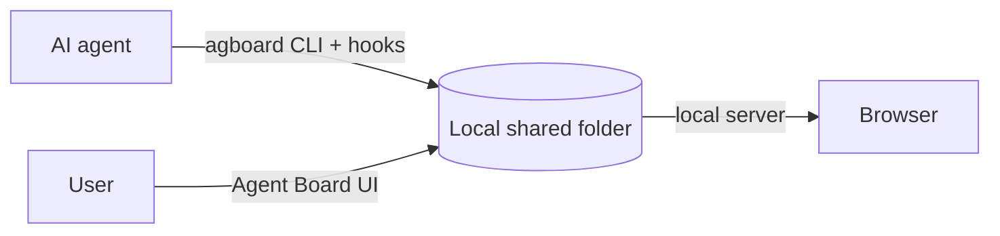

<div align="center">


# Agent Board

**A shared work board where users and AI agents keep work moving together.**

AI agents register work for themselves and users. Users update cards and answer decisions.

[日本語](README.ja.md) · [Usage guide](https://fooqoo.github.io/agent-board/guide/) · [Contributing](CONTRIBUTING.md) · [GitHub repository](https://github.com/FooQoo/agent-board)


</div>

## What is Agent Board?

When an agent works for a long time, you need to see what is moving, what is waiting, and what response will unblock it. Agent Board gives users and agents one shared, history-backed board.



## Features

**1. One board for people and AI agents.** Track work in Todo, Doing, and Done, with Running and Pending states showing what the agent is doing. Answer questions directly on a card from your PC or phone, and keep decisions and status changes in its history.

**2. A progress table that keeps agents moving.** Order tasks within an epic and let `agboard progress` return the work that can advance, together with the paths to its plans and tasks. Folder-based project selection and hooks give agents the right context. When every acceptance condition is verified, eligible AI cards move to Done automatically; completed work stays read-only for agents.

**3. Local Markdown for plans, results, and evidence.** Keep epic plans in `PLAN.md`, tasks in `TASK.md`, and images and evidence alongside them. A task's body, acceptance conditions, and operation history live in `TASK.md`; card metadata such as its current status lives in `task.json`. Status changes from the UI or CLI are recorded in `TASK.md` and shown in the history. Everything stays in your local data area, with no account or hosted service required.

See the [usage guide](https://fooqoo.github.io/agent-board/guide/) for editing, attachments, archiving, and settings.

<details>
<summary>Epic progress and mobile drawer screenshots</summary>


</details>

## Install

Build from source with Git, Rust (Cargo with edition 2024 support), Node.js, and pnpm:

```sh
git clone https://github.com/FooQoo/agent-board.git
cd agent-board
pnpm --dir web install
pnpm --dir web build
cargo install --path . --locked --force
```

Keep `~/.cargo/bin` (or `$CARGO_HOME/bin`) on your `PATH`. Build the web UI before installing: `agboard` embeds it. See the [usage guide](https://fooqoo.github.io/agent-board/guide/getting-started) for updates and installation checks.

## Get started

```sh
agboard project create "My project"
agboard serve --port 7420
```

Open [http://127.0.0.1:7420/](http://127.0.0.1:7420/), select your project, and add a card. Most board commands use `--project NAME`; `agboard progress` and hooks resolve the project from the current folder unless explicitly overridden.

## Documentation

- [Usage guide](https://fooqoo.github.io/agent-board/guide/) — browser operations, CLI examples, agent workflow, shared files, and backups.
- [Mobile monitor](https://fooqoo.github.io/agent-board/guide/mobile-monitor) — LAN and Tailscale access, HTTPS, and phone certificate setup.
- [Claude Code and Codex integration](integrations/README.md) — hooks and agent setup.
- [Contributing](CONTRIBUTING.md) — development and verification.
