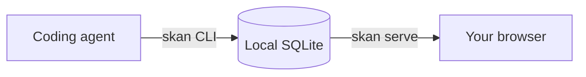

<div align="center">


# SimpleKanban

**A kanban board where your coding agents report their progress.**

Agents move the cards. You watch the board.

[日本語](README.ja.md) · [Contributing](CONTRIBUTING.md)


</div>

## What is SimpleKanban?

When a coding agent works for a long time, you can't tell what it is doing, or whether it is stuck waiting for you. SimpleKanban fixes that.

- **The agent reports with a command.** It adds cards, moves them across Todo, Doing, and Done, and says whether it is *running* or *pending*.
- **You watch in the browser.** The board updates by itself, so you always see which cards are in progress and why one is waiting.
- **Nothing leaves your machine.** Cards live in a local SQLite database, and the web view listens only on `127.0.0.1`.



## Features

**See what is happening at a glance.** Cards in Doing show a run state: Idle, Running, or Pending. A pending card shows the reason it is waiting.

**You stay in control.** Only a human can delete a card or replace the board. Agents have to hand that decision to you.

**Simple on purpose.** Three columns, one local board, no accounts, no cloud.

**English and Japanese.** Switch the web view with the globe button in the header.

## Get started

```sh
skan init --name my-board          # create the board
skan add "Write the setup guide"   # add a card to Todo
skan serve --port 7420             # open http://127.0.0.1:7420/
```

Then let your agent run `skan mv 1 doing` and `skan state 1 running` as it works. Building from source is described in [CONTRIBUTING.md](CONTRIBUTING.md).

<details>
<summary><strong>Commands</strong></summary>

```sh
skan mv 1 doing                    # move card #1 to Doing
skan state 1 running               # report that card #1 is running
skan state 1 pending --reason "Waiting for review"
skan ls                            # list cards by column
skan ls --column doing --state running
```

Other commands: `edit`, `show`, `rm`, `export`, and `import`. Run `skan --help` or `skan <command> --help` for details. Add `--json` to any command for machine-readable output.

Deleting a card (`rm`), re-running `init` on an existing board, and `import` over an existing board ask a human to confirm. Agents cannot do them.

</details>

<details>
<summary><strong>Rules for agents</strong></summary>

The same workflow and rules appear in `skan --help`.

```text
Workflow for agents:
  skan ls --json                             # read the board first; a human may have moved cards
  skan mv <id> doing                         # you start a card
  skan state <id> running                    # you are working on it
  skan state <id> pending --reason "<text>"  # you are waiting for a human or an external result
  skan state <id> running                    # the wait is over
  skan mv <id> done                          # you are finished (the card returns to idle)
Do not leave a card running when you stop: finish it, or run `skan state <id> idle`.

Rules for agents:
  - Move a card to doing before you report running or pending.
  - Report pending with --reason when you are waiting for something.
  - Moving a card to todo or done resets it to idle.
  - You cannot delete cards or replace the board. Ask a human to do it.
  - Add --json to any command for machine-readable output.
```

</details>

<details>
<summary><strong>Language</strong></summary>

The web UI opens in English. Use the globe button in the header to choose English or Japanese; the selection is saved in your browser. The interface does not choose a language from your browser or operating system settings. The CLI, its help and errors, and API and JSON values remain in English. Card content that you enter is not translated.

</details>
