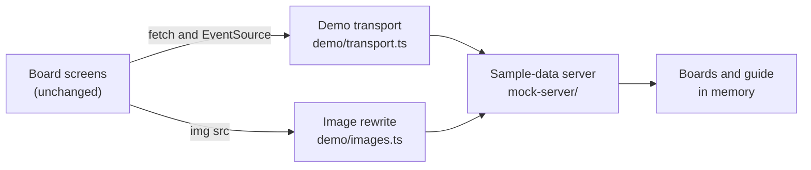

# The browser demo

The browser demo is the board running on a static site, with no `agboard serve` behind it. It is published with this documentation site at [`/agent-board/demo/`](https://fooqoo.github.io/agent-board/demo/). The screens are the product's own; only the server is replaced, by the sample-data server running in the page.

What a visitor sees is the [first-run guide](../../guide/quickstart.md#before-you-start-the-first-run-guide) followed by the ordinary board. This page explains how that is built, how to build it, and how to check it before it is published.

## How it works



`app/entry/board.tsx` checks `import.meta.env.MODE`. In the `demo` mode it first loads `web/src/app/development/demo/install.ts`, which puts the transport in place, and only then renders the board. Every other build skips that import, so the product build contains none of the demo code.

### The sample-data server

`web/src/app/development/mock-server/` answers `/api/*` the way `agboard serve` does, from boards held in memory. It uses no Node API, so two transports share it:

- `web/mock-api.ts` puts it behind the Vite dev server in the [sample-data mode](../getting-started/setup.md#development) (`pnpm --dir web dev --mode mock`).
- The demo puts it behind the page's `fetch` and `EventSource`.

The boards are made fresh from `web/test/fixtures/board.json` each time a server starts. The demo build reads that fixture at build time through the `virtual:agboard-demo-seed` module (`web/demo-build.ts`). Besides reads, the server handles the writes a visitor can make:

- creating, editing, and moving cards, and reordering them within a lane
- answering a decision request
- checking an acceptance condition, followed by the automatic Done that the server's watcher performs for an AI task whose conditions are all met (`completion.ts`)

Each change is reported to subscribers in the shape of the SSE `changed` event, so the screens update as they would against a real server.

### The fetch and EventSource shim

`demo/transport.ts` replaces `window.fetch` and `window.EventSource`:

- A request to the page's own origin under `/api/` or `/__mock/` becomes a `MockRequest` and is answered by the sample-data server. Everything else goes to the browser's `fetch`.
- A request body is read as text; for a multipart form, only its `metadata` field is read, as the dev server does.
- The replacement `EventSource` opens on the next task, sends `ready`, and then delivers each change after the answer to the write that caused it, matching the order seen over the network.

Images do not go through `fetch`. `demo/images.ts` watches the page and rewrites any `` that names the server into a `data:` URL answered by the same in-page server.

### The first-run guide

The guide's routes (`mock-server/guide.ts`, `guideState.ts`, `guideCards.ts`) follow `agboard serve`: the lease, the start, the scripted steps, the finish, and the abort. The guide acts as the AI. It creates two sample cards, runs one to Done, asks a question on the other, and finishes it once the visitor answers.

The guide's state lives only in memory. A new page is a new server, so the guide starts again on every page load, and **Skip** closes it for that page only. Its user-facing steps are described in the [quickstart](../../guide/quickstart.md#before-you-start-the-first-run-guide).

### Hidden features

A static site has no computer and no `agboard serve` to reach, so the demo hides the features that need one:

| Feature | Where it is hidden | Why |
| --- | --- | --- |
| Project Docs | `BoardWorkspace.tsx` passes no `onDocs`, so the header has no **Docs** button | Docs open files and folders on the computer. |
| Mobile connection | `BoardSettings.tsx` leaves out the connection row and dialog | A phone connects to an `agboard serve`. |
| Attachments | `EditorBody.tsx` and `RequestDialog.tsx` offer no images panel and ignore pasted or dropped images | Nothing is saved, so there is nowhere to keep them. |
| Saved language and theme | `app/entry/board.tsx` and `BoardSettings.tsx` skip `/api/preferences` | They stay in the browser, as in the sample-data mode. |

The page also has a fixed token and an empty build ID, so it never reloads for a newer build. Nothing is saved: a reload starts again from the sample data.

## Build it

The commands and the base-path option are in [Set up and run: Demo build](../getting-started/setup.md#demo-build). In short, `pnpm --dir web build:demo` writes `web/dist-demo/` for the base `/agent-board/demo/`, and `AGBOARD_DEMO_BASE` changes the base.

`.github/workflows/docs.yml` builds the documentation site, builds the demo, and copies `web/dist-demo/` into `docs/.vitepress/dist/demo/`. VitePress empties its output folder when it builds, so the copy comes after the site build. See [Documentation and images](../docs-and-images.md#documentation-site) for the rest of the site workflow.

## Check it locally

For a quick look, `pnpm --dir web preview:demo` serves the demo alone, as described in [Demo build](../getting-started/setup.md#demo-build).

To check it the way it is published, build the site with the demo inside it and run the demo suite:

```sh
pnpm --dir docs build
pnpm --dir web build:demo
rm -rf docs/.vitepress/dist/demo
cp -R web/dist-demo docs/.vitepress/dist/demo
pnpm --dir e2e test:demo
```

The suite (`e2e/playwright.demo.config.ts` and `e2e/demo/`) serves `docs/.vitepress/dist/` with `vitepress preview` on port 8446, or on `AGBOARD_DEMO_E2E_PORT`, and opens `/agent-board/demo/` in Chromium. Like the documentation site suite, it needs no Rust build and no `AGBOARD_HOME`, because the board lives in the page. It checks that:

- the guide starts on page load and runs to the end, including answering its question
- after the guide, a card can be dragged to another lane
- answering a waiting card and checking its last acceptance conditions moves it to Done automatically
- the Docs button and the mobile connection are absent, and a reload starts again from the sample data

The Pages workflow runs the same suite after the demo is copied and before anything is uploaded, on pull requests too, so a broken demo is never published.

When you change the demo's screens, also look at them at desktop and phone widths, in light and dark themes, as described in [Conventions](../getting-started/pull-request.md#conventions).
