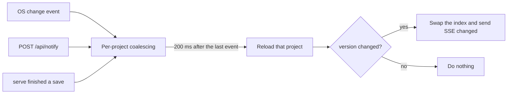

# Change notifications

How a change in the files reaches browsers and waiting agents: versions, file watching, notifications, and Server-Sent Events.

## Versions and change notifications

A project's `version` is a SHA-256 over the relative paths and contents of its source files (`project.json`, `epic.json`, `PLAN.md`, `task.json`, `TASK.md`) and the file names under `assets/` and `evidence/`. Saving identical content leaves it unchanged, and returning to earlier content can reproduce an earlier version. That is fine because consumers only ask whether the version differs.

1. `serve` resolves the data area once at startup and uses it until exit. It writes `serve.json` after it starts listening and removes it on exit.
2. It registers a recursive watcher on `shared/` before loading every project into its index. Events for dot-prefixed names, `.internal/`, and `README.md` are ignored.
3. Events are coalesced per project for 200 ms. A rescan request from the watcher reloads every project.
4. After a save that changed something, the CLI reads `serve.json` and sends `POST http://127.0.0.1:<port>/api/notify` over a plain TCP connection with a 300 ms budget, ignoring failure. Agents that edit files directly need not notify.
5. When the version changes, every connected browser receives SSE `changed` and re-fetches the project list and the current board. `wait` compares only its own project's version.
6. There is no periodic polling anywhere.

At startup, `serve` also deletes temporary files (`.<name>.tmp-*`, `.new-*`) older than one hour, never source files and never uncommitted journals.

## Live updates

Browsers subscribe to `GET /api/events`. On `ready`, `changed`, and every reconnect they re-fetch `GET /api/projects` and the current board. When SSE drops, the desktop UI shows a disconnected state and relies on the browser's automatic reconnect. There is no periodic polling or reconciliation; a missed notification is caught on the next reconnect or reload. How `changed` is produced is described in [Storage and consistency](#versions-and-change-notifications).
