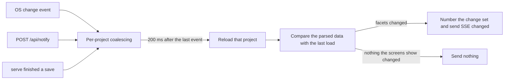

# Change notifications

How a change in the files reaches browsers and waiting agents: versions, file watching, the change feed, the Summary and Detail reads, and Server-Sent Events.

## Versions

Every Summary has a `version`. It is a SHA-256 hash (first 16 bytes, in hexadecimal) of the parsed data, not of the raw file bytes, so the same content gives the same version after a restart. The Summary's `version` is also its `ETag`.

Each task has a hash of its summary fields and one version for each of its two Detail sections, `document` and `history`. Each epic has a hash of its summary fields and a version for its `document`. A client compares versions for equality only. Returning to earlier content can reproduce an earlier version, which is fine because a client only asks whether a version differs from the one it holds.

## From a file change to a notification



1. `serve` resolves the data area once at startup and uses it until exit. It writes `serve.json` after it starts listening and removes it on exit.
2. It registers a recursive watcher on `shared/` before loading every project into its index. Events for dot-prefixed names, `.internal/`, and `README.md` are ignored. Events in a project's `docs/` folder are not board data: they go to the docs notice (see [The docs](#the-docs)) and never reload the project.
3. Events are coalesced per project for 200 ms. A rescan request from the watcher reloads every project.
4. After a save that changed something, the CLI reads `serve.json` and sends `POST http://127.0.0.1:<port>/api/notify` over a plain TCP connection with a 300 ms budget, ignoring failure. Agents that edit files directly need not notify.
5. After a reload, the server compares the parsed data with the data before it. A save that changes nothing a Summary or Detail shows sends no event. A change set gets the next `seq` of this server run, and every open stream receives SSE `changed` with the changed resources and facets.
6. There is no periodic polling anywhere.

## Facets and change events

`changed` names the resources that changed and which parts of them:

```json
{"instanceId": "inst-5f3a", "seq": 42, "projectId": "…", "changes": [
  {"resource": "task", "id": 302, "facets": ["summary", "history"]},
  {"resource": "epic", "id": "EPIC-1", "facets": ["document"]},
  {"resource": "project", "id": "…", "facets": ["deleted"]}
]}
```

| Facet | Meaning |
| --- | --- |
| `summary` | Title, status, position, epic, pending question, and acceptance counts. |
| `document` | The body and the acceptance condition text. |
| `history` | The history. |
| `deleted` | The resource is gone. A project has only `summary` or `deleted`. |

Moving a task to the archive, or restoring it, is a `summary` change. A file that cannot be parsed changes every facet of its resource.

The `seq` grows by one for each `changed` within one `instanceId`. The `instanceId` is new at every server start, so a client can tell that `seq` began again. The monitor's stream numbers its own events, so changes to other projects leave no gap in its `seq`.

## How clients use the Summary and Detail

A client keeps one Summary per project. The Summary is built from the index projection, so reading it reads no file. A request whose `If-None-Match` matches the `version` gets `304` with no body.

A Detail (a task's body and history, or an epic's document) is read only when a card or an epic is opened, and only for the sections the screen shows. The Detail arrives as NDJSON. The client commits it as a whole version only after the `complete` line, and discards a stream that ends without it.

When a `changed` event arrives, the client does the following:

- It reads the Summary again for the project.
- It marks the sections the facets name as outdated, and fetches again only the open ones.
- It keeps the sections that the event does not name.

A client that sees a gap in `seq`, a new `instanceId`, or an event it does not know drops the Summary and the related cached Details for the project, then reads the Summary again. A stream that has fallen too far behind gets `resync` (`{"instanceId", "seq"}`) instead of the events it missed, and the client does the same.

## How agent waits use events

Change waits, Pending-answer waits, and next-task waits share `src/agent/wait_engine.rs`. Each caller supplies its purpose-specific condition and an optional monotonic deadline. The engine reads the fixed ProjectId before connecting, checks again after SSE `ready`, and evaluates again after each `changed` event. It ignores changes whose snapshot does not satisfy the caller's condition.

Task mode starts its absolute idle deadline only after the initial snapshot contains no eligible task. Other-project changes and keep-alives cannot reset it. At expiry, the engine takes a final snapshot and evaluates the condition once more, so a task arriving at the boundary wins. A failed final read is an error, never an empty result. Change mode's optional timeout remains an error (`wait_timeout`); task mode's exhausted idle interval is the successful `idle_timeout` result. See [Agent integration](./agents#waiting-for-changes) for the selection predicate and output contract.

At startup, `serve` also deletes temporary files (`.<name>.tmp-*`, `.new-*`) older than one hour, never source files and never uncommitted journals.

## Live updates

The board subscribes to `GET /api/events`, which carries every project. The mobile monitor subscribes to `GET /monitor/api/events?project=<projectId>`, which carries only the project in its address and has no project-list facet. Both streams send:

- `ready` after subscribing, with the server's build ID. A page built from another web build reloads once its open operations end (see [Server and UI](./server-and-ui.md#how-the-web-ui-is-built)).
- `changed`, as described above.
- `resync` when the stream has fallen behind.
- A keep-alive every 15 seconds (the monitor sends a `heartbeat` event). A keep-alive does not fetch anything.
- `preferences` after a saved language or theme change.
- `docs` on the board's stream only, after a change in a project's `docs/` folder (see [The docs](#the-docs)).

A connection that has sent nothing for 45 seconds is dropped and reopened, with growing pauses of 1, 2, 5, 10, and then 30 seconds. The browser lets go of the connection while its tab is hidden and opens it again when the tab becomes visible. Opening a connection also fetches the Summary, so a change made between the last fetch and the subscription is not missed.

The desktop UI shows a disconnected state while the stream is down. There is no periodic polling or reconciliation: a missed notification is caught when the connection opens again or the page reloads.

## The docs

The files in a project's `docs/` folder are the user's, not board data. Their changes travel apart from `changed`:

1. The watcher classifies a path under `projects/<id>/docs/` as that project's docs. Its events wait out the same 200 ms quiet period.
2. When the period ends, the server sends `docs` with `{"projectId": "…"}` on `GET /api/events`. It reads no file, changes no `version`, and takes no `seq`. When the platform lost events, or the stream fell behind, `projectId` is `null`: any project's docs may have changed.
3. The monitor's stream never sends `docs`, and agent waits ignore it.

The Docs dialog reads the file list again on every `docs` for its project, and on every reopened stream. It reads the open file again only to compare its `revision`: a changed file is shown again with a notice, and a file gone from the list keeps its last content with a notice (see [Server and UI](./server-and-ui.md#the-docs-dialog)).
