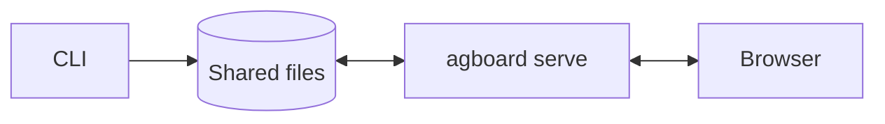
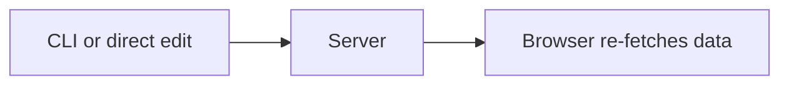
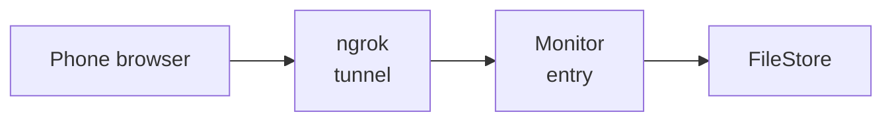
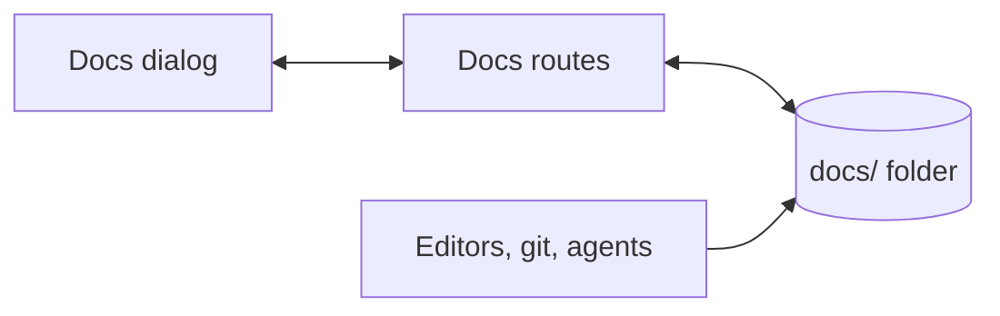

# How Agent Board works

Start here. This page gives you the mental model: what runs, where the data lives, and how one change travels from an agent to the browser. The other concept pages go deeper into each part.

## The big picture

Agent Board is a single Rust executable, `agboard`. The same binary is the CLI that agents and people run, and the web server (`agboard serve`) that shows the board in a browser.

There is no database. Every project lives as plain files in the shared area, `.agent-board/shared/` in the user's home directory (or under `AGBOARD_HOME`). Markdown holds what people and agents write: task bodies, acceptance conditions, history, and epic details. JSON holds the operational state: lanes, run states, and open questions. Because the files are the source of truth, agents may also edit `TASK.md` and `EPIC.md` directly, and the server notices.

### Reading and writing data

The CLI and browser read and write the same local files. Task state is stored in `task.json`, bodies, acceptance conditions, and history in `TASK.md`, and epic details in `EPIC.md`.

Agents use commands such as `agboard add`, `mv`, and `state`; users work in the browser. Users run `rm` and `init` in the CLI for deletion and resets. `TASK.md` and `EPIC.md` can also be edited directly, and the server detects the changes. CLI saves use locks and temporary-file renames.

### Change notifications

The CLI notifies the server through `POST /api/notify`; direct file edits are detected through OS change events. The server sends `SSE: changed` so browsers reload the data.

### Mobile monitor

A phone browser reaches the read-mostly monitor through an ngrok tunnel that runs inside `serve`. You start it from **Settings** or with `agboard serve --monitor ngrok`; the exact public Host and a 4-digit passcode made for each start guard it. The tunnel forwards to a dedicated loopback entry. That entry uses the same FileStore, file watcher, and notifications as local access. See [The mobile monitor](./remote-access.md).

### Project docs

Each project also has a `docs/` folder for the user's own Markdown documents. It sits inside the project's folder but is kept apart from the board: the watcher ignores it, it is not part of the `version`, and saving a document sends no `changed`. The browser reads and saves these files through four routes of their own, and a save is refused when the file changed since it was read. See [Saving and recovery](./saving-and-recovery.md#project-docs) and [Security model](./security.md#project-docs).

### Design principles

Three ideas run through the whole design:

- **Every operation names its project.** Projects are identified by an immutable ProjectId, and commands never guess the target from the working folder or a selection. Folder bindings exist only to help the hook find the right project.
- **A task is saved as a pair.** `task.json` (state) and `TASK.md` (body, conditions, history) are committed together under a lock, so nobody ever sees one without the other. See [Storage and consistency](./saving-and-recovery.md).
- **The server is a cache, not an owner.** `serve` keeps an in-memory index for fast reads, but the files decide. If the server is stopped, the CLI still works; when it starts again, it reads the files.

## Follow one change

### An agent moves a task

When an agent runs `agboard --project demo mv 12 doing --actor ai`:

1. The CLI resolves the project by name to its ProjectId.
2. It takes the project's write lock (`.internal/write.lock`), waiting up to 5 seconds.
3. Under the lock it re-reads the latest `task.json` and `TASK.md`, checks the rules (for example, that an AI may not move this task to Done while conditions are unmet), and computes the new state and a history entry.
4. It saves both files as one pair through a journal, then releases the lock.
5. If something actually changed, it reads `serve.json` and sends `POST /api/notify` to the running server. If no server runs, that is fine.
6. The server reloads the project, sees that its `version` changed, and sends SSE `changed` to every browser, which re-fetches the board.

### A person answers a question in the browser

1. The browser sends `POST /api/projects/{projectId}/tasks/{id}/answer` with the request ID and the chosen option, plus the write token embedded in the page.
2. The server checks Host, Origin, `Sec-Fetch-Site`, and the token before it even looks up the task.
3. Under the write lock it confirms that the task still has the same open request, stores the answer in `requestAnswers`, clears the request, appends history, and commits the pair.
4. The version changes, browsers update through SSE, and a default-waiting `state ... pending --request-json` command wakes on the same SSE stream and reads the answer. The command saves the request, notifies the server, then waits; its wait settings are process-local. `--no-wait` returns after saving and notifying.

### An agent edits TASK.md directly

1. The editor writes the file. No lock is involved; the last save wins.
2. The server's file watcher receives an OS event and waits 200 ms for related events.
3. It reloads the project, re-evaluates automatic Done for eligible tasks, and, if the version changed, notifies browsers and waiting agents.

## Where to go next

- [Follow your first change](../getting-started/first-change.md): trace one rule from the command to the file and its test.
- [Tasks and states](./tasks-and-states.md): what a task is and which states are valid.
- [History and decisions](./history-and-decisions.md): history, Pending, and automatic Done.
- [Saving and recovery](./saving-and-recovery.md): locks, atomic saves, and failures.
- [Change notifications](./notifications.md): how a change reaches browsers and waiting agents.
- [Server and web UI](./server-and-ui.md), [Agent integration](./agents.md), [The mobile monitor](./remote-access.md), and [Security model](./security.md).
- [Code map](../reference/code-map.md) when you need to find a file.
