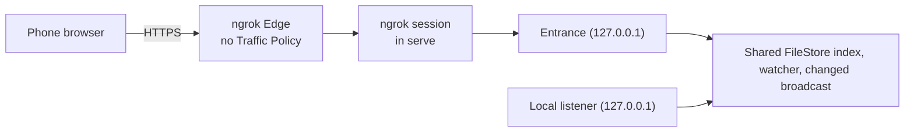

# Remote access

By default the board is reachable only from the same machine. A phone, or a browser on another computer, reaches the board app itself through an ngrok tunnel, behind a passcode session. The tunnel lives inside the `serve` process and is controlled from the board's **Settings** or from `agboard serve --monitor ngrok`. Setup steps for users are in the [remote access guide](../../guide/watch/remote-access.md); the routes are in [Entrance routes](../reference/remote-routes.md); the protections are summarized in the [Security model](./security.md#the-ngrok-entrance).

## How it is put together

- The ngrok Rust SDK is linked into `agboard`. There is no external `ngrok` program and no sidecar. The supervisor in `src/server/monitor_connection/` opens one HTTP endpoint, with no Traffic Policy, and forwards it to the entrance. With no domain set, ngrok chooses the public address, and it differs at every start (the SDK does not hand out the account's static dev domain by itself; a free account that asks for a domain it does not own is refused). When a domain the ngrok account owns, such as its free static dev domain, is set, the endpoint is requested on that domain, so the address is the same at every start and after a server restart. The domain is a setting of the PC connection dialog (a recommended, optional field), saved as `domain` in the settings file and sent with `PUT /api/monitor-connections/settings/ngrok`; the `AGBOARD_NGROK_DOMAIN` environment variable is the alternative. The environment variable wins over the saved domain (the token precedence is different: a typed token wins over the environment). Either way the value must be a bare host name (no scheme, path, port, or wildcard); the API refuses anything else with `invalid_domain`, and an environment value that is not one is ignored. If ngrok refuses the domain, the start fails with `endpoint_failed` and the reason is written to the server log. The free ngrok plan rejects Traffic Policy actions, so none is sent.
- The entrance is a dedicated loopback listener that the connection starts and stops. It runs in the same `serve` process as the local listener and shares the lifecycle guard, the FileStore index and reader, the watcher, and the `changed` broadcast. `serve.json` keeps only the local port, so the CLI, hook, and `wait` are unaffected.
- The [project docs](../reference/web-api.md#project-docs) routes are served through the entrance with the rest of the board's API, behind the session. Only `docs/open`, which starts a program on the PC, is not.
- The local listener and the entrance are separate surfaces. The local listener keeps its own Host, Origin, and token checks. The entrance serves the board router without those local guards, because its own checks (Host, session, Origin, CSRF) run first, and its page holds no token. The connection settings API, `POST /api/notify`, and `docs/open` exist only on the local listener.

## The connection

The connection is one supervisor, `MonitorConnections`, owned by the server state. It holds the saved settings, the token, the lifecycle state, and the running tunnel.

| State | Meaning |
| --- | --- |
| `disabled` | Not enabled. The default. |
| `needs_config` | Enabled in the saved settings but no token is available, so nothing was started. |
| `starting` | Opening the tunnel and applying the policy. Also shown while a restore at startup is still reading the secure storage. |
| `ready` | The public address is known and the entry admits requests. |
| `reconnecting` | Part of the status set that the API and the PC dialog understand. The supervisor does not enter it: the ngrok SDK's forwarding gives no disconnect signal, so only stopping and starting again is guaranteed to recover a lost tunnel. |
| `failed` | The last start failed; `failure` holds the code. |
| `stopping` | Closing the tunnel and its sessions. |

- **Starting.** Only an explicit start (the PC dialog's **Save and connect**, or `--monitor ngrok`) opens a tunnel. Opening the dialog or saving a draft never does. A start saves the settings as enabled first; if that fails, nothing starts. A token typed in the start request wins; otherwise `NGROK_AUTHTOKEN` is used; a token saved in the PC's secure storage is used only when neither is present.
- **Restoring.** When `serve` starts and the saved settings are enabled, the supervisor starts the tunnel only if a token is available from the environment or the secure storage; otherwise it reports `needs_config` and waits for the PC. An unreadable settings file reports `failed` with `config_unreadable` and keeps the PC entrance. A start from the command line takes priority over the saved settings; when it fails, `serve` exits with code 1. A server that a command started restores the saved connection too, and it does not stop by itself while the connection is starting, ready, reconnecting, or stopping. To let it stop, stop the connection on the PC.

  The secure storage can stop to ask the user for permission, for example after the program was reinstalled. Restoring reads it in the background, so the server is ready and answers requests at once, and the status is `starting` until the read returns. Only `--monitor ngrok` waits for the connection.
- **Starting again.** A start while the tunnel runs (the PC dialog's **Save and connect** after **Reset token**, or any other start) closes the old tunnel, generates a new passcode, and ends the old sessions and event streams before the new tunnel is reported ready. Saving the same settings again changes nothing.
- **Stopping.** Stop closes the tunnel, closes the entry so open event streams end, refuses new answers, and saves the settings as disabled. The PC dialog calls this **Pause**, and **Resume** is a start: stopping keeps the token, the saved domain, and the [registered devices](#registered-devices), so after a resume the registered phones come back without the passcode. The settings file is written atomically; passcodes, sessions, and tokens are never written to disk.

## Where things are stored

| What | Where |
| --- | --- |
| `enabled`, `revision` | `<data root>/.internal/monitor-connection.json`, an app-internal file with owner-only permissions. See [Shared files](../reference/files.md#monitor-connection-settings). |
| ngrok token | Only in memory, unless the user saves it. A saved token lives in the PC's secure storage, the OS credential store (service `agent-board`, account `ngrok-authtoken`). |
| Phone passcode and its count of wrong guesses, application sessions, CSRF tokens | Only in memory, for one start. |
| Registered devices: id, label, origin, two times, and the SHA-256 digest of the device token | `<data root>/.internal/remote-devices.json`, an app-internal file with owner-only permissions, replaced atomically. The raw device token is never stored. See [Shared files](../reference/files.md#registered-devices). |
| Language and color theme | `<data root>/.internal/preferences.json`, written by a save from the PC or from a phone. See [Shared files](../reference/files.md#display-preferences). |

The domain is not a secret and does not change the checks below: `Host` must still equal the address ngrok returns, which is the requested domain. Stopping the connection closes the tunnel, so the fixed address answers nothing from ngrok again until the next start.

`NGROK_AUTHTOKEN` and the secure storage are read lazily, so a run that never needs a token never touches the secure storage.

The secure storage is never read or written while the supervisor's state is held, because it can stop to ask the user. The first `GET /api/monitor-connections` starts the read in the background and waits for it for at most one second; while the user has not answered, it returns what is known, and the dialog's next read shows what the storage holds. A start and a deletion wait for the secure storage, but only that request waits: the board, the other requests, and the idle check keep answering.

When the secure storage is missing or refuses, `keychainAvailable` is false, saving is refused with `keychain_unavailable`, and the user enters the token each time.

## Authentication and write protection

The Edge does nothing for the app to rely on: the endpoint is opened without a Traffic Policy (the free ngrok plan rejects one), so there is no sign-in, no allow list, no deny rule, and no header that the app trusts. A request reaches the board only after three layers, in this order:

1. **Host.** The entrance admits a request only when the tunnel is ready and `Host` is exactly the public HTTPS address ngrok returned (one `Host` header, no port added). Any other request gets the same 403 with no reason; that includes a browser that opens the loopback port, whose `Host` is the loopback address. Forwarding headers and method-override headers are not trusted. The Host check does not tell the app that a request came through ngrok: see [What is not prevented](./security.md#what-is-not-prevented).
2. **Passcode and session.** The page shell and its static files need only the first layer. Nothing else is served without a session, and a session starts only at `POST /api/remote/unlock`.
   - *The passcode.* Each start makes a 4-digit passcode (`0000` to `9999`) from the operating system's random source, without modulo bias, and keeps it with a count of consecutive wrong guesses in memory. The PC sees it through the local status API only while the connection is `ready`, and on the `serve` startup line. It is never written to a file, a log, `serve.json`, the page, an error, or any phone-facing answer.
   - *Unlock.* The body is `{"code":"1234"}` as JSON, with the exact public Origin and `Sec-Fetch-Site: same-origin`; no CSRF token is needed because there is no session yet. The code is compared in constant time. A right code issues the cookie `agboard_ngrok_session` (`Secure; HttpOnly; SameSite=Lax; Path=/`, up to 12 hours) bound to this start and public address, resets the count, and returns a CSRF token. It also [registers the device](#registered-devices) with a second cookie, `agboard_ngrok_device`. A wrong code is a 403 `unlock_failed` that does not say how close it was or how many tries are left.
   - *The limit.* The fifth wrong code in a row is still a 403. From then on every attempt, the right passcode included, is a 429 `unlock_locked` and issues nothing. Only a new start makes a new passcode and a clean count. Requests refused for their headers or body (a missing Origin, a body that is not JSON) are not guesses and are not counted.
   - *Session.* `GET /api/remote/session` reports a live session and its CSRF token. Without one, a valid `agboard_ngrok_device` cookie opens a new session there, without the passcode; otherwise it answers 401 `session_required`. Every other route under `/api/` needs a live session, or answers 401 `session_required`. Event streams end with the session, when the run closes, and after five minutes (the page reconnects).
3. **Write guard.** Any change (an answer, an edit, a move, a preferences save, and so on) also needs the exact public Origin, `Sec-Fetch-Site: same-origin`, and the CSRF token in `X-Agboard-Csrf`.

A 4-digit passcode is a deliberately small secret: it has 10,000 possibilities and is guarded by the five-guess limit and by a new passcode at every start. It is weaker than an account sign-in. The [Security model](./security.md#what-is-not-prevented) lists what it does not stop.

**Answers and other changes** go through the board's own handlers. FileStore re-checks each question and its choice under its lock: only open questions are accepted, an answered or withdrawn question is refused with 409, and an unknown one with 404. The preferences handler accepts only `locale` and `theme`, writes `preferences.json` on the PC, and sends a `preferences` event to every open board stream.

No token, passcode, or session secret appears in static JS or CSS, manifests, API responses, `serve.json`, or logs. All HTML and sensitive APIs send `Cache-Control: no-store`, `Referrer-Policy: no-referrer`, `X-Content-Type-Options: nosniff`, and a CSP limiting scripts and connections to self with `frame-ancestors 'none'`. Scripts and stylesheets, which are named by their content and hold no token, are cached as immutable instead.

## Registered devices

A right passcode registers the phone, so that the passcode is needed once per phone and not once per session or per start. The registration is separate from the session: the session is short and lives in memory; the registration is long and survives a pause, a restart, and a reconnect.

- **The credential.** On a right passcode the entrance makes a random 256-bit device token and sets it as the cookie `agboard_ngrok_device` (`Secure; HttpOnly; SameSite=Lax; Path=/`, `Max-Age` of 400 days, the most a browser keeps). The server keeps only its SHA-256 digest, with an id (`dev_` and 16 hex digits), a label made from the `User-Agent` (for example `iPhone / Safari`), the public origin it was registered for, and its creation and last-seen times. A browser that already sends a valid device cookie is not registered twice. At most 32 devices are kept; the one seen longest ago is dropped first. If the registry cannot be saved, the phone still gets its session and is asked for the passcode next time.
- **Coming back.** When `GET /api/remote/session` has no live session but the request carries a device cookie whose digest is registered for this public origin, the entrance opens a new session (the same 12-hour session and CSRF token as an unlock), refreshes the device cookie, and records the time. This is what the page does first on every load and after any 401 (`RemoteGate`), so a phone returns after its session ended, after a pause and resume, and after a PC restart, with no passcode. It needs the same `Sec-Fetch-Site: same-origin` check as before; no passcode attempt is made, so the five-guess limit is neither used nor bypassed. A device cookie sent to another public origin, such as after the saved domain changed, matches nothing.
- **Unregistering.** The PC dialog lists the devices (`GET /api/monitor-connections/devices`) and removes one (`DELETE /api/monitor-connections/devices/{id}`); both exist only on the local listener. Removing deletes the record first, ends every session opened for that device in the running tunnel, and notifies the open event streams of the device, which end at once. The phone's next request is a 401, its device cookie matches nothing, and it is asked for the passcode.
- **What registration does not change.** A new device still needs the passcode of the current start, with the same limit. Pausing or stopping serves nothing from the entrance, registered or not. Sessions opened with the passcode alone (before registration was possible, or when the registry could not be saved) have no device and end only by their own time or the run.

A registered phone that is lost or stolen stays registered until someone removes it on the PC: see [What is not prevented](./security.md#what-is-not-prevented). The phone's push subscription (a later feature) can be keyed to the device id.

## The board app through the entrance

- The page at `/` is the board's own page (`web/index.html`), rendered with an empty token. The same bundle shows the PC board or the phone screen by window width, so the entrance needs no second app.
- On load, a page without a token asks `GET /api/remote/session` (`RemoteGate`, `web/src/app/remote/`). Without a session it shows the passcode screen (`ConnectionStateView`) and the board does not mount, so nothing is read. The passcode goes to `POST /api/remote/unlock`; the cookie is set by the server, and the CSRF token stays in memory (`setCsrfToken` in `web/src/shared/api/http.ts`).
- Every write sends `authHeaders()`: the board token when the page has one, and otherwise `X-Agboard-Csrf`. A 401 from any board request clears the CSRF token and brings the passcode screen back.
- The entrance builds the board router a second time (`api::remote_router`) without the local Host and write guards and without the local-only routes, and serves it behind the entrance checks. A client's `X-Agboard-Token` is removed before it gets there, so the board token has no role on this surface.

## The old monitor addresses

The earlier read-mostly phone monitor is gone. Its addresses, `/monitor`, `/monitor/` and everything under `/monitor/` (including `/monitor/api/` and `/monitor/assets/`), answer 404 on the entrance, with or without a session and without a redirect. The local listener answers 404 for them too. A phone that kept an old bookmark opens the root address instead, which asks for the passcode and shows the board.

The phone address that the PC dialog and its QR code show is the board's root with the project in the query, `https://<host>/?project=<ProjectId>`. The board app picks the project from `?project=`, as it does on the PC.

## Fetching and recovery

The phone screen shows either fresh data or an honest "stale" state, without polling. It is drawn from the board's own data layer, so it reads the same Summary and Detail routes and follows the same `/api/events` stream as the PC board; see [Notifications](./notifications.md) for the stream and [Server and web UI](./server-and-ui.md#behavior-on-failure-in-the-ui) for how the UI behaves on failure.

- **Problems.** The Summary's `problems` go to the view. Any problem makes the view `partial`, even with HTTP 200: only readable tasks are listed and counted in the lane tabs, and a notice says the data has defects. Excluded tasks are never counted as zero. Data defects alone never trigger retries, polling, or reconnects.
- **Freshness** is one of `loading`, `syncing`, `fresh`, `stale`, `partial`, `error`. The view becomes fresh only when the stream is connected, the Summary was fetched without problems, and the heartbeat is current; an open connection alone is not enough. If a manual GET succeeds while the stream is down, the view says the data is fetched but auto-update is stopped. The last full fetch time advances only on a complete, problem-free fetch.
- **Visibility.** While the page is hidden, the stream and heartbeat checks stop. On becoming visible, the screen re-fetches and reconnects at once. GET requests time out after 10 seconds, and retries back off at 1, 2, 5, 10, and 30 seconds and stop while hidden.
- **Ordering.** `agentStatusChangedAt` is the run-state change time and `taskStatusChangedAt` orders Done. Relative times may refresh every minute, but that timer never re-fetches.
- Before setup completes the view shows loading, and it distinguishes zero projects or tasks from a network failure. Fetched bodies and counts are never stored in `localStorage` or a service worker.
