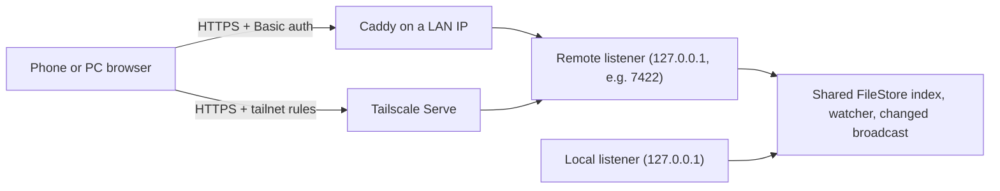

# Remote access and the mobile monitor

By default the board is reachable only from the same machine. Remote access adds a second, opt-in listener so a phone or another computer can reach the board through an HTTPS proxy. The mobile monitor is a separate, read-mostly app served on that listener. Setup steps for users are in the [mobile monitor guide](../../guide/operations/mobile-monitor.md); the routes are in [Remote and monitor routes](../reference/remote-routes.md).

## How it is put together

- The remote listener starts only when `--remote-port` and at least one `--remote-origin` are given. It runs in the same `serve` process as the local listener; both bind only to 127.0.0.1 and share the lifecycle guard, the FileStore index and reader, the watcher, and the `changed` broadcast.
- Both binds must succeed before either serves, and a failure or stop ends both. If the remote listener fails to start, the local listener stops too and no `serve.json` is left. `serve.json` keeps only the local port, so the CLI, hook, and `wait` are unaffected.
- All external authentication is done by the proxy. Agent Board itself adds Host, Origin, and token checks on every write.

Three kinds of state keep the surfaces apart:

| State | Holds | Never holds |
| --- | --- | --- |
| `RemoteBoardState` | The reader, write service, `changed`, registered HTTPS origins, and its own session token. Reuses the desktop handlers without duplicating write logic. | The local token. |
| `MonitorState` | A read-only reader, a `changed` subscription, allowed hosts, and its own assets. | Any board token or write service. |
| Monitor answer router | The single answer endpoint and its own token. | Desktop or remote board tokens. |

## Authentication and write protection

**Remote board writes** require all of the following, checked before the target lookup; otherwise 403 with no change:

- `Host` exactly matches the bound loopback authority or a registered remote origin. `Forwarded` and `X-Forwarded-Host` are never trusted, and CORS is not opened.
- `Host` and `Origin` match the same registered HTTPS origin, and `Sec-Fetch-Site` is `same-origin`.
- `X-Agboard-Token` equals the remote session token in constant-time comparison. Missing, `null`, foreign-origin, and local tokens are refused.

The remote token is generated per start from 32 random bytes, separate from the local token, and embedded only in the remote `/board/` HTML.

**Monitor answers** use a third token, also 32 random bytes per start and not interchangeable with either board token. It is injected into `/monitor/` HTML only when served. An answer requires an exact Host and Origin for a registered HTTPS origin, `Sec-Fetch-Site: same-origin`, and a constant-time token match before the target lookup. FileStore then re-checks Pending, the request ID, and the choice under its lock. Only the current request of a Todo or Doing task is accepted; Done, answered, archived, and other requests are refused.

No token ever appears in the common entry, static JS or CSS, manifests, API responses, `serve.json`, or logs. All HTML and sensitive APIs send `Cache-Control: no-store`, `Referrer-Policy: no-referrer`, `X-Content-Type-Options: nosniff`, and a CSP limiting scripts and connections to self with `frame-ancestors 'none'`. Scripts and stylesheets, which are named by their content and hold no token, are cached as immutable instead.

**Proxies.** Caddy listens only on the HTTPS port of the chosen LAN IP, applies `tls internal` and `basic_auth` to every route (unauthenticated requests get 401), proxies only to the dedicated port, does not forward `Authorization`, and does not buffer SSE. Tailscale Serve targets the same port, keeps a Host and Origin matching the registered origin, relies on tailnet access rules, and never uses Funnel. A proxy must not rewrite Host or Origin to get around the local guard. Password hashes, private keys, and real LAN IPs belong in the user's configuration, never in the repository; shared examples use environment variables.

## The monitor app

- The common entry (`web/access.html`, `web/src/app/access/entry.ts`, `web/vite.access.config.ts`) builds into `web/dist/access/` and uses only DOM and Web APIs: no React, app code, API client, or token.
- The monitor (`web/monitor.html`, `web/src/app/entry/monitor.tsx`, `web/vite.monitor.config.ts`) starts from `web/src/pages/monitor/App.tsx` only. It never imports the desktop `App.tsx`, `DetailPanel`, the editor, or the general write client. It builds into `web/dist/monitor/` with its own manifest, which `src/server/monitor/assets.rs` serves exclusively. For Mermaid it reuses the board build's `chunk-mermaid.core` chunk and every chunk it imports: they are copied into `web/dist/monitor/` unchanged, the build fails if any of them holds a module from `web/src/`, and the executable embeds the identical bytes once. The automatic redirect on phones never preloads desktop HTML, tokens, or the editor.
- Shared presentation components (header, task content, status labels, project switcher, theme, i18n, read-only Markdown, conditions, and history) are reused. A task heading opens a read-only drawer with Body, Conditions, History, and Epic tabs; the answer form lives on the task. The drawer and its Markdown view are a separate chunk fetched right after the list is shown, so the first load holds only the list and the answer form.
- The monitor client has catalog, board, events, owned image, evidence, and epic readers, and one answer POST. The token is read from the served HTML at runtime. There are no PATCH, PUT, or DELETE functions.
- Desktop and monitor answers share one FileStore save path: request matching under the lock, `requestAnswers` plus a history entry, index update, and notification. A successful answer leaves the task Idle in its lane.
- The drawer fixes its target by projectId, taskId, epicId, and a generation number. It reads task body and history from the snapshot and the epic body from `getEpic`, keeps each tab's scroll position, and ignores late or out-of-scope responses. A failed epic read can be retried without blocking the list or answers.

## Fetching and recovery

The monitor tries hard to show either fresh data or an honest "stale" state, without polling.

- **All Projects** fetches the catalog, then each board with at most four in parallel, then re-checks the catalog. If `catalogVersion` changed meanwhile, it starts over as a new generation. There is no point-in-time consistency across projects.
- **Problems.** Snapshot `problems` go to the view with their ProjectId. Any problem makes the view `partial`, even with HTTP 200: the summary shows "—", only readable tasks are listed, and a notice says the data has defects. Excluded tasks are never counted as zero. Projects that failed to fetch and projects with data defects are shown separately, with no repair action. Data defects alone never trigger retries, polling, or reconnects.
- **Freshness** is one of `loading`, `syncing`, `fresh`, `stale`, `partial`, `error`. The view becomes fresh only when SSE `ready` arrived, every project fetched without problems, and the heartbeat is current; `onopen` alone is not enough. If a manual GET succeeds while SSE is down, the view says the data is fetched but auto-update is stopped. The last full fetch time advances only on a complete, problem-free fetch.
- **One fetch routine** serves manual refresh, SSE notifications, and returning to the page. An `AbortController` and a generation number drop late responses, and `changed` during a fetch sets a dirty flag for one follow-up fetch.
- **SSE.** The monitor uses the browser's `EventSource`. Its SSE relays `changed`, sends `ready` with the monitor's build ID (`{"build":"…"}`), and sends `heartbeat` (data `{}`) every 15 seconds. If nothing arrives for 45 seconds while visible, the connection is marked stale and reconnects. A heartbeat never re-fetches the snapshot.
- **Visibility.** While hidden, SSE and heartbeat checks stop. On becoming visible, the monitor re-fetches and reconnects at once, merging the duplicate from `ready`. GET requests time out after 10 seconds. Retries back off at 1, 2, 5, 10, and 30 seconds and stop while hidden. Repeated catalog failures fall back to syncing or stale with the recovery timer instead of re-fetching forever.
- **Ordering.** `agentStatusChangedAt` is the run-state change time and `taskStatusChangedAt` orders Done. Relative times may refresh every minute, but that timer never re-fetches.
- Before setup completes the view shows loading, and it distinguishes zero projects or tasks from a network failure. Fetched bodies and counts are never stored in `localStorage` or a service worker.
