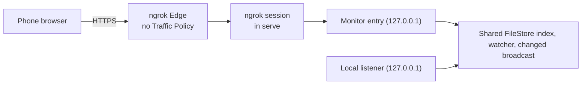

# The mobile monitor

By default the board is reachable only from the same machine. The mobile monitor is a separate, read-mostly app that a phone reaches through an ngrok tunnel. The tunnel lives inside the `serve` process and is controlled from the board's **Settings** or from `agboard serve --monitor ngrok`. Setup steps for users are in the [mobile monitor guide](../../guide/operations/mobile-monitor.md); the routes are in [Monitor routes](../reference/remote-routes.md); the protections are summarized in the [Security model](./security.md#the-ngrok-entrance).

## How it is put together

- The ngrok Rust SDK is linked into `agboard`. There is no external `ngrok` program and no sidecar. The supervisor in `src/server/monitor_connection/` opens one HTTP endpoint, with no domain and no Traffic Policy, and forwards it to the monitor entry. ngrok chooses the public address. The free ngrok plan rejects Traffic Policy actions, so none is sent.
- The monitor entry is a dedicated loopback listener that the connection starts and stops. It runs in the same `serve` process as the local listener and shares the lifecycle guard, the FileStore index and reader, the watcher, and the `changed` broadcast. `serve.json` keeps only the local port, so the CLI, hook, and `wait` are unaffected.
- The [project docs](../reference/web-api.md#project-docs) routes exist only on the board router. The monitor entry has none, so the docs are never reachable through ngrok.
- The local listener and the monitor entry are separate surfaces. The local listener keeps its own Host, Origin, and token checks; the monitor entry never serves the desktop board, and the connection settings API exists only on the local listener.

Two kinds of state keep the surfaces apart:

| State | Holds | Never holds |
| --- | --- | --- |
| `MonitorState` | A reader, the `changed` and `preferences` subscriptions, allowed hosts, and its own assets. | Any board token. |
| Monitor write router | The answer endpoint, the preferences save, and their write guard. | The desktop board token. |

## The connection

The connection is one supervisor, `MonitorConnections`, owned by the server state. It holds the saved settings, the token, the lifecycle state, and the running tunnel.

| State | Meaning |
| --- | --- |
| `disabled` | Not enabled. The default. |
| `needs_config` | Enabled in the saved settings but no token is available, so nothing was started. |
| `starting` | Opening the tunnel and applying the policy. |
| `ready` | The public address is known and the entry admits requests. |
| `reconnecting` | Part of the status set that the API and the PC dialog understand. The supervisor does not enter it: the ngrok SDK's forwarding gives no disconnect signal, so only stopping and starting again is guaranteed to recover a lost tunnel. |
| `failed` | The last start failed; `failure` holds the code. |
| `stopping` | Closing the tunnel and its sessions. |

- **Starting.** Only an explicit start (the PC dialog's **Save and connect**, or `--monitor ngrok`) opens a tunnel. Opening the dialog or saving a draft never does. A start saves the settings as enabled first; if that fails, nothing starts. A token typed in the start request wins; otherwise `NGROK_AUTHTOKEN` is used; a token saved in the PC's secure storage is used only when neither is present.
- **Restoring.** When `serve` starts and the saved settings are enabled, the supervisor starts the tunnel only if a token is available from the environment or the secure storage; otherwise it reports `needs_config` and waits for the PC. An unreadable settings file reports `failed` with `config_unreadable` and keeps the PC entrance. A start from the command line takes priority over the saved settings; when it fails, `serve` exits with code 1.
- **Starting again.** A start while the tunnel runs (the PC dialog's **Save and connect** after **Reset token**, or any other start) closes the old tunnel, generates a new passcode, and ends the old sessions and event streams before the new tunnel is reported ready. Saving the same settings again changes nothing.
- **Stopping.** Stop closes the tunnel, closes the entry so open event streams end, refuses new answers, and saves the settings as disabled. The settings file is written atomically; passcodes, sessions, and tokens are never written to disk.

## Where things are stored

| What | Where |
| --- | --- |
| `enabled`, `revision` | `<data root>/.internal/monitor-connection.json`, an app-internal file with owner-only permissions. See [Shared files](../reference/files.md#monitor-connection-settings). |
| ngrok token | Only in memory, unless the user saves it. A saved token lives in the PC's secure storage, the OS credential store (service `agent-board`, account `ngrok-authtoken`). |
| Phone passcode and its count of wrong guesses, application sessions, CSRF tokens | Only in memory, for one start. |
| Language and color theme | `<data root>/.internal/preferences.json`, written by the PC or a monitor save. See [Shared files](../reference/files.md#display-preferences). |

`NGROK_AUTHTOKEN` and the secure storage are read lazily, so a run that never needs a token never touches the secure storage. When the secure storage is missing or refuses, `keychainAvailable` is false, saving is refused with `keychain_unavailable`, and the user enters the token each time.

## Authentication and write protection

The Edge does nothing for the app to rely on: the endpoint is opened without a Traffic Policy (the free ngrok plan rejects one), so there is no sign-in, no allow list, no deny rule, and no header that the app trusts. A request reaches the monitor only after three layers, in this order:

1. **Host.** The entry admits a request only when the tunnel is ready and `Host` is exactly the public HTTPS address ngrok returned (one `Host` header, no port added). Any other request gets the same 403 with no reason; that includes a browser that opens the loopback port, whose `Host` is the loopback address. Forwarding headers and method-override headers are not trusted. The Host check does not tell the app that a request came through ngrok: see [What is not prevented](./security.md#what-is-not-prevented).
2. **Passcode and session.** The page and its assets need only the first layer. Nothing else is served without a session, and a session starts only at `POST /monitor/api/unlock`.
   - *The passcode.* Each start makes a 4-digit passcode (`0000` to `9999`) from the operating system's random source, without modulo bias, and keeps it with a count of consecutive wrong guesses in memory. The PC sees it through the local status API only while the connection is `ready`, and on the `serve` startup line. It is never written to a file, a log, `serve.json`, the page, an error, or any phone-facing answer.
   - *Unlock.* The body is `{"code":"1234"}` as JSON, with the exact public Origin and `Sec-Fetch-Site: same-origin`; no CSRF token is needed because there is no session yet. The code is compared in constant time. A right code issues the cookie `agboard_ngrok_session` (`Secure; HttpOnly; SameSite=Lax; Path=/monitor/`, up to 12 hours) bound to this start and public address, resets the count, and returns a CSRF token. A wrong code is a 403 `unlock_failed` that does not say how close it was or how many tries are left.
   - *The limit.* The fifth wrong code in a row is still a 403. From then on every attempt, the right passcode included, is a 429 `unlock_locked` and issues nothing. Only a new start makes a new passcode and a clean count. Requests refused for their headers or body (a missing Origin, a body that is not JSON) are not guesses and are not counted.
   - *Session.* `GET /monitor/api/session` only reports a live session and its CSRF token, or answers 401 `session_required`; it starts nothing. Every other `/monitor/api/` route needs a live session, or answers 401 `session_required`. Event streams end with the session, when the run closes, and after five minutes (the page reconnects).
3. **Write guard.** An answer, a preferences save (`PUT /monitor/api/preferences`), or `POST /monitor/api/disconnect` also needs the exact public Origin, `Sec-Fetch-Site: same-origin`, and the CSRF token in `X-Agboard-Csrf`.

A 4-digit passcode is a deliberately small secret: it has 10,000 possibilities and is guarded by the five-guess limit and by a new passcode at every start. It is weaker than an account sign-in. The [Security model](./security.md#what-is-not-prevented) lists what it does not stop.

**Monitor answers** then pass the write guard of the monitor's write router. The entry adds the guard's internal token only after its own checks succeed, so the page never holds it. FileStore re-checks Pending, the request ID, and the choice under its lock. Only the current request of a Todo or Doing task is accepted; Done, answered, archived, and other requests are refused.

**Preference saves** pass the same entry checks and the same write guard, then reach the shared preferences handler. The handler accepts only `locale` and `theme`, writes `preferences.json` on the PC, and sends a `preferences` event to every open board and monitor stream. No other monitor route changes the data or the settings.

No token, passcode, or session secret appears in static JS or CSS, manifests, API responses, `serve.json`, or logs. All HTML and sensitive APIs send `Cache-Control: no-store`, `Referrer-Policy: no-referrer`, `X-Content-Type-Options: nosniff`, and a CSP limiting scripts and connections to self with `frame-ancestors 'none'`. Scripts and stylesheets, which are named by their content and hold no token, are cached as immutable instead.

## The monitor app

- The monitor (`web/monitor.html`, `web/src/app/entry/monitor.tsx`, `web/vite.monitor.config.ts`) starts from `web/src/pages/monitor/App.tsx` only. It never imports the desktop `App.tsx`, `DetailPanel`, the editor, or the general write client. It builds into `web/dist/monitor/` with its own manifest, which `src/server/monitor/assets.rs` serves exclusively. For Mermaid it reuses the board build's `chunk-mermaid.core` chunk and every chunk it imports: they are copied into `web/dist/monitor/` unchanged, the build fails if any of them holds a module from `web/src/`, and the executable embeds the identical bytes once.
- The address names the project: `/monitor/?project=<ProjectId>`. A missing, malformed, or unknown project shows an error screen, and nothing is read from the server. The monitor has no project list and no project switcher; a phone shows another project through its own address.
- Shared presentation components (header, task content, status labels, theme, i18n, read-only Markdown, conditions, and history) are reused. A task heading opens a read-only drawer with Body, Conditions, History, and Epic tabs; the answer form lives on the task. The drawer and its Markdown view are a separate chunk fetched right after the list is shown, so the first load holds only the list and the answer form.
- The monitor client has Summary, Detail, events, and owned image readers, one answer POST, one preferences read and save, and the session calls. The page holds no token: on load it asks `GET /monitor/api/session` whether it has a session. Without one the page shows **Enter the passcode** and reads nothing; it sends the passcode only when a person submits it, to `POST /monitor/api/unlock`, and keeps the returned CSRF token in memory to send in `X-Agboard-Csrf` with its one answer POST. If the session later ends (expired, or the connection started again), the passcode screen comes back. A wrong passcode keeps the digits typed and shows no count; after the fifth, the form closes. If the answer is not the monitor's JSON, the page treats the connection as unreachable and retries instead of asking for a passcode. The preferences save sends the CSRF token the same way as an answer. Apart from that save and the answer, there are no PATCH, PUT, or DELETE functions.
- Desktop and monitor answers share one FileStore save path: request matching under the lock, `requestAnswers` plus a history entry, index update, and notification. A successful answer leaves the task Idle in its lane.
- The drawer fixes its target by projectId, taskId, epicId, and a generation number. Each tab reads its own Detail section when it is opened: Body and Conditions read `document`, History reads `history`, and Epic reads the epic's document. The drawer keeps each tab's scroll position and ignores late or out-of-scope responses. A failed Detail read can be retried without blocking the list or answers.

## Fetching and recovery

The monitor tries hard to show either fresh data or an honest "stale" state, without polling.

- **One project.** The address names one project. The monitor reads its Summary when the page opens and again after each `changed` event. Detail sections are read only when the drawer shows them. The stream is opened with `?project=`, so events for other projects never reach the page.
- **Problems.** The Summary's `problems` go to the view. Any problem makes the view `partial`, even with HTTP 200: the summary shows "—", only readable tasks are listed, and a notice says the data has defects. Excluded tasks are never counted as zero. Data defects alone never trigger retries, polling, or reconnects.
- **Freshness** is one of `loading`, `syncing`, `fresh`, `stale`, `partial`, `error`. The view becomes fresh only when SSE `ready` arrived, the Summary was fetched without problems, and the heartbeat is current; `onopen` alone is not enough. If a manual GET succeeds while SSE is down, the view says the data is fetched but auto-update is stopped. The last full fetch time advances only on a complete, problem-free fetch.
- **One fetch routine** serves manual refresh, SSE notifications, and returning to the page. An `AbortController` and a generation number drop late responses, and `changed` during a fetch sets a dirty flag for one follow-up fetch.
- **SSE.** The monitor uses the browser's `EventSource`. Its SSE relays `changed`, sends `ready` with the monitor's build ID (`{"build":"…"}`), and sends `heartbeat` (data `{}`) every 15 seconds. If nothing arrives for 45 seconds while visible, the connection is marked stale and reconnects. A heartbeat never re-fetches the snapshot.
- **Visibility.** While hidden, SSE and heartbeat checks stop. On becoming visible, the monitor re-fetches and reconnects at once, merging the duplicate from `ready`. GET requests time out after 10 seconds. Retries back off at 1, 2, 5, 10, and 30 seconds and stop while hidden. Repeated failures fall back to syncing or stale with the recovery timer instead of re-fetching forever.
- **Ordering.** `agentStatusChangedAt` is the run-state change time and `taskStatusChangedAt` orders Done. Relative times may refresh every minute, but that timer never re-fetches.
- Before setup completes the view shows loading, and it distinguishes zero projects or tasks from a network failure. Fetched bodies and counts are never stored in `localStorage` or a service worker.
