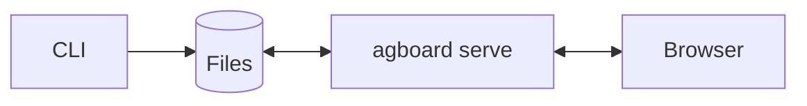

# Developer guide

This chapter explains the architecture, implementation, and verification needed to develop Agent Board. If you only want to use the board, read the [guide](../guide/index.md) instead.

Agent Board is a single Rust program, `agboard`, that is both a CLI and a web server. All data is stored in files; the CLI, direct Markdown edits, and the browser work with the same data:

## How this chapter is organized

| Part | What you will find | Read it when |
| --- | --- | --- |
| [Get started](./getting-started/setup.md) | Set up and run, follow a first change, use Storybook, verify and open a pull request. | You want to build and change something. |
| [Concepts](./concepts/overview.md) | Short pages that explain one idea each: the overall design, tasks and states, history and decisions, saving and recovery, notifications, the server, agents, remote access, and security. | You want to understand how it works before you change it. |
| [Reference](./reference/files.md) | Facts to look up: shared files, the web API, error codes, the JSON that agents receive, remote routes, and the code map. | You know what you are looking for. |
| [Troubleshooting](./troubleshooting.md) | Symptoms, causes, and what to do. | Something fails. |
| [Documentation and images](./docs-and-images.md) | Previewing the site, UI Stories, and regenerating screenshots and videos. | You change `docs/` or the UI. |

## A path for your first day

1. [Set up and run](./getting-started/setup.md): build it and run it against a temporary board.
2. [How Agent Board works](./concepts/overview.md): read the overview and follow one change through the system.
3. [Follow your first change](./getting-started/first-change.md): trace one rule from the CLI to the file and to its test.
4. [Tasks and states](./concepts/tasks-and-states.md), then the concept page of the area you will touch.
5. [Verify and open a pull request](./getting-started/pull-request.md).

## Keeping these pages current

- They describe how Agent Board works **now**. Plans and the history of decisions are kept outside the repository.
- Update them in the same change as the behavior they describe.
- English is the source. The Japanese pages in `docs/ja/dev/` are translations for developers; update them in the same change.
- The repository's `AGENTS.md` indexes these pages for coding agents.
