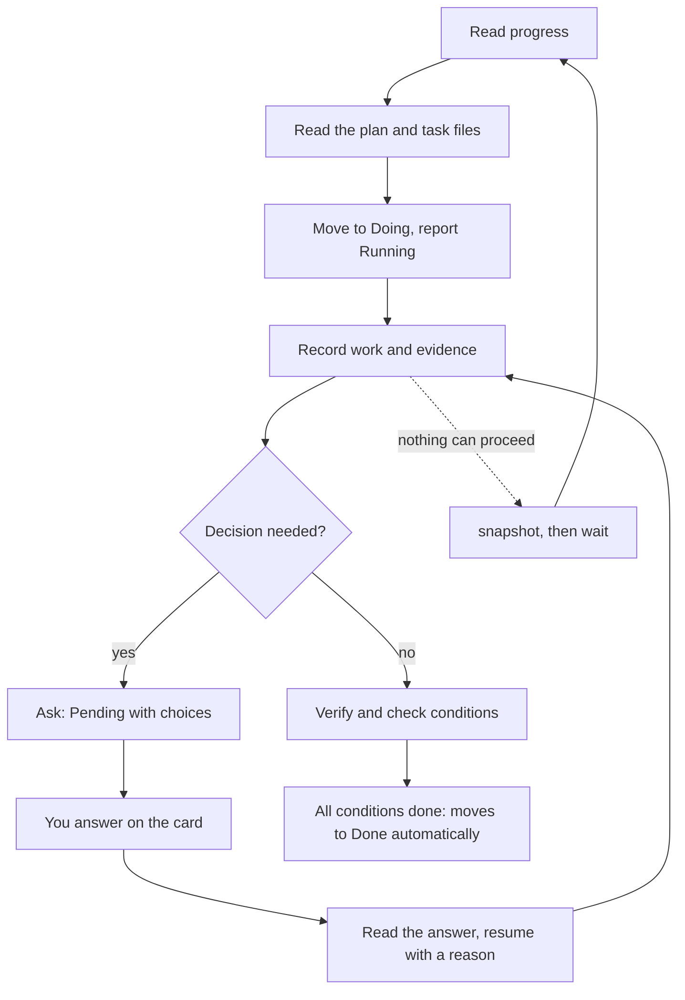

# Working with agents

Agents work from the same board as you. A hook gives them a short progress table, they pick a card, report what they do, ask you when a decision is needed, and wait for the answer.

## Connect your agent

Configure hooks using the [Claude Code and Codex integration guide](https://github.com/FooQoo/agent-board/blob/main/integrations/README.md). The settings templates live in the repository's `integrations/` folder, so this page summarizes the guide instead of copying it.

- **Folder resolution.** Hook templates use a fixed command, `agboard hook --agent claude`, with no project name or session ID. The hook reads `cwd` from its input and resolves the nearest registered ancestor folder; an explicit `--project NAME` overrides the binding. A missing or broken binding returns `AGBOARD_ERROR`; the hook never guesses another project. Register the folder with `agboard project create` or `agboard project bind`.
- **Progress table.** Hooks supply the same concise table as `agboard progress`. Done, archived, and Pending cards are left out. If the table exceeds 256 KiB or cannot be read, the agent gets `AGBOARD_ERROR` and must not make board-dependent changes.
- **Shared files.** Agents may edit only a non-draft card's `TASK.md` and an epic's `PLAN.md`, as the project's `README.md` allows. They never edit `task.json`, `epic.json`, or `project.json`, never delete card or epic folders, and keep machine-specific absolute paths out of shared files. See [Editing and evidence](./editing#edit-shared-markdown-files).
- **Claude Code.** Merge `integrations/claude-code/settings.json` into the project's `.claude/settings.json` and review it in `/hooks`.
- **Codex CLI and Codex App.** Merge `integrations/codex/hooks.json` into the project's `.codex/hooks.json` and review it in `/hooks`.
- **Waiting for an answer.** When no work can proceed, an agent waits with `snapshot` and `wait` (see the loop below).

Hooks and the agent skill run `agboard` from `PATH`, so they use the installed version, not a development build. See [Getting started](./getting-started).

## The work loop



1. Read `agboard progress --json` and select a ready AI-owned card following its epic's saved task order. Read only the selected epic's `PLAN.md` and task's `TASK.md`; use `show` when its history or an active question is needed.
2. Move an AI-owned card to Doing with a reason, then report Running. Review a user-owned card only when it affects the work.
3. Record execution, verification results, and evidence in the shared files. Ask a question through Pending when a decision is needed.
4. After an answer, read the card and history, reconsider the plan, and resume with a reason. Mark acceptance conditions done only after verification; eligible AI cards move to Done automatically when all conditions are complete.
5. If no work can proceed, wait for a change using the cursor from the same project's snapshot.

For how to ask and answer, see [Decisions](./decisions); for the progress table, see [Epics and progress](./epics).

## Wait for changes

```sh
agboard --project "My project" snapshot --json
agboard --project "My project" wait --after "<cursor>" --json
```

A cursor has the format `f1:<project-id>:<version>`. Treat it as the value returned by `snapshot`; do not construct one. `wait` requires a running `agboard serve` in the same data area and listens for changes without polling. It follows the same project ID through a rename; update the name in future commands and hooks.

`wait` resolves the project name once and follows that project. Changes to other projects do not end it. If the project is deleted it fails with `project_not_found`. `wait_timeout`, `board_unavailable`, `cursor_invalid`, and `project_not_found` are errors, not answers. When it returns, read the full snapshot and history, reconsider the user's reason, then resume or ask a follow-up question.

## Drafts and errors

A draft (`isDraft: true`) is read-only for agents: `edit`, `mv`, and `state` fail with `card_is_draft`. Work on other cards until the user finalizes it. On `AGBOARD_ERROR`, a missing project, a technical connection failure, or an unreadable board, report the problem and stop board-dependent changes until a valid progress table is available. A timeout or interruption of a wait does not answer or expire a question.
