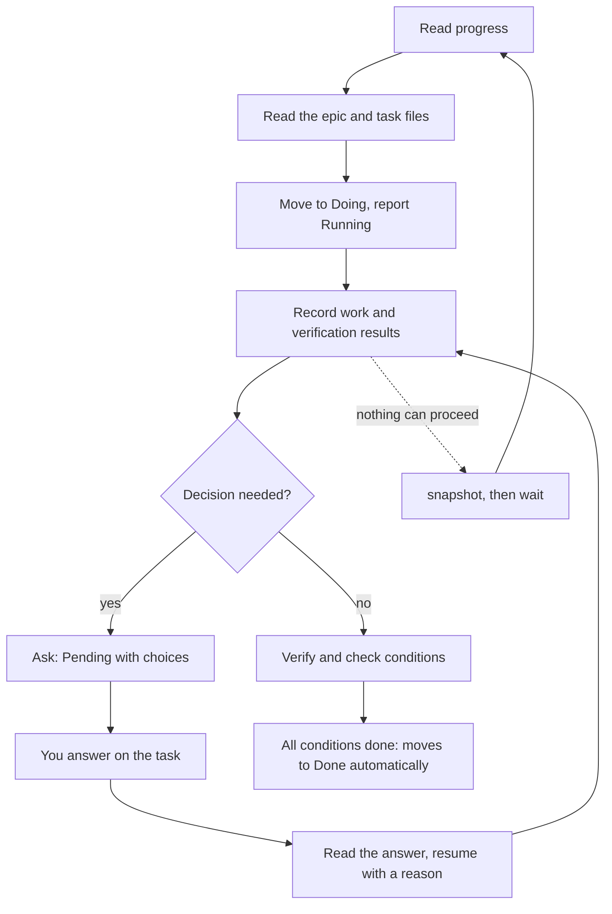

# Working with agents

Agents work from the same board as you. A hook gives them a short progress table, they pick a task, report what they do, ask you when a decision is needed, and wait for the answer. This page shows how to connect an agent and what the loop looks like. You can see the loop by hand in the [Quickstart](../quickstart).

## Connect your agent

Connecting an agent takes three separate steps, all manual:

1. **Prepare the shared folder** so the agent may write there: run `agboard setup` once. It only adds the data folder to your Codex and Claude Code user settings; it installs neither hooks nor the skill. See [Set up the shared folder](../operations/data#set-up-the-shared-folder).
2. **Register the hook** that hands the agent the progress table.
3. **Install the agent skill** (`agent-board`) that tells the agent how to work.

The settings templates for the hooks live in the repository's `integrations/` folder, so follow the [Claude Code and Codex integration guide](https://github.com/FooQoo/agent-board/blob/main/integrations/README.md) instead of copying them here:

- **Claude Code.** Merge `integrations/claude-code/settings.json` into the project's `.claude/settings.json` and review it in `/hooks`.
- **Codex CLI and Codex App.** Merge `integrations/codex/hooks.json` into the project's `.codex/hooks.json` and review it in `/hooks`.

Register the project's folder with `agboard project create` or `agboard project bind` so the hook knows which project it belongs to.

Hooks and the agent skill run `agboard` from your `PATH`, so they use the installed version, not a development build. See [Install and start](../getting-started#update).

### What the hook does

- **Folder resolution.** The hook command is fixed, `agboard hook --agent claude`, with no project name or session ID. It reads `cwd` from its input and uses the nearest registered ancestor folder; an explicit `--project NAME` overrides the binding. A missing or broken binding returns `AGBOARD_ERROR`; the hook never guesses another project.
- **Progress table.** The hook supplies the same concise table as `agboard progress`. Done, archived, and Pending tasks are left out. If the table exceeds 256 KiB or cannot be read, the agent gets `AGBOARD_ERROR` and must not make board-dependent changes.

### What agents may edit

- Agents may edit only a non-draft task's `TASK.md` and an epic's `EPIC.md`, as the project's `README.md` allows.
- `task.json` holds metadata and is changed through the CLI. `TASK.md` holds the body, the acceptance conditions, and the history.
- Task operations add history automatically; agents use `history add` for meaningful progress, and keep plans and concise verification results in the body.
- Agents never edit `epic.json` or `project.json`, never delete task or epic folders, and never put machine-specific absolute paths in shared files.

The format is in [Markdown file format](./file-format).

Agents write history in the same language as the task body. Generated notes from browser operations use your selected screen language. CLI operations and automatic completion use Japanese when the body contains Japanese characters, otherwise English; empty bodies and the default template use the title. Existing history and reasons you entered stay unchanged.

## The work loop



1. **Choose.** Read `agboard progress --json` and select a ready AI-owned task, following its epic's saved task order. Read only the selected epic's `EPIC.md` and the task's `TASK.md`; use `show` when you need its history or an open question.
2. **Start.** Move the task to Doing with a reason, then report Running. Review a user-owned task only when it affects the work.
3. **Work and record.** Record meaningful progress with `history add`, with concise reasons based on actual work and verification. Keep the plan and concise results in the body; attach images when visual proof is useful. Moves and state changes already add history, so do not duplicate them.
4. **Ask when blocked.** Ask a question with Pending when you need a decision (see [Decisions](../use/decisions)).
5. **Resume.** After an answer, read the task and history, reconsider the plan, and resume with a reason.
6. **Finish.** Mark acceptance conditions done only after verifying them. Eligible AI tasks move to Done automatically when all conditions are complete.
7. **Wait.** If no work can proceed, wait for a change (see below).

For the progress table, see [Epics and progress](../use/epics).

After reading an editable AI task, the agent shortens an unclear title to describe the affected area and requested change before starting work. The original request and images stay in the task body and attachments. An already clear title stays as it is. This happens in the agent session, including listener mode; the form still initially uses the request's first non-empty line. Completed tasks are not renamed by the agent.

Agents ask task-related questions only on the board, including clarification and approval. Each request includes choices and waits for your answer by default (`"wait": {}`). Chat may point you to the pending request. If the board is unavailable, the agent reports the problem and waits to ask there.

## Wait for changes

```sh
agboard --project "My project" snapshot --json
agboard --project "My project" wait --after "<cursor>" --json
```

A cursor has the format `f1:<project-id>:<version>`. Use the value that `snapshot` returns; do not construct one.

- `wait` needs a running `agboard serve` in the same data area and listens for changes without polling.
- It follows the same project through a rename, so update the name in future commands and hooks. Changes to other projects do not end it. If the project is deleted, it fails with `project_not_found`.
- `wait_timeout`, `board_unavailable`, `cursor_invalid`, and `project_not_found` are errors, never answers.
- When `wait` returns, read the full snapshot and history, reconsider the user's reason, then resume or ask a follow-up question.

## Listen for the next task

You can keep one already-open Codex or Claude Code session working through AI tasks in one project. Run `agboard serve` against the same data area, then start listening explicitly and choose how many seconds the board must have no eligible task before the command ends:

```sh
agboard --project "My project" wait --until task --idle-timeout 300 --json
```

The timeout is required and must be from 1 to 86,400 seconds; there is no default. A task already in Todo is returned immediately, so tasks created before listening are included. An AI task already in Doing is also eligible when its `agentStatus` is `idle`. Before starting or resuming the listener, inspect AI tasks by `agentStatus`: if any task is `running` or `pending`, resolve that work first. A Doing lane by itself does not block the listener. Each successful call returns one task. Finish or pause that task, then call `wait` again in the same session to take the next one. The selector follows the same order as the progress table: epics sorted by ID, each epic's saved task priority and then task ID, followed by ungrouped tasks by ID. It selects only AI-owned Todo/Doing tasks with `agentStatus: idle` that are non-draft and non-archived. It does not claim or edit the task; read its epic's `EPIC.md` when it has one, its body, attachments, and current state before deciding whether its work is approved and ready to start. Keep ordinary manual task creation available; it creates the same kind of task the listener can later pick up.

Use the [listener procedure in the agent-board skill](https://github.com/FooQoo/agent-board/blob/main/.agents/skills/agent-board/references/listening.md) for the full loop, including pending decisions and recovery after a session is interrupted. A Pending task keeps the same session waiting for the answer; it is not another task to skip to, and its time does not count toward idle timeout. After the answer, read it and resume that task before listening again.

`idle_timeout` is a normal exit with code 0. It says only that no eligible task appeared for the full requested interval. A lost server connection, invalid board data, deleted project, or invalid command is an error; it must not be reported as an empty board. See the [CLI reference](./cli#wait-for-changes-or-a-task) for the output and error codes.

## Drafts and errors

A draft (`isDraft: true`) is read-only for agents: `edit`, `mv`, and `state` fail with `task_is_draft`. Work on other tasks until the user finalizes it.

On `AGBOARD_ERROR`, a missing project, a technical connection failure, or an unreadable board, report the problem and stop board-dependent changes until a valid progress table is available. A timeout or an interrupted wait does not answer or expire a question. For causes and fixes, see [Troubleshooting](../operations/troubleshooting).

## Next

- [CLI reference](./cli): every command an agent uses.
- [Decisions](../use/decisions): how agents ask, and how you answer.
