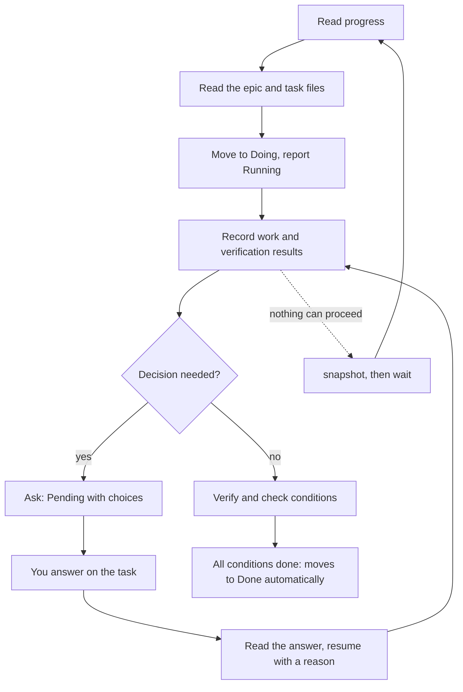

# Working with agents

Agents work from the same board as you. A hook gives them a short progress table, they pick a task, report what they do, ask you when a decision is needed, and wait for the answer. This page shows how to connect an agent and what the loop looks like. You can see the loop by hand in the [Quickstart](../quickstart).

## Connect your agent

Run `agboard connect` in the folder you bound to a project (see [Install and start](../getting-started#create-or-bind-a-project)). It installs the **Skill** (`agent-board`, which tells the agent how to work) and the **Hook** (which hands the agent the progress table) for Claude Code, Codex, or both. `connect` and `update` are in [public preview](../feature-stages#connect-and-update).

```sh
cd my-project
agboard connect
```

`connect` needs a terminal. It shows the project and the bound root first, then asks, in this order:

1. **Agents.** It looks for `claude` and `codex` on your `PATH` and lists them with their versions. An agent it cannot find is shown with the reason and cannot be chosen. Type the numbers of the agents to connect, `a` for all that are available, or `q` to cancel.
2. **Skill scope.** One choice, Global or Project, for every agent you selected.
3. **Hook scope.** One choice, Global or Project, for every agent you selected. It is separate from the Skill scope.
4. **Confirmation.** It lists every file it will add, change, or remove, the permission it will add, and the backups, then asks `[y/N]`. Anything but `y` or `yes`, and Ctrl+C or the end of input, cancels without writing.

Skill scope and Hook scope are independent. A rerun offers what you chose before.

### Choose scopes

The scope decides where the files go and which folders they cover. `<bound-root>` is the root of the nearest binding, even when you run `connect` in a subfolder.

| Agent | Component | Global | Project |
| --- | --- | --- | --- |
| Claude Code | Skill | `~/.claude/skills/agent-board/` | `<bound-root>/.claude/skills/agent-board/` |
| Claude Code | Hook | `~/.claude/settings.json` | `<bound-root>/.claude/settings.json` |
| Codex | Skill | `~/.agents/skills/agent-board/` | `<bound-root>/.agents/skills/agent-board/` |
| Codex | Hook | `~/.codex/hooks.json` | `<bound-root>/.codex/hooks.json` |

- **Global** works in every folder. The Claude Code Global paths follow `CLAUDE_CONFIG_DIR` when it is set, and the Codex Hook follows `CODEX_HOME`. The Codex Skill is always under `~/.agents/skills`.
- **Project** works only in that project's folders and writes files you may want to commit or ignore.
- A Global Hook also runs in folders with no project. There it prints nothing and exits normally, so the agent keeps working. Only a folder bound to a project gets the progress table.
- The data folder permission is separate from both scopes. `connect` adds the data folder to Claude Code's `permissions.additionalDirectories` and to Codex's `sandbox_workspace_write.writable_roots`, the same change as `agboard setup`. If Codex is not set to `sandbox_mode = "workspace-write"`, or uses a permission profile, `connect` changes nothing for Codex, shows the manual steps, and finishes with exit code 1. Claude Code is still configured. Make the change yourself in Codex's `config.toml`, then run `connect` again.

### Trust hooks

Writing the files does not mean the agent has loaded them. After `connect` reports **configured**, start a new Claude Code session, or restart Codex, and review the Hook with `/hooks` before you trust it. A Hook you have not trusted does not run. The same applies after `agboard update` changes a Hook.

### Conflicts, backups, and what stays yours

- **Your files are kept.** `connect` merges only its own entries into the settings and adds no duplicate. A rerun with nothing to change writes nothing and makes no backup.
- **Backups.** Before it changes an existing file or Skill folder, `connect` copies it next to the original as `<name>.agboard-backup-<id>-<n>`. The copy stays. It holds your original settings, so keep it out of shared folders.
- **Moving a scope.** If you choose another scope, `connect` shows the removal of its own entries from the old place and the addition in the new one, and moves them together for that agent.
- **Duplicates.** If an equivalent Hook was registered by hand, or an `agboard` command it cannot identify is in a settings file, `connect` stops for that agent and names the file. Remove or tidy that registration yourself, then run `connect` again. `connect` only looks at the Global files, the bound root and its parent folders, and the folders it recorded earlier; it does not search your disk. A Skill of the same name elsewhere produces a warning, because the agent may load that one instead.
- **Edited files.** If you edited a file `connect` installed, or added a file to its Skill folder, `connect` and `update` report a conflict and leave the files as they are.
- **Failure.** Each agent is applied on its own, Claude Code first. If one fails, its files return to how they were, and the agent that succeeded stays configured. A run that was cut off is undone by the next `connect` or `update`; if it cannot be undone safely, the command stops and names the backup files. See [Troubleshooting](../operations/troubleshooting#connect-or-update-reports-a-problem).

If the folder is not bound, `connect` prints how to create or bind a project and exits with code 1. Exit codes: `0` for success, nothing to change, or a cancel; `1` when an agent could not be configured or the folder is not bound; `2` for a bad command line, or when there is no terminal.

### Refresh the integrations

After `brew upgrade fooqoo/tap/agboard`, bring the installed Skill and Hook up to the new version:

```sh
agboard update
agboard update --yes
```

`update` handles the agents, Skill scope, and Hook scope that `connect` recorded: the Global installations, and the Project installations of the nearest bound root. It works from a folder with no project, but then updates only the Global ones. It does not look at other projects. It shows the old and new version of each part and asks `[y/N]`. `--yes` skips only that question. It never adds an agent or a permission and never changes a scope; use `connect` for that.

- With nothing recorded it says `No managed integrations found. Run agboard connect in a bound project.` and exits with `0`. With everything current it writes nothing.
- When the Hook changes, you must trust the changed Hook again in the agent (`/hooks`).
- A conflict (see above) stops the update of that agent, even with `--yes`. The other agent is still updated, and the exit code is `1`.
- Exit codes: `0` for success, nothing to update, or a cancel; `1` for a failure, a conflict, or a partial failure; `2` for a bad command line, or no terminal without `--yes`. `--json` and `--dry-run` are refused.
- It never installs an older version over a newer one.

Ordinary commands remind you. When the installed Skill or Hook is older than your command, a command you run in a terminal prints one line to the error output after its normal output:

```text
Agent Board 1.0.0 is newer than the installed Skill and Hook (0.9.0). Run "agboard update" to update them.
```

The line never appears with `--json`, in a pipe, in hooks, in `wait`, `serve`, `connect`, or `update`, and it never changes a command's result.

### What the hook does

- **Folder resolution.** The hook command is fixed, `agboard hook --agent claude`, with no project name or session ID. It reads `cwd` from its input and uses the nearest registered ancestor folder; an explicit `--project NAME` overrides the binding. A folder with no binding at all is not an error: the hook prints nothing and exits normally, so a Global Hook does not disturb work in other folders. A broken binding, a bound project that was deleted, or an unreadable `cwd` returns `AGBOARD_ERROR`; the hook never guesses another project.
- **Progress table.** The hook supplies the same concise table as `agboard progress`. Done, archived, and Pending tasks are left out unless you add `--include-pending` or `--include-done COUNT` to the hook command (see [Epics and progress](../use/epics)). If the table exceeds 256 KiB or cannot be read, the agent gets `AGBOARD_ERROR` and must not make board-dependent changes.

### What agents may edit

- Agents may edit only a non-draft task's `TASK.md` and an epic's `EPIC.md`, as the project's `README.md` allows.
- `task.json` holds metadata and is changed through the CLI. `TASK.md` holds the body, the acceptance conditions, and the history.
- Task operations add history automatically; agents use `history add` for meaningful progress, and keep plans and concise verification results in the body.
- Agents never edit `epic.json` or `project.json`, never delete task or epic folders, and never put machine-specific absolute paths in shared files.

The format is in [Markdown file format](./file-format).

Agents write history in the same language as the task body. Generated notes from browser operations use your selected screen language. CLI operations and automatic completion use Japanese when the body contains Japanese characters, otherwise English; empty bodies and the default template use the title. Existing history and reasons you entered stay unchanged.

## The work loop



1. **Choose.** Read `agboard progress --json` and select a ready AI-owned task, following its epic's saved task order. Read only the selected epic's `EPIC.md` and the task's `TASK.md`; use `show` when you need its history or an open question.
2. **Start.** Move the task to Doing with a reason, then report Running. Review a user-owned task only when it affects the work.
3. **Work and record.** Record meaningful progress with `history add`, with concise reasons based on actual work and verification. Keep the plan and concise results in the body; attach images when visual proof is useful. Moves and state changes already add history, so do not duplicate them.
4. **Ask when blocked.** Ask a question with Pending when you need a decision (see [Decisions](../use/decisions)).
5. **Resume.** After an answer, read the task and history, reconsider the plan, and resume with a reason.
6. **Finish.** Mark acceptance conditions done only after verifying them. Eligible AI tasks move to Done automatically when all conditions are complete.
7. **Wait.** If no work can proceed, wait for a change (see below).

For the progress table, see [Epics and progress](../use/epics).

After reading an editable AI task, the agent shortens an unclear title to describe the affected area and requested change before starting work. The original request and images stay in the task body and attachments. An already clear title stays as it is. This happens in the agent session, including listener mode; the form still initially uses the request's first non-empty line. Completed tasks are not renamed by the agent.

Agents ask task-related questions only on the board, including clarification and approval. Each request includes choices and waits for your answer by default. The agent uses `--no-wait` only when you explicitly ask it to register the question and return immediately. Chat may point you to the pending request. If the board is unavailable, the agent reports the problem and waits to ask there.

## Wait for changes

```sh
agboard --project "My project" snapshot --json
agboard --project "My project" wait --after "<cursor>" --json
```

A cursor has the format `f1:<project-id>:<version>`. Use the value that `snapshot` returns; do not construct one.

- `wait` needs a running `agboard serve` in the same data area and listens for changes without polling.
- It follows the same project through a rename, so update the name in future commands and hooks. Changes to other projects do not end it. If the project is deleted, it fails with `project_not_found`.
- `wait_timeout`, `board_unavailable`, `cursor_invalid`, and `project_not_found` are errors, never answers.
- When `wait` returns, read the full snapshot and history, reconsider the user's reason, then resume or ask a follow-up question.

## Listen for the next task

You can keep one already-open Codex or Claude Code session working through AI tasks in one project. Run `agboard serve` against the same data area, then start listening explicitly and choose how many seconds the board must have no eligible task before the command ends:

```sh
agboard --project "My project" wait --until task --idle-timeout 300 --json
```

The timeout is required and must be from 1 to 86,400 seconds; there is no default. A task already in Todo is returned immediately, so tasks created before listening are included. An AI task already in Doing is also eligible when its `agentStatus` is `idle`. Before starting or resuming the listener, inspect AI tasks by `agentStatus`: if any task is `running` or `pending`, resolve that work first. A Doing lane by itself does not block the listener. Each successful call returns one task. Finish or pause that task, then call `wait` again in the same session to take the next one. The selector follows the same order as the progress table: epics sorted by ID, each epic's saved task priority and then task ID, followed by ungrouped tasks by ID. It selects only AI-owned Todo/Doing tasks with `agentStatus: idle` that are non-draft and non-archived. It does not claim or edit the task; read its epic's `EPIC.md` when it has one, its body, attachments, and current state before deciding whether its work is approved and ready to start. Keep ordinary manual task creation available; it creates the same kind of task the listener can later pick up.

Use the [listener procedure in the agent-board skill](https://github.com/FooQoo/agent-board/blob/main/.agents/skills/agent-board/references/listening.md) for the full loop, including pending decisions and recovery after a session is interrupted. A Pending task keeps the same session waiting for the answer; it is not another task to skip to, and its time does not count toward idle timeout. After the answer, read it and resume that task before listening again.

`idle_timeout` is a normal exit with code 0. It says only that no eligible task appeared for the full requested interval. A lost server connection, invalid board data, deleted project, or invalid command is an error; it must not be reported as an empty board. See the [CLI reference](./cli#wait-for-changes-or-a-task) for the output and error codes.

## Drafts and errors

A draft (`isDraft: true`) is read-only for agents: `edit`, `mv`, and `state` fail with `task_is_draft`. Work on other tasks until the user finalizes it.

On `AGBOARD_ERROR`, a missing project, a technical connection failure, or an unreadable board, report the problem and stop board-dependent changes until a valid progress table is available. A timeout or an interrupted wait does not answer or expire a question. For causes and fixes, see [Troubleshooting](../operations/troubleshooting).

## Next

- [CLI reference](./cli): every command an agent uses.
- [Decisions](../use/decisions): how agents ask, and how you answer.
