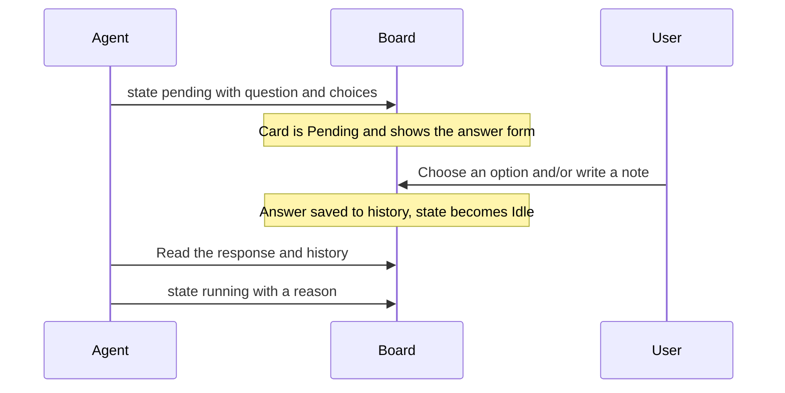

# Decisions

## Answer in the browser

Todo and Doing cards with a current Pending request show the question and answer form on the card. Choose one of the offered options, write a note, or do both, then submit the answer. On the PC board, the card heading still opens its details and the card can still be dragged while the answer form is in use. Moving the card to Done clears the answer input. The answer is recorded and the agent state becomes Idle in its current lane; the agent reads the response before deciding how to resume.

{.screenshot}

The card shows the question, the options, and a text field for a note. Your answer remains available to the agent, and a concise reason is saved to history.

A Pending question has no expiry. It remains available until it is answered or the request is withdrawn or changed. The CLI `wait.timeoutSeconds` option limits that wait command only; it does not expire the question.

## Answer on your phone

On the mobile monitor, tap the card to open its Body, Conditions, History, and Epic drawer; swipe horizontally to switch tabs. See the [mobile monitor](./mobile-monitor) page for connecting a phone.

{.screenshot .screenshot--narrow}

## Ask and answer decisions



An AI-owned card must be in Doing to become Running. It can ask a Pending question in either Todo or Doing. A question for the user always has choices: pass the question and two to ten options as JSON with `--request-json`, either inline or from standard input with `-`:

```json
{
  "question": "Which launch approach should we use?",
  "choices": [
    { "id": "preview", "label": "Publish a preview first" },
    { "id": "public", "label": "Launch publicly" }
  ]
}
```

Send it inline:

```sh
agboard --project "My project" state 1 pending --actor ai --request-json '{"question":"Which launch approach should we use?","choices":[{"id":"preview","label":"Publish a preview first"},{"id":"public","label":"Launch publicly"}]}'
```

Or read it from standard input:

```sh
cat question.json | agboard --project "My project" state 1 pending --actor ai --request-json -
```

Add a `wait` object to the JSON to ask and wait for the answer in one command. It needs a running `agboard serve`. An empty object waits indefinitely and prints the answer (the choice, the note, and the card) once the request is answered:

```json
{
  "question": "Which launch approach should we use?",
  "choices": [
    { "id": "preview", "label": "Publish a preview first" },
    { "id": "public", "label": "Launch publicly" }
  ],
  "wait": {}
}
```

You may add `"timeoutSeconds": 600` to limit this wait command; the value must be from 1 to 86,400 (a day). Without `wait`, the command asks and returns. A timeout or Ctrl+C stops waiting but leaves the request Pending. A lost server connection returns `board_unavailable`, a technical error that also leaves the request Pending. If a card move withdraws the question, the command exits with `request_changed`. Without a running server, nothing is asked.

`choices` takes 2 to 10 options; a request with fewer or more is refused, and so is a pending state without `--request-json`. The request gets an ID; read the current request in `show` or `snapshot`. A user can answer in the browser, or pass that request ID to the CLI:

```sh
agboard --project "My project" state 1 idle --actor human --request "<request-id>" --choice preview --reason "Get feedback before the public launch"
```

The user can supply a choice, a note with `--reason`, or both. After reading the full response and history, the agent can resume:

```sh
agboard --project "My project" state 1 running --actor ai --reason "Preparing the preview requested by the user"
```
