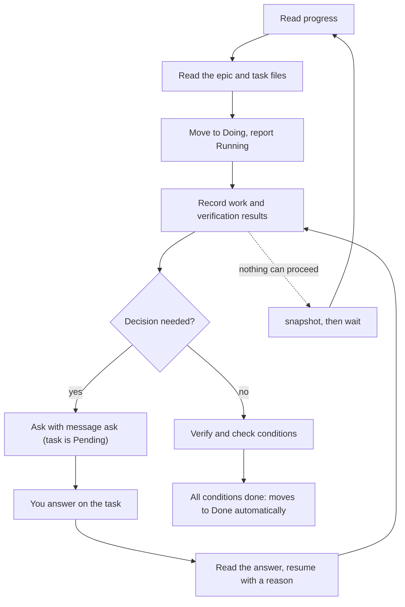

# Working with agents

This is how you hand work to an agent. You ask in the chat; the agent turns the request into a plan of AI drafts on the board, asks what it cannot settle, starts the plan once you have answered, and works through the tasks, stopping for you only when it must. A hook gives the agent a short progress table, and it reports what it does, asks when a decision is yours, and waits for the answer. This page shows how to set up an agent and what the work loop and the delegation flow look like. You can walk through the flow once in the [Quickstart](../quickstart), and the ideas behind it are in [The work model](../work-model).

## Set up your agents {#set-up-your-agents}

Run `agboard setup` once on your computer. It installs the **Agent Board plugin** for Claude Code, Codex, or both. The plugin holds the **Skill** (`agent-board`, which tells the agent how to work) and the **Hook** (which hands the agent the progress table).

```sh
agboard setup
```

`setup` works in any folder and needs no project. On a terminal it goes like this:

1. **Agents.** It looks for `codex` and `claude` on your `PATH`. An agent it cannot find is named with the reason. When it finds both, choose **Codex**, **Claude Code**, or **Both** with the arrow keys and Enter. When it finds one, it uses that one.
2. **Plan.** It shows, for each agent, how the plugin will be installed or updated, every settings file it will change, whether the Codex hooks will be trusted, and any step you have to take yourself.
3. **Confirmation.** It asks **Apply these changes?** When Codex is in the plan, the question also says that the Agent Board hooks will be marked as trusted in Codex. Press `y` to go on. Any other answer, Esc, or Ctrl+C changes nothing.

4. **Remote access (optional).** After the plugin is installed, it asks whether to set up the ngrok connection for your phone now; the default is no. If you answer yes, it shows what is saved and asks for the fixed domain and the ngrok token, which you type hidden. Each question can be skipped. This is the same step as [`agboard setup remote`](../reference/cli#save-the-remote-access-settings), which you can also run later.

After the run, start a new agent session to load the plugin. Then create or bind a project in your working folder (see [Install and start](../getting-started#create-or-bind-a-project)).

Without a terminal, or with `--json`, `setup` asks nothing. Name the agent with `--agent codex`, `--agent claude`, or `--agent all`, and add `--yes` to agree in advance or `--dry-run` to see the plan. `--dry-run` installs, creates, and changes nothing. The remote access step is skipped in these runs.

### What setup changes

- **The data folder.** It creates the data folder and its `shared` folder (see [Data and backups](../operations/data)).
- **The plugin.** It installs the plugin with the agent's own plugin command. The marketplace is the Agent Board repository at the tag of your `agboard` version, so the plugin always matches the command. Codex runs `codex plugin marketplace add https://github.com/FooQoo/agent-board.git --ref vX.Y.Z` and `codex plugin add agent-board@agent-board`. Claude Code runs `claude plugin marketplace add https://github.com/FooQoo/agent-board.git#vX.Y.Z` and `claude plugin install agent-board@agent-board`. When the plugin of this version is installed already, nothing is installed.
- **Access to the shared folder.** For Claude Code it adds the data folder to `permissions.additionalDirectories` in `~/.claude/settings.json`. For Codex it adds it to `sandbox_workspace_write.writable_roots` in `~/.codex/config.toml`. This works only with `sandbox_mode = "workspace-write"`. With any other mode, or a permission profile, setup leaves the file as it is and shows the step to take yourself; it never changes the sandbox mode. With `danger-full-access` nothing is needed, so nothing is written.
- **The agboard command in Codex.** It writes `~/.codex/rules/agboard.rules`, which lets Codex run `agboard` without asking each time: `prefix_rule(pattern=["agboard"], decision="allow")`. A file you already have is kept as it is. It is not written for `danger-full-access`.
- **Codex hook trust.** Codex runs a plugin's hook only after you trust it. With your consent, setup trusts the Agent Board hooks through Codex itself. Other hooks are not touched.

`CLAUDE_CONFIG_DIR` and `CODEX_HOME` move the Claude Code and Codex paths. Before it changes a settings file, setup copies it next to the original as `<name>.agboard-backup…`. It keeps your other settings and comments. If a settings file cannot be read, nothing is written and the file is named.

Exit codes: `0` for success, nothing to change, or a cancel; `1` when an agent failed or no agent could be set up; `2` for a bad command line, or when the needed options are missing without a terminal. An agent whose command is missing is skipped with the reason, and the other agent is still set up.

### Trust hooks

Writing the files does not mean the agent has loaded them. Start a new Claude Code session, or restart Codex, after setup. In Claude Code, review the Hook with `/hooks`. In Codex, setup has trusted the Agent Board hooks when you agreed; you can review them with `/hooks`.

### Update the plugin {#update-the-plugin}

After `brew upgrade fooqoo/tap/agboard`, the plugin updates itself. When a new agent session starts, the Hook compares the plugin the agent runs with the one your `agboard` ships. If they differ, it reinstalls the plugin from the tag of your `agboard` version in the background, and the agent tells you so; the new plugin applies from the next session. Nothing is asked. For Codex, the update also marks the Agent Board hooks as trusted, but only when the hook definition it installed is exactly the one your `agboard` ships; your consent in `agboard setup` covers trusting Agent Board's own hook. A changed or unknown definition is never trusted. This is the same reinstall that `agboard update` does, so you can also run it yourself, which is needed in these cases:

- **Codex, when the hook definition is not the one `agboard` ships.** Codex runs a plugin's hooks only after they are trusted, and the trust is tied to the hook definition. The definition rarely changes, and the automatic update trusts only the definition `agboard` ships. If the installed one differs, nothing is trusted and the agent tells you: run `agboard update` once (it asks the same question as `setup`).
- **The automatic update could not finish.** The agent then tells you that it did not complete (for example, no network to GitHub). The update is not tried again for six hours; run `agboard update` to try now.
- **The plugin is broken or was changed by hand.** `agboard update` always reinstalls it.

To turn the automatic update off, set `AGBOARD_NO_PLUGIN_AUTO_UPDATE=1` in the environment of the agent.

```sh
agboard update
agboard update --yes
```

`update` handles every agent that has the plugin; `--agent` limits it to one. It moves the marketplace to the tag of the new version, installs the new plugin, and trusts the new Codex hooks again. It shows the plan and asks the same way `setup` does; `--yes` answers in advance and `--dry-run` shows the plan only. It changes no settings file. An agent without the plugin is skipped with a note to run `agboard setup`.


### What the hook does

- **Folder resolution.** The hook command is fixed, `agboard hook --agent claude`, with no project name or session ID. It reads `cwd` from its input and uses the nearest registered ancestor folder; an explicit `--project NAME` overrides the binding. A folder with no binding at all is not an error: the hook prints nothing and exits normally, so the Hook does not disturb work in other folders. A broken binding, a bound project that was deleted, or an unreadable `cwd` returns `AGBOARD_ERROR`; the hook never guesses another project.
- **Progress table.** The hook supplies the same concise table as `agboard progress`. Done, archived, and Pending tasks are left out unless you add `--include-pending` or `--include-done COUNT` to the hook command (see [Epics and progress](../watch/epics)). If the table exceeds 256 KiB or cannot be read, the agent gets `AGBOARD_ERROR` and must not make board-dependent changes.

### What agents may edit

- Agents may edit only a non-draft task's `TASK.md` and an epic's `EPIC.md`, as the project's `README.md` allows.
- `task.json` holds metadata and is changed through the CLI. `TASK.md` holds the body, the acceptance conditions, and the history.
- Task operations add history automatically; agents use `history add` for meaningful progress, and keep plans and concise verification results in the body.
- Agents never edit `epic.json` or `project.json`, never delete task or epic folders, and never put machine-specific absolute paths in shared files.

The format is in [Markdown file format](../reference/file-format).

Agents write history in the same language as the task body. Generated notes from browser operations use your selected screen language. CLI operations and automatic completion use Japanese when the body contains Japanese characters, otherwise English; empty bodies and the default template use the title. Existing history and reasons you entered stay unchanged.

## The work loop



1. **Choose.** Read `agboard progress --json` and select a ready AI-owned task, following its epic's saved task order. Read only the selected epic's `EPIC.md` and the task's `TASK.md`; use `show` when you need its history or an open question.
2. **Start.** Move the task to Doing with a reason, then report Running. Review a user-owned task only when it affects the work.
3. **Work and record.** Record meaningful progress with `history add`, with concise reasons based on actual work and verification. Keep the plan and concise results in the body; attach images when visual proof is useful. Moves and state changes already add history, so do not duplicate them.
4. **Ask when blocked.** Ask with `message ask` when you need a decision; the task shows Pending until you answer (see [Decisions](./decisions)).
5. **Resume.** After an answer, read the task and history, reconsider the plan, and resume with a reason.
6. **Finish.** Mark acceptance conditions done only after verifying them. Eligible AI tasks move to Done automatically when all conditions are complete.
7. **Wait.** If no work can proceed, wait for a change (see below).

For the progress table, see [Epics and progress](../watch/epics).

After reading an editable AI task, the agent shortens an unclear title to describe the affected area and requested change before starting work. The original request and images stay in the task body and attachments. An already clear title stays as it is. This happens in the agent session, including listener mode; the form still initially uses the request's first non-empty line. Completed tasks are not renamed by the agent.

### Break a request into tasks

When you ask an agent for work that is more than one task, it puts a plan of AI drafts on the board right away, without asking first: an epic with its goal, scope, and completion conditions, and the tasks in the order they will be done. Everything an agent creates is an AI draft, so nothing starts until the draft is started (see [Drafts and errors](#drafts-and-errors)). The tasks show as ordinary Todo cards with a **Draft** badge, and you can open them and read the plan while the agent asks about it.

1. **Questions about the plan.** The agent asks what it cannot settle itself, as ordinary questions with choices and a recommendation. A task that refers to an open question shows **Pending** until you answer.
2. **Revisions.** The agent changes the epic and the tasks as your answers say, and asks more questions if something is still open.
3. **Start.** Once your questions are answered and the agent has written the plan up, it starts the plan itself with `agboard epic start <EPIC-ID> --actor ai` for the epic and all its drafts, or `agboard start <id> --actor ai` for one task. You do not approve the start, and a person can run the same commands with `--actor human`. An open question on one of the tasks refuses the start (`start_blocked_by_questions`), so the agent waits for the answer first. The history records "The agent wrote the plan up and started the task."
4. **Work.** After the start, the agent works through the tasks in the epic's order without asking each time.

After the start, the agent calls you only when:

- your intent is unclear and the reading changes the result;
- your preference decides it, such as the look, the wording, or what comes first;
- an action cannot be undone, such as deleting, publishing, or sending something outside;
- the work turns out bigger than you asked for.

It decides everything else itself and records each decision in the task's history. While it waits for you, it can still work on parts that do not depend on the answer.

A task you put on the board yourself is not a draft and needs no start.

### Questions

Every question an agent asks is on the board, with choices, so that the record stays in one place. While you are talking with the agent, it also writes the same question in the chat as plain text, with its choices and its recommendation, and says that the question is on the board. It does not open a question dialog of its own, because that would keep the agent from noticing an answer you give on the board. Answer wherever is easier:

- **In the chat.** Reply in your own words. The agent records them on the board as your answer with `message answer --via chat` and continues. It never answers a question itself.
- **On the board or your phone.** See [Decisions](./decisions).

Whichever answer is recorded first is the one that counts, and the agent does not ask the same question again in the other place. If you answer on the board and then differently in the chat, the agent tells you which answer was recorded and continues with it.

The agent keeps `message ask` running until every question is answered, up to 10 minutes at a time, and after a timeout waits again for the same questions. The two agents differ in how they wait:

- **Claude Code** waits in the background and ends its turn. An answer on the board finishes the wait and wakes the agent, so it continues without a message from you. If you reply in the chat instead, the agent records your reply and continues.
- **Codex** waits in the foreground after writing the question in the chat. Answer on the board, or interrupt the agent and reply in the chat; it then records your reply.

The agent writes its chat replies in the language you use with it. When nobody is in the conversation, such as while it listens for tasks, the agent asks only on the board.

The agent uses `--no-wait` only when you explicitly ask it to register a question and return immediately. If the board is unavailable, it reports the problem and waits to ask there.

## Wait for changes

```sh
agboard --project "My project" snapshot --json
agboard --project "My project" wait --after "<cursor>" --json
```

A cursor has the format `f1:<project-id>:<version>`. Use the value that `snapshot` returns; do not construct one.

- `wait` needs the server of the same data area. It starts one in the background when none runs, then listens for changes without polling.
- A server started in the background, by `wait`, a question that waits, or the hook, opens the project's board in your browser once, unless a board tab is already connected. See [Open the board in the browser](../reference/cli#open-the-board-in-the-browser) for when it does not, and for `agboard open`.
- It follows the same project through a rename, so update the name in future commands and hooks. Changes to other projects do not end it. If the project is deleted, it fails with `project_not_found`.
- `wait_timeout`, `board_unavailable`, `cursor_invalid`, and `project_not_found` are errors, never answers.
- When `wait` returns, read the full snapshot and history, reconsider the user's reason, then resume or ask a follow-up question.

## Listen for the next task

You can keep one already-open Codex or Claude Code session working through AI tasks in one project. Start listening explicitly (the command starts the server of the same data area if none runs) and choose how many seconds the board must have no eligible task before the command ends:

```sh
agboard --project "My project" wait --until task --idle-timeout 300 --json
```

The timeout is required and must be from 1 to 86,400 seconds; there is no default. A task already in Todo is returned immediately, so tasks created before listening are included. An AI task already in Doing is also eligible when its `agentStatus` is `idle`. Before starting or resuming the listener, inspect AI tasks by `agentStatus`: if any task is `running` or `pending`, resolve that work first. A Doing lane by itself does not block the listener. Each successful call returns one task. Finish or pause that task, then call `wait` again in the same session to take the next one. The selector follows the same order as the progress table: epics sorted by ID, each epic's saved task priority and then task ID, followed by ungrouped tasks by ID. It selects only AI-owned Todo/Doing tasks with `agentStatus: idle` that are non-draft and non-archived. It does not claim or edit the task; read its epic's `EPIC.md` when it has one, its body, attachments, and current state before deciding whether its work is approved and ready to start. A task created with `agboard add` is the same kind of task, and the listener can pick it up later.

Use the listener procedure of the agent-board skill (printed by `agboard skills listening`) for the full loop, including pending decisions and recovery after a session is interrupted. A Pending task keeps the same session waiting for the answer; it is not another task to skip to, and its time does not count toward idle timeout. After the answer, read it and resume that task before listening again.

To keep a session on the board without typing the command, invoke the plugin's `wait` skill (`/agent-board:wait` in Claude Code). It follows the listener procedure with a 3600-second idle timeout when you give none, and starts the wait again after each `idle_timeout`, so the session stays attached until you interrupt it or an error stops it. It handles answers and requests before tasks.

`idle_timeout` is a normal exit with code 0. It says only that no eligible task appeared for the full requested interval. A lost server connection, invalid board data, deleted project, or invalid command is an error; it must not be reported as an empty board. See the [CLI reference](../reference/cli#wait-for-changes-or-a-task) for the output and error codes.

## Sessions the board starts {#sessions-the-board-starts}

Instead of starting an agent yourself, the board can start a headless Claude Code or Codex session in a project's folder. The session stays attached to the board and works on what you hand it. The board sends it your requests, the answers to its questions, and ready tasks, one at a time and only when the session is idle, so there is no `wait` command to run or keep alive. A session you started yourself in a terminal still waits on the board with `agboard wait`. The board keeps at most one such session in total, whichever tool or project, and the session needs the `claude` or `codex` command on the `PATH` of the server and a login in that tool.

> **Warning: nobody watches a session the board starts, and its approvals are automatic.** Claude Code runs in auto mode: a reviewer checks each action, and anything that would ask you is refused instead. Codex runs in its workspace-write sandbox with automatic review, and the board's data folder is added as writable so the agent can use `agboard`. Neither stops to ask you. Automatic review can approve actions you would not, and a mistaken instruction, for example one in a task or a web page the agent reads, can still do harm. Start sessions only in projects you trust, and stop one from the board when you are done. When the board server stops, it stops the sessions it started.

Only the board on your own computer can start or stop these sessions. The phone connection cannot. The agent's output is written to `resident/<tool>.log` in the data folder.

## Drafts and errors

A draft a person is writing (`draft: "human"`) is read-only for agents: `edit`, `mv`, `state`, and `history add` fail with `task_is_draft`. Work on other tasks until the user finalizes it.

Every task and epic an agent creates is an AI draft (`draft: "ai"`), also when it is for the user. An agent can still edit it and add history, but `mv` and `state` fail with `task_is_draft` until the draft is started: `agboard start <id> --actor ai` for one task, or `agboard epic start <EPIC-ID> --actor ai` for an epic and all its AI drafts. The agent starts its own drafts after its questions are answered and the plan is written up. While a question about the draft is open, the start fails with `start_blocked_by_questions`. A person can run the same commands with `--actor human`.

On `AGBOARD_ERROR`, a missing project, a technical connection failure, or an unreadable board, report the problem and stop board-dependent changes until a valid progress table is available. A timeout or an interrupted wait does not answer or expire a question. For causes and fixes, see [Troubleshooting](../operations/troubleshooting).

## Next

- [CLI reference](../reference/cli): every command an agent uses.
- [Decisions](./decisions): how agents ask, and how you answer.
