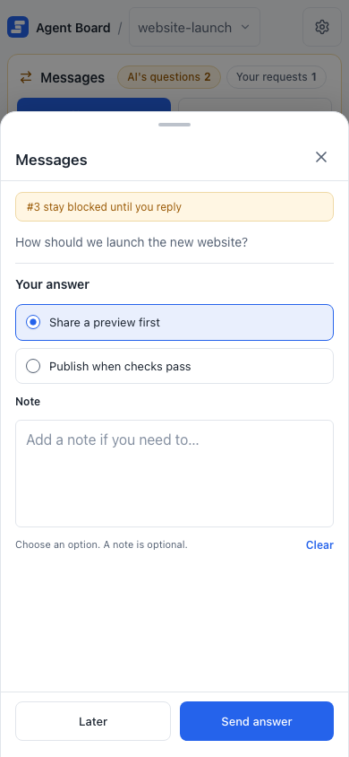
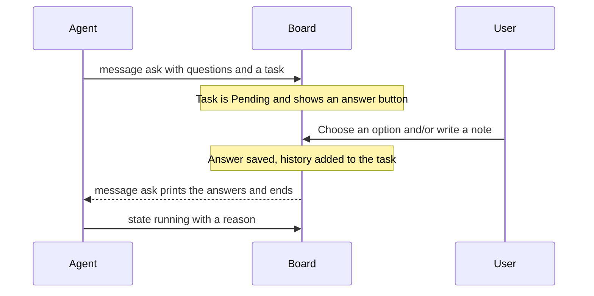

# Decisions

A decision is a question an agent asks when it cannot continue without you. It is the place where you step in when asked: the agent stops and waits, and your answer lets it resume. This page shows how you answer on the PC and on your phone, and how an agent asks. For the idea in two sentences, see [The work model](../work-model#decisions). To step in without being asked, see [The board](../watch/board).

## How you notice a question

A question belongs to the project, and a task refers to it. An AI-owned task that refers to an open question is **Pending**. In Todo or Doing, its card says how many questions it waits on, such as **Unanswered questions: 2**, and shows an **Answer the question** button. You can also see Pending tasks on the [remote access](../watch/remote-access).

Every open message of the project is counted in the **Messages** band above the lanes. The band is always there. It shows two counts:

- **AI's questions** is the number of questions that wait on you.
- **Your requests** is the number of requests you sent that no agent has picked up yet.

Select a count to open the list on its tab: **AI's questions** opens the tab of questions, and **Your requests** opens the tab of requests. With nothing open, the counts are 0. Select **Questions & requests** to read the messages, starting on **AI's questions**.

## The list of messages

**Questions & requests** opens the list of messages as a modal on the PC. It has three tabs, **AI's questions**, **Your requests**, and **Summary**, each with its count (see [Summary](#summary)). You can also swipe or drag the list sideways to switch between them; the selected tab follows the movement. Each row shows the kind (question or request), the direction, the ID, the time, and the first line, with its state on the right:

| State | Meaning |
| --- | --- |
| **Unanswered** | A question that waits on your answer. |
| **Answered, waiting for an AI** | A question you answered that no agent has taken in yet. It is not counted as waiting on you. |
| **Waiting to be picked up** | A request you sent that no agent has accepted yet. |

Open messages are listed. A question you have answered stays in the list, marked **Answered, waiting for an AI**, until an agent takes your answer in. Then it leaves the list, as do a request an agent accepted and a message that was withdrawn.

Select a question or a request to open it in place of the list. An answered question that waits for an AI opens with the question and **Your answer** read-only, and the note "It leaves the list once an AI takes your answer in." **Back to list** returns to the list. A question opened straight from its card has no list behind it, so it does not show this button. On a phone, **Back to list** is the left button of the footer, in place of **Later**; see [Answer on your phone](#answer-on-your-phone).

{.screenshot}

## Answer in the browser

Select a question in the list, or select **Answer the question** on its card to open the list at that task's first open question. The question opens in a wide modal with two columns:

- On the left, the question, drawn like a task body. When tasks wait on it, a note above it says so, such as **#21 #22 stay blocked until you reply**.
- On the right, your answer: choose one of the offered options, write a note, or do both.

**Later** and **Send answer** stay at the bottom, so they are in reach however long the question is. **Send answer** sends your answer at once and returns to the list. **Later** closes the list and keeps nothing. You can also close it with the close button, Escape, or a click outside. Closing never asks for confirmation.

A question with choices needs a choice, a note, or both: **Send answer** stays disabled until you do one of them, so you can answer with only a note when none of the options fits. A note added to a choice supplements it. A question without choices needs a note. The note takes up to 2,000 characters. Answers are sent one question at a time: there is no review step, and no answer is held on the page.

To show the agent what you mean, add pictures to your answer, with or without a choice. Select **Image** under the note to pick PNG, JPEG, WebP, or GIF files, or paste a picture into the note. Each picture appears as a thumbnail that you can remove with its X button before you send; select a thumbnail to see it larger. On a phone the thumbnails are about 88 px square and the X button has a 44 px tap area at the thumbnail's corner. You can add up to 20 pictures and 50 MiB in all. The pictures are saved with the question, shown under your answer while it waits for the agent, and handed to the agent with the answer. A picture that cannot be accepted, such as a file that is not an image, stops the whole answer, and the question stays open.

On a window narrower than 900 px, the question and the answer stack in one column.

{.screenshot}

Each answer is saved to the history of every task that refers to its question. The question and each part of your answer appear as separate blocks there. A task stays in its current column. When none of its questions is open any more, its agent state becomes Idle, and the agent reads your response before it decides how to resume.

A question has no expiry. It stays open until it is answered or the agent withdraws it. Moving or archiving the task does not withdraw it.

### If a question is answered elsewhere or withdrawn

A question can be answered somewhere else, for example in the chat, while you are answering it, and an agent can withdraw a question it no longer needs. Such a question leaves the list, and an open question you were writing returns you to the list. When you send an answer to a question that was just answered or withdrawn, nothing is saved and the dialog says **This question was answered elsewhere or withdrawn.**

### If sending fails

The dialog keeps your choice and note and shows **It could not be sent. Try again.** Select **Send answer** again.

## Your requests

A request you sent with **Ask AI** shows in the **Your requests** tab as **Waiting to be picked up** until an agent accepts it. Open it to read what you sent, with its images. While it waits, **Withdraw** takes it back, and the request leaves the list. Once an agent has accepted it, it leaves the list, and it can no longer be withdrawn.

## Summary

The **Summary** tab lists the periodic summaries the board records of the results in the project (see [Notification settings](../watch/remote-access) for the interval). Its count is the number of summaries you have not deleted. Nothing is marked read or unread, and the **Messages** count in the phone's bottom bar still counts questions only.

Each item shows the window it covers in your local time, such as `11/20 09:00–10:00`, and one row for every result recorded in it: the task number, the result's title, and its version such as `Result v2`. Newest windows come first. A window without results has no item.

Each result row is a link. Select it to open that task's **Results** tab, scrolled to the result and highlighted, without reloading the page. Closing the task brings the **Summary** tab back at the scroll position you left. Control-click, Command-click, or middle-click opens the link in a new tab instead. The row has a border, a chevron on the right, and a hover and pressed color, and you can reach it with the keyboard and open it with Enter. A summary recorded before the board kept versions shows `Results` instead of a version; its row opens the **Results** tab without highlighting a result.

To delete a summary from the list, press the trash button at the right end of the item's heading on the PC. On a phone, swipe the item to the left, or tap it, to show the trash tile on its right, then tap the tile. Only a swipe to the left moves an item: a swipe to the right that starts on an item is left to the tab swipe and switches to the previous tab. An item that already shows its trash tile can be swiped back to the right to close it. A deleted summary disappears at once, and the board keeps its record on disk. If the board cannot delete it, the item comes back with a notice. The list also updates by itself when a new summary is recorded.

The notification for a periodic summary opens the messages on this tab.

Each tab is as tall as its own content, so a long Summary tab does not stretch the other tabs. Sending an answer or going back to the list brings you to the top of the list, on the PC and on a phone.

## Answer on your phone

On remote access, a Pending task shows the same **Answer the question** button, and there is no band: **Messages** in the bottom bar opens the list as a sheet that slides up from the bottom, with the same tabs. The number on its icon counts the open questions only, and it is hidden at 0. **Ask** in the middle of the bar opens the request form.

The sheet works like the modal. The tabs and rows are the same, and you can swipe the list sideways to switch between **AI's questions**, **Your requests**, and **Summary** in the same way; the selected tab follows your finger. Scrolling the list, tapping a row, and pulling the sheet down to close it work as before. To read the latest messages at once, pull the list down from its top, as you pull a lane: the hint reads **Pull to refresh**, then **Release to refresh**, and a spinner shows while the data is read again. A short pull and a sideways swipe do nothing. An open question stacks the answer under the question, with the question, your answer, the options, and the note all starting at the same edge. The sheet scrolls while the buttons stay at the bottom, in reach of your thumb. When you opened the question from the list, the left button is **Back to list**, which returns to the list without sending anything; when you opened it from a task's card, it is **Later**, which closes the sheet. **Send answer** is on the right in both cases. While you type, the sheet grows to fill the screen from under the status bar down to the keyboard, with the buttons just above the keyboard and the question scrolling above them. It looks the same with the keyboard closed. Opened from a task's **Answer the question** button, the sheet opens at that task's first open question.

{.screenshot .screenshot--narrow}

Tapping the task itself opens its Body, Conditions, History, and Epic drawer. Swipe sideways to switch tabs. See [Remote access](../watch/remote-access) for connecting a phone.

## Answer in the chat

While you are talking with an agent, it writes the same question in the chat as plain text, with its choices and recommendation. Answer there in your own words, or give the id or label of a choice. The agent records your answer on the board with `message answer --via chat`, and the history notes that it came from the chat. Whichever answer is recorded first counts: if the board already has a different answer, the agent tells you which one was recorded and continues with it. The agent does not ask the question again in the other place. See [Questions](./agents#questions) for how agents wait.

## How an agent asks

This section is for people who write or configure agents. The exchange looks like this:



An agent asks with `message ask`. Each question is saved as its own message with an ID such as `Q-12`, numbered in the project. One command asks up to 20 questions and waits until none of them is open. `--task` makes a task refer to every question of the command; repeat it for more tasks. The questions are written as JSON with `--questions-json`, either inline or from standard input with `-`:

```json
{
  "questions": [
    {
      "body": "Which launch approach should we use?",
      "choices": [
        { "id": "preview", "label": "Publish a preview first" },
        { "id": "public", "label": "Launch publicly" }
      ],
      "recommendedChoiceId": "preview"
    }
  ]
}
```

```sh
cat question.json | agboard --project "My project" message ask --actor ai --task 1 --questions-json - --json
```

- `questions` takes 1 to 20 questions.
- `body` is Markdown, 1 to 5,000 characters. It is drawn like a task body, so headings, lists, code, links, and images attached to the same task appear as they do in the body. Images from `http` or `https` addresses are shown too.
- `choices` is optional and takes 2 to 10 options. Each `id` is 1 to 64 characters of letters, digits, `_`, or `-`, and each `label` is 1 to 200 characters. A question without choices is answered in words.
- `images` is optional and lists image files (PNG, JPEG, WebP, or GIF; up to 20 files and 50 MiB in all) that the command saves with the question. Show each one in the `body` as ``. The picture appears in the question on the PC and on the phone, so the agent does not need to send a local link that the phone cannot open. An image that is not a picture of one of those types, a duplicate name, or an unreadable file makes the whole command fail and no question is saved.
- `recommendedChoiceId` is optional and names the option the agent recommends.
- `tasks` in a question, such as `"tasks": [421, 422]`, links that question only to those tasks.

The answer note takes up to 2,000 characters. It is required when the question has no choices, and it can stand in for the choice when the question has choices.

The task must be AI-owned and in Todo or Doing. While it waits, it cannot be set to Running. Moving the task to another column or archiving it does not withdraw its questions.

### What the command prints

With `--json`, the command prints one JSON object per line. Without it, it prints the same events as short sentences.

| Event | Meaning | Exit code |
| --- | --- | --- |
| `registered` | The questions were saved. It holds the question IDs. | — |
| `waiting` | Some question is still open. It is printed every 60 seconds (`--heartbeat` sets 10 to 600). | — |
| `answered` | Every question is answered. It holds all the answers. | 0 |
| `timeout` | The wait ended. The questions stay open. | 5 |
| `withdrawn` | No question is open any more, and some were withdrawn. It holds the withdrawn IDs and the answers that were given. | 6 |
| `error` | Waiting failed after the questions were saved, for example when the server stopped. The questions stay open. | 1 |

The command waits 600 seconds by default. `--timeout` takes 1 to 86,400 seconds, or `none` to wait without a limit. Waiting needs the server; the CLI checks it before saving anything and starts it in the background when none runs. If it cannot start the server, nothing is saved and the command fails with `board_unavailable`. `--no-wait` saves the questions, prints `registered`, and returns at once, without a server.

To wait again after a timeout or an error, pass the question IDs. The questions are not asked a second time:

```sh
agboard --project "My project" message wait Q-12 Q-13 --json
```

### Read, withdraw, and link questions

```sh
agboard --project "My project" message ls --json
agboard --project "My project" message show Q-12 --json
agboard --project "My project" message withdraw Q-12 --actor ai
agboard --project "My project" message link Q-12 --task 3
agboard --project "My project" message unlink Q-12 --task 3
```

- `message ls` lists open messages, which are questions and requests. `--status closed` lists answered questions and accepted requests, `--status withdrawn` lists withdrawn ones, and `--status all` lists every one. `--type question` or `--type request` limits the list to one kind, and `--task` limits it to one task's questions.
- `message show` prints one message in full: for a question, its options, its answer, and the tasks that refer to it.
- `message withdraw` withdraws a question that has no answer yet. Only an agent withdraws a question (`--actor ai`). A waiting `message ask` ends with `withdrawn` once no question is open. A question that already has its answer cannot be withdrawn.
- `message link` and `message unlink` add questions to a task or remove them. They change the `questions` list in the task's `TASK.md` and the `tasks` of the question together.

### Answer from the command line

A person can also answer from the CLI with the question ID, one question per command:

```sh
agboard --project "My project" message answer Q-12 --actor human --via cli --choice preview --text "Get feedback before the public launch"
```

A question with choices needs `--choice`, a note, or both (a note alone is an answer with no choice); a question without choices needs a note. Give a note with `--text` or `--text-file`. When the user answers in the chat, the agent records the user's words with `--via chat`. The first recorded answer is final: answering an answered question fails with `question_answered` and prints the recorded answer.

After reading the answers and history, the agent resumes:

```sh
agboard --project "My project" state 1 running --actor ai --reason "Preparing the preview requested by the user"
```

## Requests

A request is a message in the other direction: a person writes it for the agents. It is saved like a question, with an ID such as `Q-13` from the same numbering, and `message ls --type request` lists requests.

```sh
agboard --project "My project" message send --actor human --text "Add a Windows section to the guide" --image ./sketch.png
agboard --project "My project" message accept Q-13 --actor ai
agboard --project "My project" message withdraw Q-13 --actor human
```

- `message send` records a request of 1 to 20,000 characters, from `--text` or `--text-file`. Repeat `--image` to attach pictures.
- `message accept` marks an open request as accepted and records when. It also takes in the answer of an answered question: `message accept Q-12 --actor ai` prints `Accepted the answer of Q-12.` Only an agent accepts, and only once. A question with no answer yet fails with `question_open`, and one already taken in with `answer_accepted`.
- An agent that sees an answer through the hook, the progress table, or `wait --until task` takes it in with `message accept`. `message ask` and `message wait` take in the answers they return, and an answer recorded from the chat is accepted as it is written.
- Only a person withdraws a request, and only while it is open. An accepted request cannot be withdrawn.

## Next

- [Working with agents](./agents): the full work loop, including waiting.
- [Troubleshooting](../operations/troubleshooting): an answer that is refused or a question that disappeared.
