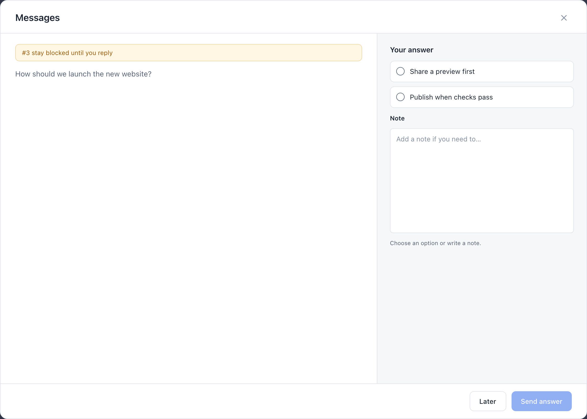
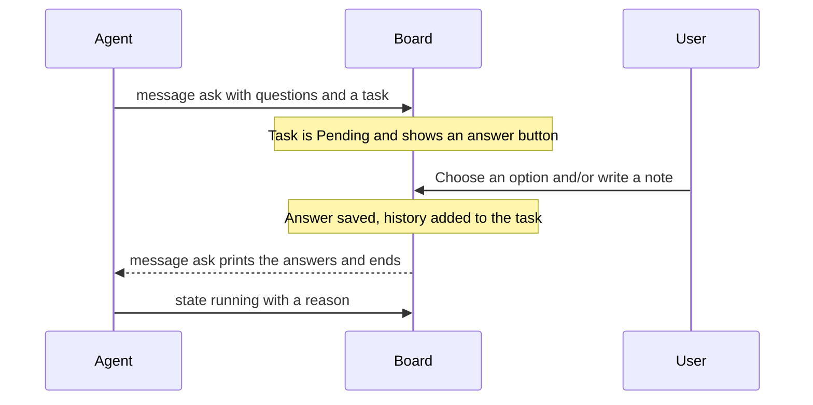

# Decisions

A decision is a question an agent asks when it cannot continue without you. It is the place where you step in when asked: the agent stops and waits, and your answer lets it resume. This page shows how you answer on the PC and on your phone, and how an agent asks. For the idea in two sentences, see [The work model](../work-model#decisions). To step in without being asked, see [The board](../watch/board).

## How you notice a question

A question belongs to the project, and a task refers to it. An AI-owned task that refers to an open question is **Pending**. In Todo or Doing, its card says how many questions it waits on, such as **Unanswered questions: 2**, and shows an **Answer the question** button. The button reads **Continue answering** when you have answered and have not sent it yet. You can also see Pending tasks on the [remote access](../watch/remote-access).

Every open question of the project is also listed in the **Unanswered questions** band above the lanes. The band is always there, and it starts closed: its header shows the title and the number of open questions, and **Answer them** (or **Continue answering** and **Review and send** while you hold answers) stays in the header. Select the header, or its arrow, to open the list; select it again to close it. The band does not remember its state, so it is closed again when you reload the page.

Each item of the open list shows the tasks that refer to the question, or **No task**, and its title in up to two lines. An item you have answered but not sent is marked **Answered, not sent**. When the items do not fit, scroll the band sideways with the arrow buttons that appear while it is open. When there are no questions, the header shows a count of 0 and there is nothing to open.

## Answer in the browser

You can answer from the band in two ways.

- **One question at a time.** Select an item in the open list. The dialog holds only that question, and **Send** sends your answer at once, with no review step. The other questions stay open.
- **Every question in a row.** **Answer them** in the band header goes through all the open questions and sends them together at the end. Nothing is sent, and the waiting agent does not move, until you select **Send all**.

To answer one task's questions and send them at once, start from its card instead (see [Answer from a card](#answer-from-a-card)).

To answer every question in a row:

1. Select **Answer them** in the band. The dialog starts at the first question without an answer. The button reads **Continue answering** once you have answered some, and **Review and send** opens the review directly.
2. Read the question on the left, and answer on the right: choose one of the offered options, write a note, or do both. The header shows the task and where you are, such as **2 / 5**. When several tasks share the question, the header lists their IDs and reads **3 tasks** instead of naming only the first.
3. Select **Next** to go on, or **Previous** to go back. The steps under the header show which questions you have answered; select a step to jump to it.
4. After the last question, the **Review and send** step lists every question with your answer. Select **Change** to edit one, or **Answer** for one you skipped.
5. Select **Send all**. The answers you gave are sent together, and the questions you skipped stay open.

On a window narrower than 900 px, the question and the answer stack in one column.

{.screenshot}

Each answer is saved to the history of every task that refers to its question. The question and each part of your answer appear as separate blocks there. A task stays in its current column. When none of its questions is open any more, its agent state becomes Idle, and the agent reads your response before it decides how to resume.

- **Close** the dialog at any time with the close button, Escape, or a click outside it. Closing never asks for confirmation, and your answers stay. Open the dialog again from the band or the card to go on, or select **Review and send** in the band.
- While you have answers that are not sent, you cannot switch to another project. Send them, or clear them with **Clear**, first.
- Your answers are kept while the page stays open. Reloading the page clears them.
- A question has no expiry. It stays open until it is answered or the agent withdraws it. Moving or archiving the task does not withdraw it.

### Answer from a card

**Answer the question** on a card opens only the questions that task waits on. There is no review step. On the last of them, select **Send**, and the answers to that task's questions are sent at once.

When the task waits on more than one question, select **Next** to go through them first. Answers you hold for other tasks' questions are not sent, and the band still offers **Review and send** for them.

### If a question is answered elsewhere or withdrawn

A question can be answered somewhere else, for example in the chat, while you are answering it. An agent can also withdraw a question it no longer needs. The dialog then marks that question:

- On its step, the dialog shows **This question was withdrawn. You can no longer answer it.**, or that it was answered elsewhere. You can still read the question and your input, but you cannot change them.
- In the review, the answer is marked as one that cannot be sent, and **Discard** removes it. **Send all** sends only the others.

A question the agent asks while the dialog is open is added at the end of the steps.

### If sending fails

The dialog keeps your answers and shows **Could not save. Try again.** Select **Retry**. When some of the questions were answered or withdrawn elsewhere in the meantime, nothing is sent. Those questions are marked, and sending again sends the others.

## Answer on your phone

On remote access, the same **Unanswered questions** band is above the lane tabs, and a Pending task shows the same **Answer the question** button. The band works as it does on the PC: it starts closed, shows the count in its header, and opens and closes when you select the header. Its one button, **Answer them**, or **Review and send** while you have answers that are not sent, stays in the header. An item in the open list opens the sheet with only that question, and **Send** sends it at once. With no questions the header shows a count of 0 and does not open.

The answer sheet slides up from the bottom. It shows the task and the position, such as **2 / 5**, then the question and your answer. Dots show your progress. **Previous** and **Next** stay at the bottom, so they are in reach as you scroll. After the last question, the review lists your answers, and **Send all** sends them. Opened from a task's **Answer the question** button, the sheet shows only that task's questions, and **Send** on the last one sends them without the review. An item of the band works the same way for its one question.

{.screenshot .screenshot--narrow}

Tapping the task itself opens its Body, Conditions, History, and Epic drawer. Swipe sideways to switch tabs. See [Remote access](../watch/remote-access) for connecting a phone.

If you close the sheet with an answer that is not sent, and the question is then answered elsewhere or withdrawn, the review keeps that answer, marked as one that cannot be sent. Select **Discard** to remove it.

## Answer in the chat

While you are talking with an agent, it writes the same question in the chat as plain text, with its choices and recommendation. Answer there in your own words, or give the id or label of a choice. The agent records your answer on the board with `message answer --via chat`, and the history notes that it came from the chat. Whichever answer is recorded first counts: if the board already has a different answer, the agent tells you which one was recorded and continues with it. The agent does not ask the question again in the other place. See [Questions](./agents#questions) for how agents wait.

## How an agent asks

This section is for people who write or configure agents. The exchange looks like this:



An agent asks with `message ask`. Each question is saved as its own message with an ID such as `Q-12`, numbered in the project. One command asks up to 20 questions and waits until none of them is open. `--task` makes a task refer to every question of the command; repeat it for more tasks. The questions are written as JSON with `--questions-json`, either inline or from standard input with `-`:

```json
{
  "questions": [
    {
      "body": "Which launch approach should we use?",
      "choices": [
        { "id": "preview", "label": "Publish a preview first" },
        { "id": "public", "label": "Launch publicly" }
      ],
      "recommendedChoiceId": "preview"
    }
  ]
}
```

```sh
cat question.json | agboard --project "My project" message ask --actor ai --task 1 --questions-json - --json
```

- `questions` takes 1 to 20 questions.
- `body` is Markdown, 1 to 5,000 characters. It is drawn like a task body, so headings, lists, code, links, and images attached to the same task appear as they do in the body. Images from `http` or `https` addresses are shown too.
- `choices` is optional and takes 2 to 10 options. Each `id` is 1 to 64 characters of letters, digits, `_`, or `-`, and each `label` is 1 to 200 characters. A question without choices is answered in words.
- `recommendedChoiceId` is optional and names the option the agent recommends.
- `tasks` in a question, such as `"tasks": [421, 422]`, links that question only to those tasks.

The answer note takes up to 2,000 characters. It is required when the question has no choices.

The task must be AI-owned and in Todo or Doing. While it waits, it cannot be set to Running. Moving the task to another column or archiving it does not withdraw its questions.

### What the command prints

With `--json`, the command prints one JSON object per line. Without it, it prints the same events as short sentences.

| Event | Meaning | Exit code |
| --- | --- | --- |
| `registered` | The questions were saved. It holds the question IDs. | — |
| `waiting` | Some question is still open. It is printed every 60 seconds (`--heartbeat` sets 10 to 600). | — |
| `answered` | Every question is answered. It holds all the answers. | 0 |
| `timeout` | The wait ended. The questions stay open. | 5 |
| `withdrawn` | No question is open any more, and some were withdrawn. It holds the withdrawn IDs and the answers that were given. | 6 |
| `error` | Waiting failed after the questions were saved, for example when the server stopped. The questions stay open. | 1 |

The command waits 600 seconds by default. `--timeout` takes 1 to 86,400 seconds, or `none` to wait without a limit. Waiting needs the server; the CLI checks it before saving anything and starts it in the background when none runs. If it cannot start the server, nothing is saved and the command fails with `board_unavailable`. `--no-wait` saves the questions, prints `registered`, and returns at once, without a server.

To wait again after a timeout or an error, pass the question IDs. The questions are not asked a second time:

```sh
agboard --project "My project" message wait Q-12 Q-13 --json
```

### Read, withdraw, and link questions

```sh
agboard --project "My project" message ls --json
agboard --project "My project" message show Q-12 --json
agboard --project "My project" message withdraw Q-12 --actor ai
agboard --project "My project" message link Q-12 --task 3
agboard --project "My project" message unlink Q-12 --task 3
```

- `message ls` lists open messages, which are questions and requests. `--status closed` lists answered questions and accepted requests, `--status withdrawn` lists withdrawn ones, and `--status all` lists every one. `--type question` or `--type request` limits the list to one kind, and `--task` limits it to one task's questions.
- `message show` prints one message in full: for a question, its options, its answer, and the tasks that refer to it.
- `message withdraw` withdraws a question that has no answer yet. Only an agent withdraws a question (`--actor ai`). A waiting `message ask` ends with `withdrawn` once no question is open. A question that already has its answer cannot be withdrawn.
- `message link` and `message unlink` add questions to a task or remove them. They change the `questions` list in the task's `TASK.md` and the `tasks` of the question together.

### Answer from the command line

A person can also answer from the CLI with the question ID, one question per command:

```sh
agboard --project "My project" message answer Q-12 --actor human --via cli --choice preview --text "Get feedback before the public launch"
```

A question with choices needs `--choice`; a question without choices needs a note. Give a note with `--text` or `--text-file`. When the user answers in the chat, the agent records the user's words with `--via chat`. The first recorded answer is final: answering an answered question fails with `question_answered` and prints the recorded answer.

After reading the answers and history, the agent resumes:

```sh
agboard --project "My project" state 1 running --actor ai --reason "Preparing the preview requested by the user"
```

## Requests

A request is a message in the other direction: a person writes it for the agents. It is saved like a question, with an ID such as `Q-13` from the same numbering, and `message ls --type request` lists requests.

```sh
agboard --project "My project" message send --actor human --text "Add a Windows section to the guide" --image ./sketch.png
agboard --project "My project" message accept Q-13 --actor ai --by "<agent-id>"
agboard --project "My project" message withdraw Q-13 --actor human
```

- `message send` records a request of 1 to 20,000 characters, from `--text` or `--text-file`. Repeat `--image` to attach pictures.
- `message accept` marks an open request as accepted by the agent named with `--by`. Only an agent accepts, and only once.
- Only a person withdraws a request, and only while it is open. An accepted request cannot be withdrawn.

## Next

- [Working with agents](./agents): the full work loop, including waiting.
- [Troubleshooting](../operations/troubleshooting): an answer that is refused or a question that disappeared.
