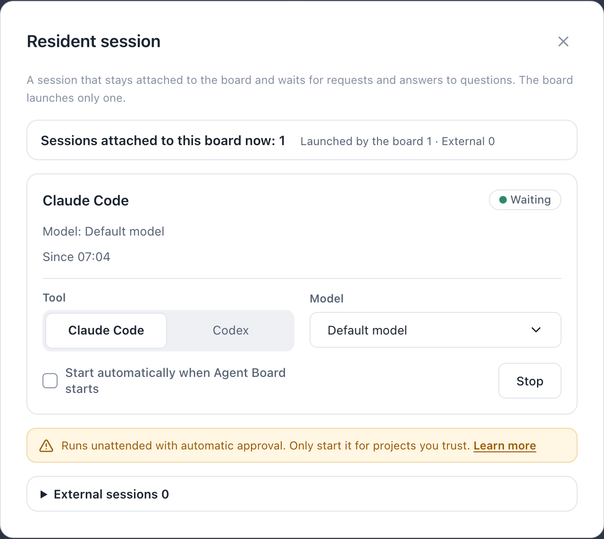

# Resident agent

A resident agent is an agent session that Agent Board starts for you and keeps attached to the board. The board sends it your requests, the answers to its questions, and the tasks that are ready, only while it is idle: the open requests together in one message, the answers together in one message, and tasks one at a time. So you do not have to start an agent in a terminal first or keep a wait command running. A session you started yourself in a terminal is not affected: it keeps waiting on the board and is counted as an external session (see below). You start and stop it from **Settings**.

::: info Public preview
This feature is in public preview. Its behavior and specifications may change. See [Feature stages](../feature-stages#resident-sessions) for its current limitations.
:::

::: warning It runs unattended with automatic approval
A session the board starts runs without a person watching it, and it approves the actions it takes by itself. Start it only for projects you trust. It works in the folder bound to the project and can change files there.
:::

## Start and stop it {#start-and-stop}

1. Open **Settings** and choose **Agent settings**. The row shows a one-line summary, such as `Claude Code · working` or `Not running`, and `· External 1` when a session you started yourself is also attached.
2. Under **Tool**, choose **Claude Code** or **Codex**. The board starts one session in total, so a running session has to stop before the other tool can start.
3. Under **Model**, keep **Default model** or choose one from the list. If the list cannot be read, the dialog says why and offers only the default.
4. Choose **Start**. While the request runs, the controls are disabled and the button reads **Starting…**. Choose **Stop** to end the session, or **Restart** after a failure.

{.screenshot}

The tool and model you choose apply from the next start. While a session runs with another choice, the dialog shows `Next start: …`.

If the tool is not installed or not logged in, the card says so with the reason and the command to run in a terminal. Choose **Check again** after you fix it. A project without a bound folder cannot start a session; bind one with `agboard project bind`.

## Start automatically {#start-automatically}

Turn on **Start automatically when Agent Board starts** to start the session each time the board starts. The board remembers one choice in total: the tool, the model, and the project you had open. Turning it off does not stop a running session.

## States {#states}

| State | Meaning |
| --- | --- |
| **Working on a task** | The session runs and is busy with a turn, for example a task or a request you sent. |
| **Waiting** | The session runs and is idle. The board hands it the next request, answer, or task as soon as there is one. |
| **Restarting** | The session ended and the board starts it again. The dialog shows the next try and how many times it restarted. |
| **Stopped** | Nothing is running. |
| **Failed** | The board gave up, for example after the session ended repeatedly in a short time. The reason is shown. Fix the cause, then choose **Restart**. |

The dialog also counts the sessions attached to the board, split into those the board started and **External sessions** you started yourself. An external session is counted while it waits on the board, and also when it used the board in the last 5 minutes: any `agboard` command or hook of an ordinary Claude Code or Codex session counts, so a session that works on the board without waiting appears while it is active and drops out after 5 minutes without use. Only a session of an agent that exposes its own session ID (Claude Code and Codex do) is counted this way; a command run by hand in a plain terminal is not. The footer of the board shows a dot followed by the tool, just left of the sync state, while a session is launched or auto-start is on; click it to open the dialog.

## When a session does not handle something {#not-handled}

If the session ends its turn without handling an item, for example a request it did not accept, the board sends the item again after a short delay, up to three times. After that it stops sending that item so a failing turn cannot loop, and the other items keep going. Handle the item yourself on the board, or stop and start the session. An item leaves the list once it is no longer on the board.

The board shows these items in two places:

- The dialog has a **Some items could not be handled** notice with each item by name (for example **Request Q-3**, **Answer to Q-5**, or **Task #12**), the reason the last turn failed, and how to clear it.
- On the PC, the footer indicator gets a warning with the number of items. Click it to open the dialog. The phone indicator shows only the warning icon, and its description names the items.

## Remote access {#remote-access}

Starting, stopping, and the auto-start choice are available only on the PC. Through [remote access](../watch/remote-access) the footer indicator is display-only. The phone board shows the same indicator in its status line at the bottom, after the connection state, with a dot, the tool name, and a short state word. It is display-only there: it has no button, and it is hidden when nothing is launched and auto-start is off. On a narrow phone it takes the place of the time of the last update. Its **Settings** has the same **Resident agent** row on a local page; the dialog opens as a bottom sheet.
