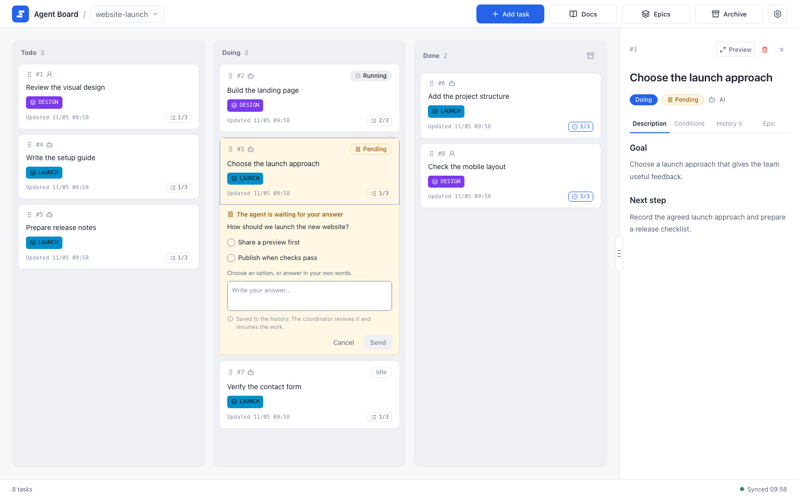

# Install and start

By the end of this page, `agboard` is installed with Homebrew, your working folder has a project, your agents are connected, and the board is open in your browser. Then continue with the [Quickstart](./quickstart).

The steps are: install, create or bind a project, connect your agents, and start the server.

## Before you begin

- A Mac running macOS 15 or later, with Apple Silicon or an Intel processor.
- [Homebrew](https://brew.sh). Homebrew has its own requirements, such as the Command Line Tools on some Macs; follow the Homebrew documentation for them.
- For the connect step, Claude Code or Codex on your `PATH` (the `claude` or `codex` command).

You do not build Agent Board yourself. The Homebrew package is a prebuilt command with the web UI inside, so you do not need Rust, Node.js, or pnpm, and you do not clone the repository. To build from source, see [Set up and run](../dev/getting-started/setup).

## Install

```sh
brew install fooqoo/tap/agboard
agboard --version
```

The command is signed with a Developer ID certificate and notarized by Apple. If macOS refuses to run it, do not turn off Gatekeeper; see [Troubleshooting](./operations/troubleshooting#macos-will-not-run-agboard).

Agent Board is released under the MIT License. The license and the notices for bundled third-party components are installed in `share/agboard` under your Homebrew prefix (`$(brew --prefix)/share/agboard`).

## Create or bind a project

Go to the folder you work in. A project belongs to the folder it is bound to, and its subfolders use the same project. You do this once for each folder.

```sh
cd my-project
agboard project create "My project"
```

`project create` makes the project and binds the current folder to it. If the project already exists, bind this folder to it instead:

```sh
agboard project bind "My project"
```

For renaming projects and registering other folders, see [Data and backups](./operations/data#projects-and-folders).

## Connect your agents

```sh
agboard connect
```

`connect` is a step-by-step setup in the terminal. It installs the Skill and the Hook for Claude Code, Codex, or both. It must run in a bound folder, because the Hook and the Project scope depend on the folder's project. See [Connect your agent](./automation/agents#connect-your-agent) for the questions it asks, where it writes, and what to do afterwards.

## Start the board

Start the server:

```sh
agboard serve
```

Open [http://127.0.0.1:7420/](http://127.0.0.1:7420/) and select the project in the header. Keep the server running while you use the browser or while an agent waits for you. Press Ctrl+C in its terminal to stop it. The server listens only on `127.0.0.1`; choose another port with `--port` if 7420 is taken.

{.screenshot}

The board opens with the selected project in the header. Tasks sit in the Todo, Doing, and Done columns.

Most commands name the project explicitly with `--project NAME`. The examples in this guide use `My project`; replace it with your project's name, and use the task IDs that the CLI returns. For renaming projects and registering folders, see [Data and backups](./operations/data#projects-and-folders).

## Update

Update the command with Homebrew, then update the Skill and Hook that `connect` installed:

```sh
brew upgrade fooqoo/tap/agboard
agboard --version
agboard update
```

`brew upgrade` replaces the command and the web UI inside it. It does not change the Skill or the Hook in your agents' settings. `agboard update` does that, and only for what `connect` installed. It shows what will change and asks for confirmation; `agboard update --yes` skips the question but never overwrites your own edits. See [Refresh the integrations](./automation/agents#refresh-the-integrations).

Stop and restart `agboard serve` after an upgrade to use the new command and UI. Open boards and monitors reload themselves once the server is back, after you finish any edit or answer in progress.

After an upgrade, an ordinary command in your terminal tells you when the installed Skill and Hook are older than the command. The notice goes to the error output once and does not change the command's result.

Hooks and the agent Skill run `agboard` from your `PATH`, so they use the installed version. A development build (`cargo build`, `cargo run`, or `target/debug/agboard`) is a separate executable.

## Next

- [Quickstart](./quickstart): take one task from creation to Done.
- [Working with agents](./automation/agents): the questions `connect` asks, and how agents work on the board.
- [Feature stages](./feature-stages): which features are generally available and which are in public preview.
