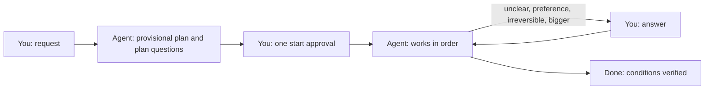
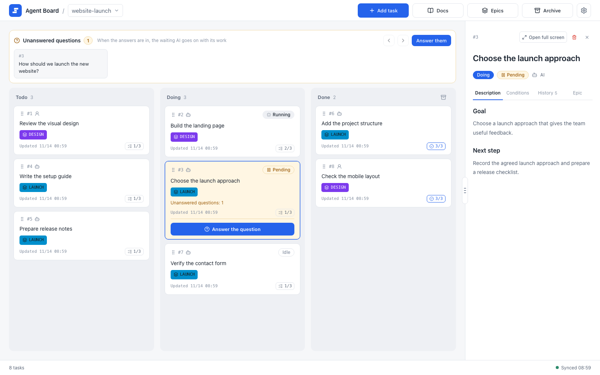

# Introduction

<video class="demo-video" :src="withBase('/videos/demo.mp4')" :poster="withBase('/videos/demo.jpg')" autoplay muted loop playsinline></video>

One task, start to finish: the agent starts the task and asks a question, you answer on the task, and the agent resumes. When every acceptance condition is checked, the task moves to Done on its own.

Want to see it for yourself? [Try the demo](https://fooqoo.github.io/agent-board/demo/) in your browser, with nothing to install. It opens the first-run guide on sample data, in Japanese when your browser prefers Japanese and in English otherwise. Reloading the page starts it over.

## The problem: big work does not finish without you

You can hand a big piece of work to an AI agent, but it rarely runs to the end on its own. Someone has to turn the request into a plan, notice when the agent is stuck or off course, catch the question that scrolled past in the chat, explain the work again after a new session starts, and check at the end whether it is really done. The agent works, and you keep watching.

Agent Board is built to cut that watching down. It does not run the agent. It gives the agent a structure to work inside, so that you can ask for the work, answer when you are asked, and stay away the rest of the time.

## Agent Board: a work harness

An agent such as Claude Code or Codex already has what it needs to act: tools, context, and a loop. What it lacks is a shared model of the work itself. Agent Board is that layer, a **work harness** that sits on top of your agent. It keeps four things in one place:

- **A plan.** Epics group the work and set its order, and tasks are the pieces that can be reviewed on their own. The agent reads the order to know what to do next.
- **Acceptance conditions.** Each task says up front what has to be true for it to be finished, and the agent checks them before it calls the task done.
- **Questions the agent must stop for.** When a decision is yours, the agent asks with choices and waits. The question and your answer are recorded once, whichever window you answer in.
- **A history.** Every move, question, answer, and check is recorded with its reason, so a new session or a different agent can continue from where the last one stopped, and you can read back what happened.

Everything is stored as plain files on your machine, and you and the agent read and write the same files. See [The work model](./work-model) for the elements, the states, and what the model guarantees.

## How delegation works

You do not write the plan. You ask, and the agent does the planning on the board.

1. **Request.** Tell the agent what you want in the chat, in your own words.
2. **Provisional plan.** The agent puts a plan on the board right away: an epic, and tasks in work order, each with acceptance conditions. It also asks the questions it cannot settle itself.
3. **One start approval.** You answer the plan questions, and the agent revises the plan. Then it asks once whether to start. Nothing starts before you approve.
4. **Work in order.** The agent works through the tasks, records what it does, and decides everything else itself.
5. **Stop only when it must.** After the start, the agent calls you in four cases: your intent is unclear, your preference decides it, an action cannot be undone, or the work grows beyond what you asked.
6. **Done on its own.** When the agent has verified every acceptance condition of a task and nothing is waiting on you, the task moves to Done by itself.

[Quickstart](./quickstart) takes you through this once, and [Working with agents](./delegate/agents) describes it in full.

## Windows on the work

The board is not the product; it is one window onto the model. You use the windows to watch the work, and there are two ways to take part.

- **Answer when asked (human in the loop).** When the agent stops for a decision, you answer on the board, on your phone, in the chat, or with the CLI. The answer is recorded once, and the agent resumes. See [Decisions](./delegate/decisions).
- **Watch and step in (human on the loop).** The agent keeps working while you look. You move a card back, check an acceptance condition, or rewrite a plan, and the agent follows the change the next time it reads the board. See [The board](./watch/board).

{.screenshot}

The board shows Todo, Doing, and Done. Here a task in Doing is waiting for your answer, and every task shows how many of its acceptance conditions are done. On the go, the [mobile monitor](./watch/mobile-monitor) shows the same work on your phone. The agent's own window is the chat, and the `agboard` command is the one the agent and your scripts use.

## Where to start

New here? Read the first four pages in order.

1. [Install and start](./getting-started): install `agboard`, set up your agent, and open the board.
2. [Quickstart](./quickstart): delegate your first piece of work and watch it reach Done.
3. [The work model](./work-model): the few ideas that explain everything else.
4. [Working with agents](./delegate/agents): how the agent plans, asks, and finishes.

## Find what you need

| I want to… | Read |
| --- | --- |
| Hand a piece of work to an agent | [Quickstart](./quickstart) and [Working with agents](./delegate/agents) |
| Answer a question from an agent | [Decisions](./delegate/decisions) |
| Add, move, and review tasks | [The board](./watch/board) |
| Group tasks and see what to do next | [Epics and progress](./watch/epics) |
| Write a task and attach images | [Editing and image attachments](./watch/editing) |
| Read and edit the project's Markdown documents | [Project docs](./watch/docs) |
| Check on the board from my phone | [Mobile monitor](./watch/mobile-monitor) |
| Look up a command | [CLI reference](./reference/cli) |
| Edit `TASK.md` or `EPIC.md` by hand | [Markdown file format](./reference/file-format) |
| Know where files live, back them up | [Data and backups](./operations/data) |
| Fix something that does not work | [Troubleshooting](./operations/troubleshooting) |

For what the Agent Board plugin installs in Claude Code and Codex, see the [plugin guide](https://github.com/FooQoo/agent-board/blob/main/plugins/agent-board/README.md). If you want to change Agent Board itself, read the [developer guide](../dev/).
