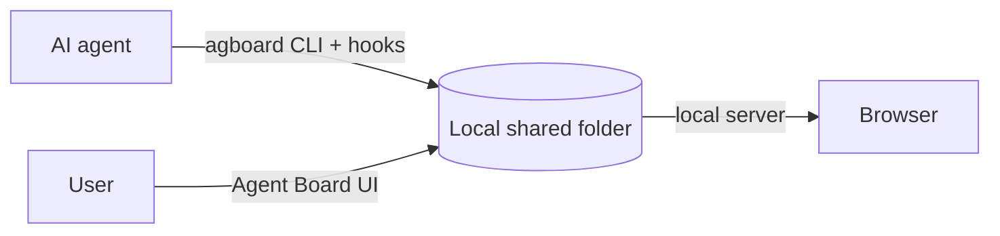

# Introduction

<video class="demo-video" :src="withBase('/videos/demo.mp4')" :poster="withBase('/videos/demo.jpg')" autoplay muted loop playsinline></video>

One card, start to finish: the agent starts the task and asks a question, you answer on the card, and the agent resumes. When every acceptance condition is checked, the card moves to Done on its own.

## What is Agent Board?

Agent Board is a local work board shared by users and AI agents. Each project has its own cards, epics, and history. Use the browser for reviewing and editing work, and `agboard` for agent updates and project management.

When an agent works for a long time, you need to see what is moving, what is waiting, and what response will unblock it. Agent Board gives users and agents one shared, history-backed board.

{.screenshot}

The screenshot shows the board with Todo, Doing, and Done columns. A card in Doing is waiting for an answer, and each card shows how many acceptance conditions are done.

## Who does what

- **Users** work in the browser. They add and edit cards, answer decisions, and review progress.
- **Agents** work through the `agboard` CLI and hooks. They report progress, ask questions, and record results.
- **The local shared folder** is the source of truth. Both sides read and write the same plain files, and the local server keeps the browser up to date. Everything stays in your local data area, with no account or hosted service required.

## Where to go next

- [Getting started](./getting-started): install `agboard`, create a project, and open the board.
- [The board](./board): cards, columns, agent states, drafts, archive, and settings.
- [Decisions](./decisions): ask and answer questions on a card, from the CLI, the browser, or your phone.
- [Epics and progress](./epics): group cards into epics and read the progress table.
- [Editing and evidence](./editing): the Markdown editor, images, evidence, and the shared file format.
- [Working with agents](./agents): the agent workflow and hook setup.
- [CLI reference](./cli): `agboard` commands.
- [Mobile monitor](./mobile-monitor): watch the board from a phone.
- [Data and backups](./data): where files live and how to back them up.

For the Claude Code and Codex hook setup, see the [integration guide](https://github.com/FooQoo/agent-board/blob/main/integrations/README.md).
