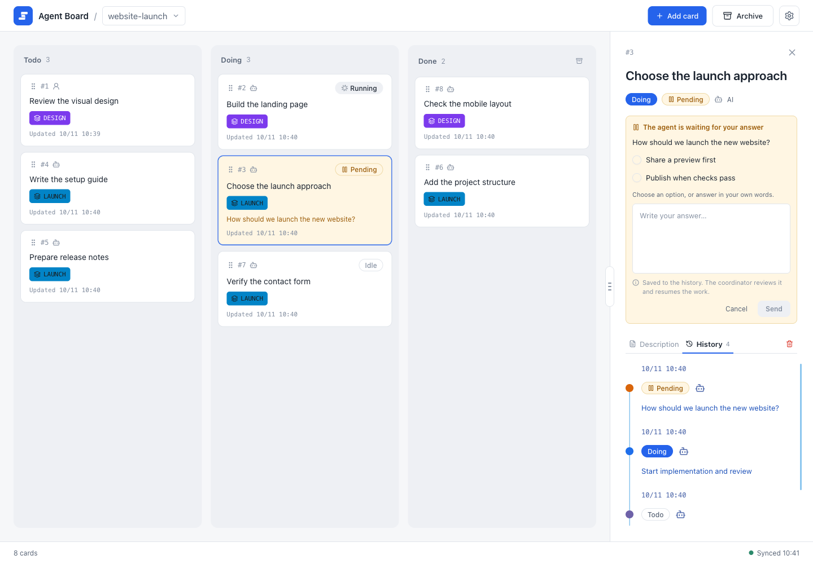
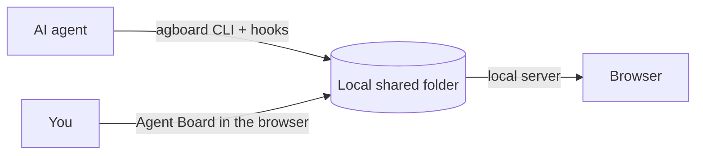

# Introduction

<video class="demo-video" :src="withBase('/videos/demo.mp4')" :poster="withBase('/videos/demo.jpg')" autoplay muted loop playsinline></video>

One task, start to finish: the agent starts the task and asks a question, you answer on the task, and the agent resumes. When every acceptance condition is checked, the task moves to Done on its own.

## What Agent Board is

Agent Board is a local work board shared by you and your AI agents. When an agent works for a long time, you need to see what is moving, what is waiting, and what answer will unblock it. Agent Board gives you and the agent one shared board, with a history of everything that happened.

{.screenshot}

The board has three columns: Todo, Doing, and Done. Here a task in Doing is waiting for your answer, and every task shows how many of its acceptance conditions are done.

## How it works

- **You** work in the browser. You add and edit tasks, answer the agent's questions, and review progress.
- **Agents** work through the `agboard` command and hooks. They report progress, ask questions, and record results.
- **A local shared folder** holds the board as plain files. You and the agents read and write the same files, and the local server keeps your browser up to date. Everything stays on your machine; no account or hosted service is needed.

## Where to start

New here? Read the first three pages in order.

1. [Install and start](./getting-started): build `agboard` and open the board.
2. [Quickstart](./quickstart): in about ten minutes, take one task from creation to Done.
3. [Core concepts](./concepts): the few ideas that explain everything else.

## Find what you need

| I want to… | Read |
| --- | --- |
| Add, move, and review tasks | [The board](./use/board) |
| Answer a question from an agent | [Decisions](./use/decisions) |
| Group tasks and see what to do next | [Epics and progress](./use/epics) |
| Write a task and attach images | [Editing and image attachments](./use/editing) |
| Connect Claude Code or Codex | [Working with agents](./automation/agents) |
| Look up a command | [CLI reference](./automation/cli) |
| Edit `TASK.md` or `EPIC.md` by hand | [Markdown file format](./automation/file-format) |
| Check on the board from my phone | [Mobile monitor](./operations/mobile-monitor) |
| Know where files live, back them up | [Data and backups](./operations/data) |
| Fix something that does not work | [Troubleshooting](./operations/troubleshooting) |

For the Claude Code and Codex hook setup, see the [integration guide](https://github.com/FooQoo/agent-board/blob/main/integrations/README.md). If you want to change Agent Board itself, read the [developer guide](../dev/).
