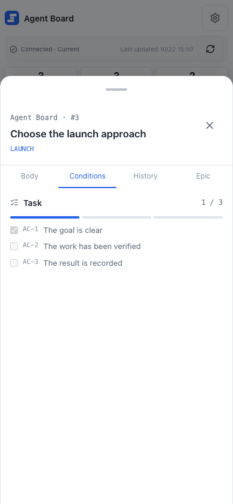

# Mobile monitor

The mobile monitor is a phone-sized view of the board. Use it to check progress and to answer an agent's question when you are away from your desk. This page explains what the monitor shows, how to connect it from your phone with ngrok, and how to check that it works.

## What the monitor shows

The monitor groups tasks into Todo, Doing, and Done. AI-owned tasks show their agent state inline; Pending questions in Todo or Doing show an answer form on the task. Tapping a task opens a bottom drawer with **Body**, **Conditions**, **History**, and **Epic** tabs. The drawer slides up from the bottom, follows a downward drag of its top handle, and closes when dismissed; each tab's content scrolls independently. The Conditions tab shows only the task's own conditions; epic reference conditions remain in the epic details. The Epic tab shows the epic details without repeating the label or title already shown in the drawer and body. The monitor can answer a pending question, but its only write operation is that answer.

{.screenshot--narrow}

Horizontal swipes move the tab content and underline together. Gestures inside the tab content stay within that area; drag the top handle to dismiss the drawer. Each project's complete epic list is loaded when the monitor initializes and retained for the page session. Switching tabs performs no epic request. Reload the page to refresh the epic lists, or use the retry button after a failed initial request.

The monitor HTML and API responses are never cached. The browser keeps the monitor's scripts and styles, so later visits download only the page and the data. The monitor has no offline snapshot cache or service worker.

After you install a new version and restart `agboard serve`, an open monitor reloads itself to show the new UI. If you are writing an answer, it waits until you send or clear it. When disconnected, the page reports the connection state.

## Before you start

You need an ngrok account and its authtoken. The **Mobile connection** dialog has a button that opens the ngrok page where you copy the token. Agent Board opens the address without any of ngrok's Traffic Policy features, including its Google sign-in (OAuth), which a free ngrok account cannot use. A free account can therefore run the monitor; the other limits and terms of your ngrok plan still apply.

Agent Board uses ngrok to open a public HTTPS address that leads to the monitor only. The full board stays on `127.0.0.1`. Never expose the board to the public Internet and never use router port forwarding. ngrok ends the HTTPS connection, so ngrok can process the traffic; the connection is not end-to-end encrypted between your PC and your phone.

## How the passcode protects the monitor

The monitor is guarded by a 4-digit passcode. Agent Board does not use Google authentication or ngrok's sign-in, and it keeps no list of allowed accounts.

- Each time the connection starts, Agent Board makes a new passcode from the operating system's random source, from `0000` to `9999`. It is kept in memory only: it is not saved to a file, logged, or put in the monitor page.
- You see it on the PC only: in the **Mobile connection** dialog, in step 2 **Enter the passcode**, and on the startup line of `agboard serve --monitor ngrok`.
- The phone opens the address, asks for the passcode, and shows nothing of the board until the passcode is right. The connection then lasts up to 12 hours, after which the phone asks for the passcode again.
- After 5 wrong passcodes in a row, the monitor stops accepting any passcode, even the right one. Stop the connection and connect again (or restart `serve`) to get a new passcode and a fresh count.

A 4-digit passcode has only 10,000 possibilities, so it is weaker than signing in with an account. The 5-attempt limit, the random address that ngrok chooses, and a new passcode at every start make guessing hard, but they are not a substitute for keeping the address private. Treat the address and the passcode like a password pair:

- Do not share the address or the QR code in public places.
- Stop the connection when you are not using it.
- The address is one that ngrok chooses at random. It is harder to find, though it is not a secret you can rely on.

Because ngrok adds nothing for Agent Board to check, the monitor checks two things itself: the request names exactly the public address, and the passcode. ngrok ends the HTTPS connection and can see the traffic, and anyone who manages your ngrok account can change how the address is served. The passcode does not protect against them.

A program that is already running on your PC can send requests straight to the monitor's local port without going through ngrok. It still needs the passcode to read anything, but it can use up the 5 tries, which closes the monitor to the phone until you stop and connect again. Agent Board trusts the person who uses the PC, so it adds no further protection against this. Run the connection only on a PC you trust.

## Connect from the PC

1. Open the board, then open **Settings**. In **Mobile connection**, choose **Set up**. The settings dialog closes and the **Mobile connection** dialog opens with **Not connected**.
2. In step 1, **Get a token**, choose **Open the token page**. Sign in to ngrok and copy the authtoken.
3. In step 2, **Paste and connect**, paste the token into **ngrok auth token**.
4. Decide whether to keep the token with **Save the token on this PC** (see [Where the token is kept](#where-the-token-is-kept)).
5. Choose **Save and connect**.

While it connects, the dialog shows **Connecting to ngrok…** in place of the two steps. When it is ready, the dialog shows **Accepting connections**. Step 1, **Scan the QR code**, has the QR code and **Copy URL**, which copies the address. Step 2, **Enter the passcode**, shows the 4-digit passcode. The QR code only carries the address: the phone still has to enter the passcode, and the PC does not ask you to approve a device.

The passcode is shown only while the connection is running. It is new every time the connection starts, so a stopped or failed connection has none.

If ngrok cannot be reached, the dialog says so and gives the reason. Check the token and the internet connection, then choose **Save and connect** again. The board on the PC keeps working.

## Where the token is kept

- A token you type is used only while Agent Board is running and is not saved.
- To keep it, select **Save the token on this PC** before you connect. The token is stored in this PC's secure storage, the one your operating system provides. It is never written to the data folder.
- If the `NGROK_AUTHTOKEN` environment variable is set, it takes priority over a saved token. The dialog then says it is using the environment variable, and you can leave the token field empty.
- A saved token is shown as saved in this PC's secure storage. Choose **Delete the saved token** to remove it.
- If the PC has no usable secure storage, the dialog says **This PC cannot save the token. Enter it each time.** and the save option is unavailable. Enter the token each time you connect.

Whether the connection stays on is stored in Agent Board's internal area. You do not edit a file for it. The passcode is not stored anywhere.

## Open it on the phone

1. On the phone, open the URL or scan the QR code.
2. The page shows **Enter the passcode**. Type the 4-digit passcode shown on the PC and choose **Connect**.
3. The monitor opens. The connection lasts up to 12 hours; after that, or when the connection was stopped and started again on the PC, the page asks for the passcode again.

On ngrok's free plan, the first visit from a phone shows ngrok's warning page. Choose **Visit Site**, and the monitor opens. ngrok shows the warning to each visitor only once.

Knowing the address is not enough to read the board. A wrong passcode is refused without saying how many tries are left. After 5 wrong passcodes in a row the page says **Too many wrong passcodes** and takes no more; stop the connection on the PC and connect again to get a new passcode. If the page says the connection is stopped, check the PC.

## Stop and connect again

Choose **Stop connection** in the dialog to close the connection. The dialog shows **Stopped**, and the saved token stays on this PC. The phone can no longer read the board or send answers, and the connection stays off the next time Agent Board starts. To connect again with the saved token, choose **Reconnect**. To use another token, choose **Change connection settings**, paste the token, and choose **Save and connect**.

If the connection drops, for example because the PC slept or the network changed, stop it and connect again. To use another token while connected, choose **Reset token**, which shows the setup again, enter the new token, and choose **Save and connect**. This replaces the connection, so the phone has to enter the new passcode. Closing the dialog instead leaves the connection as it was.

When the connection was left on, it starts again the next time Agent Board starts, as long as a token is available from the environment or this PC's secure storage. Without one, the dialog asks for the token.

## Check that ngrok keeps no traffic content

ngrok's Traffic Inspector can keep request details if **Full Capture** is turned on for your account. Agent Board cannot turn it off for you. In the ngrok dashboard, open **Settings** → **Observability** and confirm that Full Capture is disabled. Do this before you use the monitor.

## Start it from the command line

To start the connection with the server, set the token in the environment:

```sh
export NGROK_AUTHTOKEN=<your authtoken>
agboard serve --monitor ngrok
```

The command prints the phone address and the passcode with the local address, for example `Serving at http://127.0.0.1:7420/; mobile monitor at https://… with passcode 4821`, or in the `monitor` field with `--json`. The passcode changes each time the server starts. If the connection cannot start, `serve` stops with exit code 1. The other options are in the [CLI guide](../automation/cli).

When the computer sleeps or the server stops, the monitor is unavailable until the server and the connection run again.

## Check on a phone

Responsive browser tests cover narrow viewports; the software keyboard needs a real-device check. Open the monitor in the phone's browser and find a Todo or Doing task with a Pending question. Confirm that the keyboard leaves the answer field and Send button reachable, then submit an answer. Also check scrolling in long Body, Conditions, and Epic tabs, horizontal tab swipes, and downward dismissal using the handle. Browser emulation alone does not verify Safari's keyboard behavior.

## Next

- [Decisions](../use/decisions): answer a question from your phone.
- [Troubleshooting](./troubleshooting): the page does not load or does not update.
