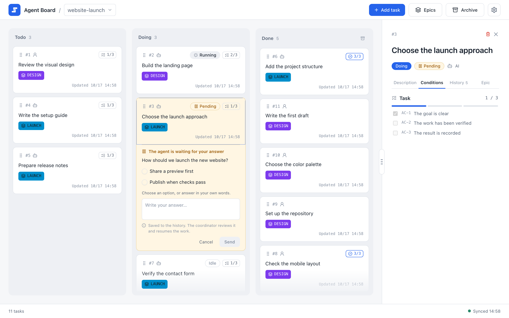
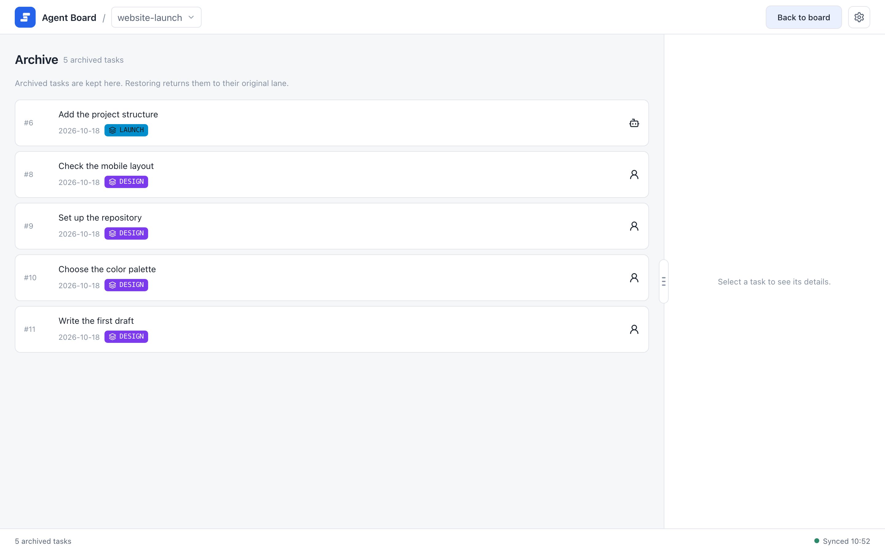
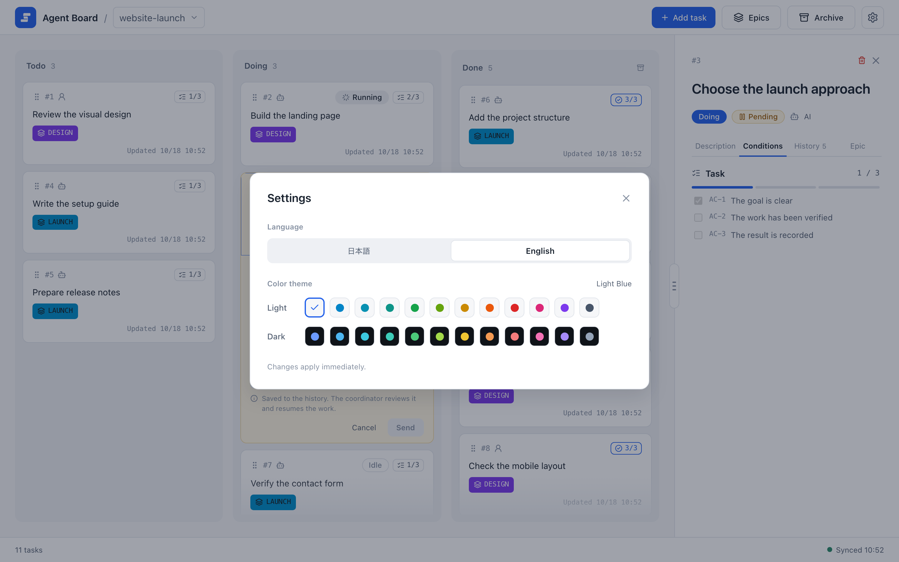
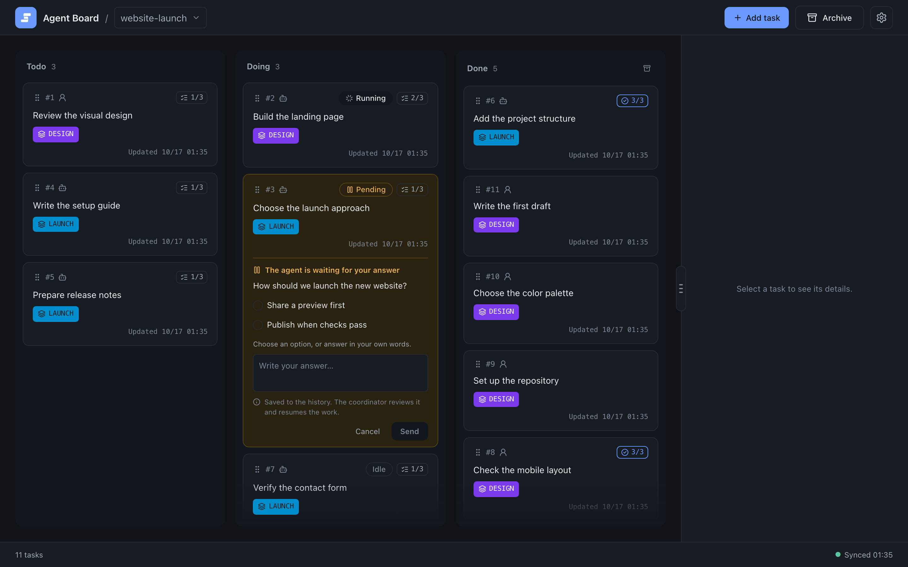

# The board

The board is where you add tasks, follow what agents are doing, and review the result. This page covers the daily actions; the ideas behind them are in [Core concepts](../concepts).

## Add a task

1. Select a project in the header and choose **Add task**.
2. Enter a short request and submit it. This creates an AI-owned task; the first non-empty line becomes its title.

To set the title, owner, acceptance conditions, or draft state yourself, choose **Create manually** in the request form and use the full editor. See [Editing and image attachments](./editing#send-a-task-request). The owner cannot be changed after the task is created.

The new task appears at the end of Todo.

## Read a task

Select a task to open its details on the right. The tabs show:

| Tab | Shows |
| --- | --- |
| **Description** | The task's body. |
| **Conditions** | The task's own acceptance conditions and its progress. |
| **History** | What happened, newest first, each entry with its time and reason. |
| **Epic** | The details of the epic the task belongs to, if any. |

{.screenshot}

The panel on the right shows the selected task. The Conditions tab lists the task's own acceptance conditions with a progress bar. An epic's own reference conditions stay in its Markdown details.

## Move a task

Drag a task to another column and confirm the move. The reason field is optional; if you leave it empty, a reason is generated from the move. The columns mean:

| Column | Meaning |
| --- | --- |
| Todo | Work that has not started. |
| Doing | Work in progress. AI-owned tasks also show an agent state. |
| Done | Completed work. |

AI-owned tasks in Doing show **Idle**, **Running**, or **Pending**. Todo tasks can also be Pending when an agent asks a question before starting. User-owned and Done tasks are always Idle. Running means the agent is working; Pending means it needs your answer, which you give on the task (see [Decisions](./decisions)). Moving a task to another column resets the agent state to Idle and withdraws an open question. Every change and its reason stay in the history.

## Change a task

To edit a task or put it in an epic, choose **Make draft** in the details panel, edit the text, and choose **Finalize** when it is ready. See [Editing and image attachments](./editing) for the editor.

## Drafts

A draft is a task that agents must leave alone while you write it. Agents cannot change a draft, including its `TASK.md` file.

- To create a draft, choose **Create manually** in the request form and check **Draft** in the full editor.
- To work on an existing task, choose **Make draft** in the details panel, edit and save its text, then choose **Finalize** when an agent may use it. Saving in the editor keeps the draft state; the editor has no Draft checkbox.
- A running task cannot become a draft.

If you forget to finalize, the agent cannot move or update the task. A draft is marked with a **Draft** chip on its card.

## Archive

Archive finished tasks to clear the board without deleting anything.

- Archive one task from its details, or choose **Archive completed tasks** in Done to archive several at once.
- Open **Archive** in the header to review archived tasks, restore them to their original column, or delete them permanently. Permanent deletion is possible only from Archive.

{.screenshot}

The Archive screen lists archived tasks with their ID, title, owner, date, and the epic they belonged to, if any. Select a task to see its details.

The details of an archived task use the same layout as an active task. **Restore** and the trash icon for permanent deletion sit at the top right, next to the close button. Permanent deletion asks for confirmation first.

## Settings

Open **Settings** to choose the language (English or Japanese) and one of 24 themes (12 colors, each in light and dark).

The choice is saved on this PC, so every browser on this PC shows the same language and theme. Changes apply at once to the other open pages, including other browser windows and the mobile monitor, without a reload. The first start uses English and light blue; the board does not follow the browser or OS settings. Task text is not translated. CLI help, errors, and JSON values stay in English.

The width of the detail panel is not part of these settings. Each browser keeps its own width.

**Mobile connection** in the same dialog opens the setup for checking the board from a phone with ngrok; see the [mobile monitor guide](../operations/mobile-monitor).

{.screenshot}

The dialog has a language switch and a grid of themes: one row of 12 light colors and one row of 12 dark colors.

{.screenshot}

The same board after choosing a dark theme.

## Next

- [Decisions](./decisions): answer an agent's question.
- [Epics and progress](./epics): group tasks and see what to do next.
