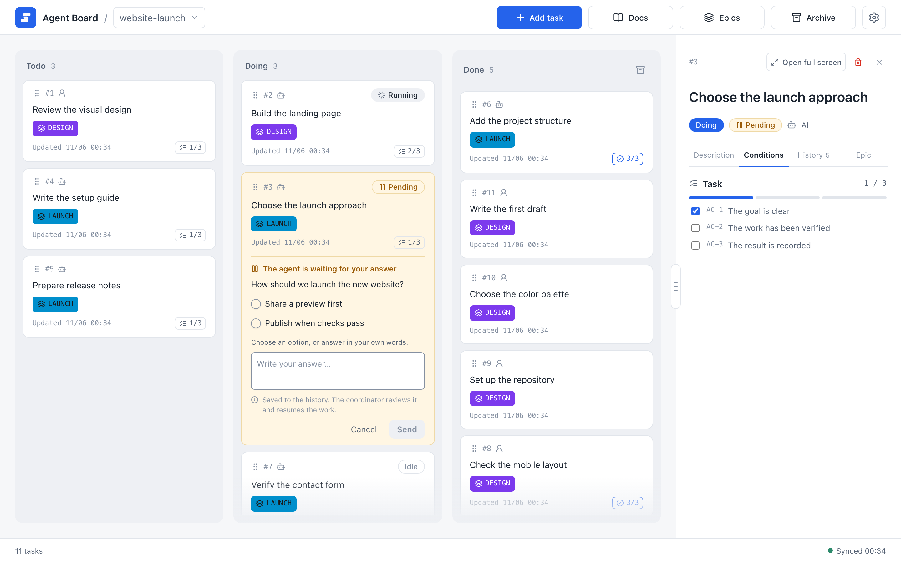
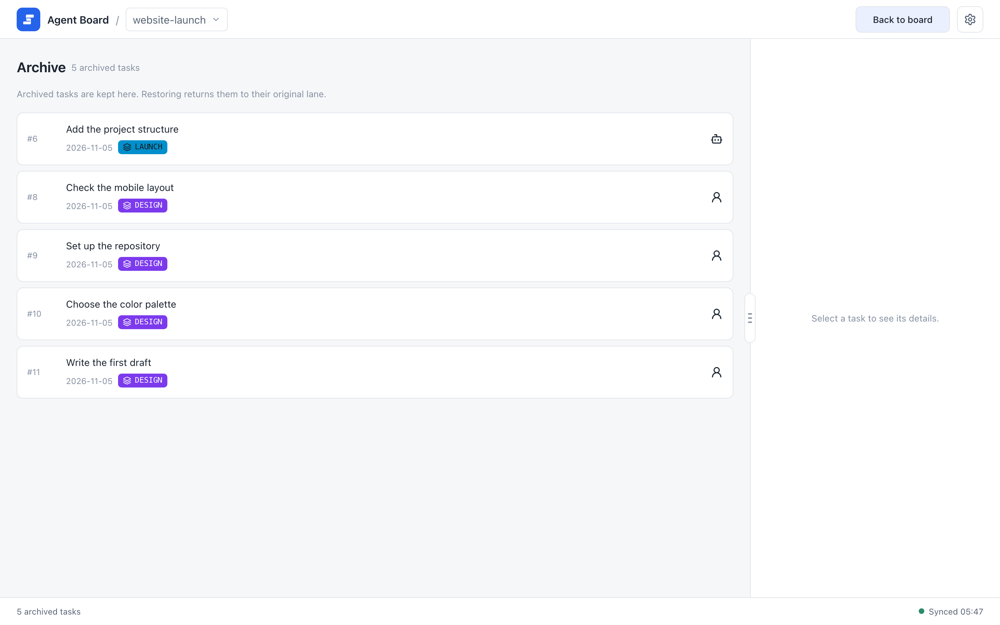
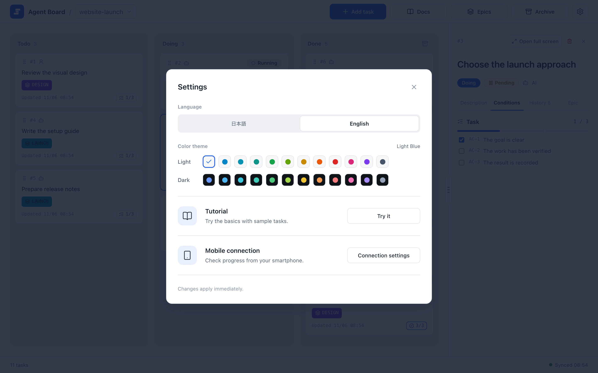
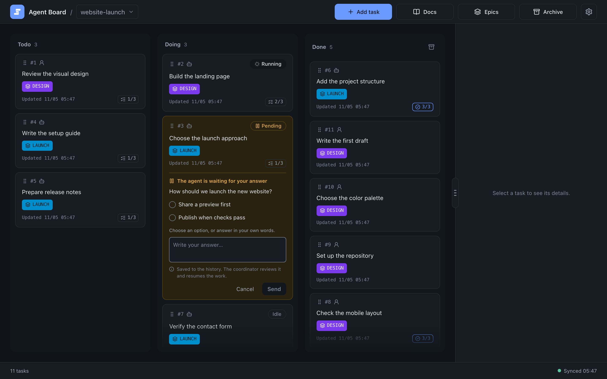

# The board

The board is where you add tasks, follow what agents are doing, and review the result. This page covers the daily actions; the ideas behind them are in [Core concepts](../concepts).

## Add a task

1. Select a project in the header and choose **Add task**.
2. Enter a short request and submit it. This creates an AI-owned task; the first non-empty line becomes its title.

To set the title, owner, acceptance conditions, or draft state yourself, choose **Create manually** in the request form and use the full editor. See [Editing and image attachments](./editing#send-a-task-request). The owner cannot be changed after the task is created.

The new task appears at the end of Todo.

## Read a task {#read-a-task}

Select a task to open its details on the right. The tabs show:

| Tab | Shows |
| --- | --- |
| **Description** | The task's body. |
| **Conditions** | The task's own acceptance conditions and its progress. |
| **History** | What happened, newest first, each entry with its time and reason. |
| **Epic** | The details of the epic the task belongs to, if any. |

{.screenshot}

The panel on the right shows the selected task. The Conditions tab lists the task's own acceptance conditions with a progress bar. Each condition is drawn as Markdown, like the task body, so it can hold links, code, and images. An epic's own reference conditions stay in its Markdown details.

You can check and uncheck a condition in the Conditions tab. The change shows at once and is saved right away; if it cannot be saved, the checkbox goes back and a message says so. Your choice is saved over the latest file, so it wins even if an agent changed the task after you opened it, and the rest of the file, including the agent's other changes, stays. The history records that a person checked or unchecked the condition.

- When you check the last condition of an AI-owned task in Todo or Doing, the task moves to Done by itself, the same as when an agent checks it.
- Unchecking a condition of a task in Done leaves it in Done. Move it yourself if work should continue.
- An archived task's conditions cannot be changed. To change a condition's text, restore the task and open its preview.

Each tab loads its text when you open it. The number on the **History** tab appears after the history has loaded.

## Move a task

Drag a task to another column and confirm the move. The reason field is optional; if you leave it empty, a reason is generated from the move.

If an agent or another browser moves the task while the dialog is open, the move is not made. The dialog shows the column the task is in now and says so, and the reason you typed stays. Confirm again to move it from there.

The columns mean:

| Column | Meaning |
| --- | --- |
| Todo | Work that has not started. |
| Doing | Work in progress. AI-owned tasks also show an agent state. |
| Done | Completed work. |

AI-owned tasks in Doing show **Idle**, **Running**, or **Pending**. Todo tasks can also be Pending when an agent asks a question before starting. User-owned and Done tasks are always Idle. Running means the agent is working; Pending means it needs your answer, which you give from the card's **Answer the question** button (see [Decisions](./decisions)). Moving a task to another column resets the agent state to Idle and withdraws an open question. Every change and its reason stay in the history.

## Change a task

To edit a task or put it in an epic, choose **Open full screen** in the details toolbar. The preview uses the same editor, and opening it changes nothing. Your first change makes the task a draft, and **Save** finalizes it. See [Preview and save](./editing#preview-and-save) for the details.

## Drafts

A draft is a task that agents must leave alone while you write it. Agents cannot change a draft, including its `TASK.md` file.

- To create a draft, choose **Create manually** in the request form and check **Draft** in the full editor.
- To change an existing task, open its preview. Your first change makes it a draft, and **Save** releases it, so agents can work on the task again. The editor has no Draft checkbox.
- To drop your changes, choose **Cancel** and then **Discard and close**. The text returns to the saved version, and the history records `Discarded draft changes.`
- A running task opens read-only and cannot become a draft.

A draft is marked with a **Draft** chip on its card. If you forget to finalize, the agent cannot move or update the task.

If a draft is left behind, for example because a save failed and you closed the browser, choose **Finalize** in the task's details to release it. The **Finalize** button appears only on a draft.

## Archive

Archive finished tasks to clear the board without deleting anything.

- Archive one task from its details, or choose **Archive completed tasks** in Done to archive several at once.
- Open **Archive** in the header to review archived tasks, restore them to their original column, or delete them permanently. Permanent deletion is possible only from Archive.

{.screenshot}

The Archive screen lists archived tasks with their ID, title, owner, date, and the epic they belonged to, if any. Select a task to see its details.

The details of an archived task use the same layout as an active task. **Restore** and the trash icon for permanent deletion sit at the top right, next to the close button. Permanent deletion asks for confirmation first.

## Updates

The board updates itself when a change is saved, whether an agent made it or another browser on this PC did. There is no refresh button; reloading the page reads everything again.

The board follows changes while a details panel is open beside it. When an agent moves the task or checks a condition, the card and the panel show it at once, so you can read a task and watch its progress together.

While an editor or a dialog is open, automatic updates wait, so the text you are editing does not move. They are applied about three seconds after you close it.

A decision is the exception. When an agent asks for a decision, or a decision is answered or withdrawn, the board shows it at once, even while an editor or a dialog is open.

## Settings

Open **Settings** to choose the language (English or Japanese) and one of 24 themes (12 colors, each in light and dark).

The choice is saved on this PC, so every browser on this PC shows the same language and theme. Changes apply at once to the other open pages, including other browser windows and the mobile monitor, without a reload. The first start uses English and light blue; the board does not follow the browser or OS settings. Task text is not translated. CLI help, errors, and JSON values stay in English.

The width of the detail panel is not part of these settings. Each browser keeps its own width.

Below the themes, two rows open other features. Each has an icon, a title, one line of description, and a button:

- **Tutorial** with **Try it** closes the dialog and shows the [first-run guide](#the-first-run-guide) again.
- **Mobile connection** with **Connection settings** opens the setup for checking the board from a phone with ngrok; see the [mobile monitor guide](../operations/mobile-monitor).

{.screenshot}

The dialog has a language switch and a grid of themes: one row of 12 light colors and one row of 12 dark colors. On a narrow window the button of each row moves under its description.

{.screenshot}

The same board after choosing a dark theme.

## The first-run guide

The first-run guide is shown only in the board on a PC.

The guide's two sample cards appear in the lanes like other cards, but while the guide is on screen the rest of the board is covered, so you cannot open or move cards until the guide ends. Agents never pick them up: they are not listed in the progress table, and `wait --until task` does not return them. Once the guide finishes or ends, both cards are archived. See [Before you start](../quickstart.md#before-you-start-the-first-run-guide).

## Next

- [Decisions](./decisions): answer an agent's question.
- [Epics and progress](./epics): group tasks and see what to do next.
