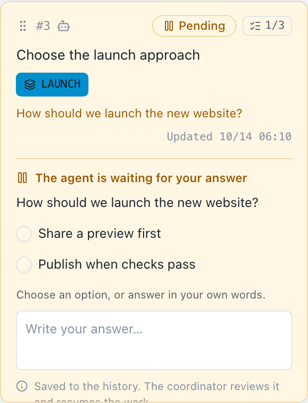
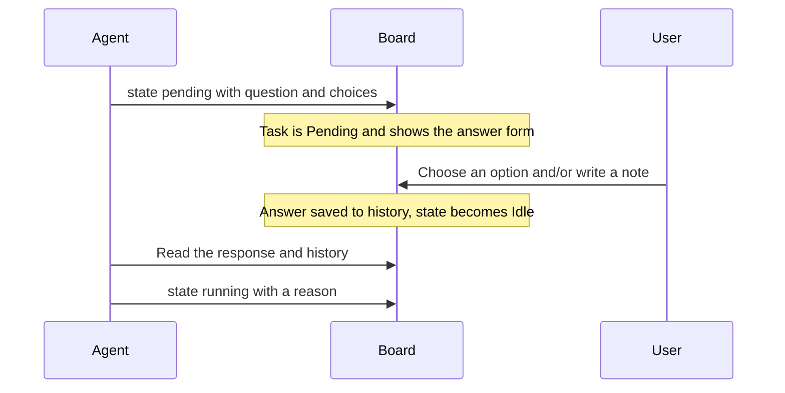

# Decisions

A decision is a question an agent asks when it cannot continue without you. This page shows how you answer on the PC and on your phone, and how an agent asks. For the idea in two sentences, see [Core concepts](../concepts#decisions).

## How you notice a question

A task with a question is **Pending** and shows the question and an answer form right on the task, in Todo or Doing. You can also see Pending tasks on the [mobile monitor](../operations/mobile-monitor).

## Answer in the browser

Choose one of the offered options, write a note, or do both, then send the answer. The answer is recorded, and the agent state becomes Idle in the task's current column. The agent reads your response before it decides how to resume.

{.screenshot}

The task shows the question, the options, and a text field for a note. Your answer stays available to the agent, and a concise reason is saved to the history.

- On the PC board you can still open the task's details and drag it while the answer form is in use.
- Moving the task to Done clears whatever you typed in the answer field.
- A question has no expiry. It stays open until it is answered, or until moving the task withdraws it or the agent replaces it.

## Answer on your phone

On the mobile monitor, a Pending task shows the same answer form. Tap the task to open its Body, Conditions, History, and Epic drawer, and swipe sideways to switch tabs. See [Mobile monitor](../operations/mobile-monitor) for connecting a phone.

{.screenshot .screenshot--narrow}

## How an agent asks

This section is for people who write or configure agents. The exchange looks like this:



An AI-owned task can ask in Todo or Doing, but it must be in Doing to become Running. The agent skill asks with two to ten choices. The CLI accepts a question and zero to ten options as JSON with `--request-json`, either inline or from standard input with `-`:

```json
{
  "question": "Which launch approach should we use?",
  "choices": [
    { "id": "preview", "label": "Publish a preview first" },
    { "id": "public", "label": "Launch publicly" }
  ]
}
```

Send it inline:

```sh
agboard --project "My project" state 1 pending --actor ai --request-json '{"question":"Which launch approach should we use?","choices":[{"id":"preview","label":"Publish a preview first"},{"id":"public","label":"Launch publicly"}]}'
```

Or read it from standard input:

```sh
cat question.json | agboard --project "My project" state 1 pending --actor ai --request-json -
```

`choices` takes 2 to 10 options; a request with fewer than 2 or more than 10 is refused, and so is a pending state without `--request-json`. The request gets an ID, which you can read with `show` or `snapshot`.

### Ask and wait in one command

Add a `wait` object to the JSON to ask and wait for the answer in one command. It needs a running `agboard serve`. An empty object waits indefinitely and prints the answer (the choice, the note, and the task) once the request is answered:

```json
{
  "question": "Which launch approach should we use?",
  "choices": [
    { "id": "preview", "label": "Publish a preview first" },
    { "id": "public", "label": "Launch publicly" }
  ],
  "wait": {}
}
```

You may add `"timeoutSeconds": 600` to limit this wait command; the value must be from 1 to 86,400 (a day). Without `wait`, the command asks and returns.

- A timeout or Ctrl+C stops waiting but leaves the question Pending.
- A lost server connection returns `board_unavailable`, a technical error that also leaves the question Pending.
- If moving the task withdraws the question, the command exits with `request_changed`.
- Without a running server, nothing is asked.

### Answer from the command line

A person can also answer from the CLI by passing the request ID:

```sh
agboard --project "My project" state 1 idle --actor human --request "<request-id>" --choice preview --reason "Get feedback before the public launch"
```

You can supply a choice, a note with `--reason`, or both. After reading the full response and history, the agent resumes:

```sh
agboard --project "My project" state 1 running --actor ai --reason "Preparing the preview requested by the user"
```

## Next

- [Working with agents](../automation/agents): the full work loop, including waiting.
- [Troubleshooting](../operations/troubleshooting): an answer that is refused or a question that disappeared.
