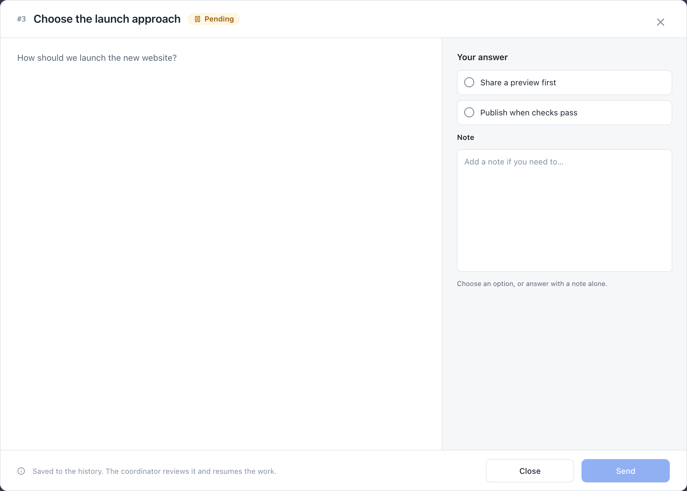
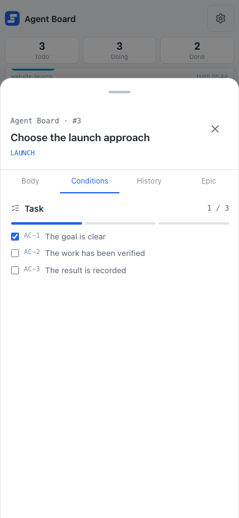
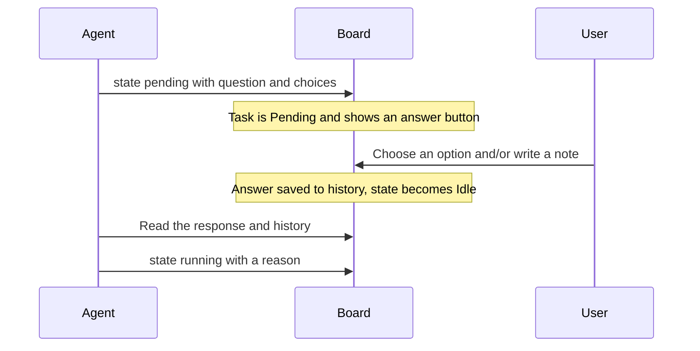

# Decisions

A decision is a question an agent asks when it cannot continue without you. This page shows how you answer on the PC and on your phone, and how an agent asks. For the idea in two sentences, see [Core concepts](../concepts#decisions).

## How you notice a question

A task with a question is **Pending**. In Todo or Doing, its card shows an **Answer the question** button. The button reads **Continue answering** when you have typed something and have not sent it yet. You can also see Pending tasks on the [mobile monitor](../operations/mobile-monitor).

## Answer in the browser

Select **Answer the question** on the card to open the answer dialog. The question is on the left, and your answer is on the right. Choose one of the offered options, write a note, or do both, then select **Send**. The answer is recorded, and the agent state becomes Idle in the task's current column. The agent reads your response before it decides how to resume.

On a window narrower than 900 px, the question and the answer stack in one column.

{.screenshot}

The answer is saved to the task's history. The question and each part of your answer appear as separate blocks there.

- **Close** the dialog at any time with the close button, Escape, or a click outside it. Closing never asks for confirmation, and your input stays. Select **Continue answering** on the card to return to it.
- Your input is kept while the page stays open. Reloading the page clears it.
- Moving the task to Done clears whatever you typed.
- A question has no expiry. It stays open until it is answered, or until moving or archiving the task withdraws it.

### If the question changes

If the agent asks a new question while the dialog is open, the dialog shows **The question has changed. Review it and answer again.** The options you chose are cleared, so choose again. Your note stays.

### If the question is withdrawn

Moving the task to another column, or archiving it, withdraws the question. The dialog then shows **This question was withdrawn. You can no longer answer it.** It keeps the question and your input so you can read them, but **Send** and **Clear** are hidden, and only **Close** remains.

### If sending fails

The dialog keeps your input and shows **Could not save. Try again.** Try again from the dialog.

## Answer on your phone

On the mobile monitor, a Pending task shows the same **Answer the question** button. Tap it to open the answer sheet, which slides up from the bottom. The question comes first, then your answer. **Send** stays at the bottom, so it is in reach as you scroll.

Tapping the task itself opens its Body, Conditions, History, and Epic drawer. Swipe sideways to switch tabs. See [Mobile monitor](../operations/mobile-monitor) for connecting a phone.

{.screenshot .screenshot--narrow}

If you close the sheet with an unsent answer, and the question is then withdrawn or the task leaves the board, the monitor lists that answer under **Unsent answers**. Nothing is sent from it. Select **Discard answer draft** to remove it.

## How an agent asks

This section is for people who write or configure agents. The exchange looks like this:



An AI-owned task can ask in Todo or Doing, but it must be in Doing to become Running. The agent skill asks with two to ten choices. The CLI accepts a question and two to ten options as JSON with `--request-json`, either inline or from standard input with `-`:

```json
{
  "question": "Which launch approach should we use?",
  "choices": [
    { "id": "preview", "label": "Publish a preview first" },
    { "id": "public", "label": "Launch publicly" }
  ]
}
```

Send it inline:

```sh
agboard --project "My project" state 1 pending --actor ai --request-json '{"question":"Which launch approach should we use?","choices":[{"id":"preview","label":"Publish a preview first"},{"id":"public","label":"Launch publicly"}]}'
```

Or read it from standard input:

```sh
cat question.json | agboard --project "My project" state 1 pending --actor ai --request-json -
```

`choices` takes 2 to 10 options; a request with fewer than 2 or more than 10 is refused, and so is a pending state without `--request-json`. The request gets an ID, which you can read with `show` or `snapshot`.

The question is Markdown, up to 5,000 characters. It is drawn like a task body, so headings, lists, code, links, and images attached to the same task appear as they do in the body. The answer note takes up to 2,000 characters.

### Replace a question

A Pending task keeps its question. Running `state pending` again on that task does not replace the question. To ask something else, withdraw the current question first by moving the task to another column, which clears the request. Then ask the new question.

### Ask and wait for the answer

A `pending --request-json` command waits for the answer by default, even when the JSON omits `wait`. A running `agboard serve` is required for this waiting path. When the request is answered, the command prints the task and answer. Existing requests with `"wait": {}` still wait indefinitely.

Use these three forms as needed:

Default wait until an answer, with no `wait` field:

```sh
agboard --project "My project" state 1 pending --actor ai --request-json '{"question":"Which launch approach should we use?","choices":[{"id":"preview","label":"Publish a preview first"},{"id":"public","label":"Launch publicly"}]}'
```

To register a question and return immediately, use `--no-wait`:

```sh
agboard --project "My project" state 1 pending --actor ai --request-json '{"question":"Which launch approach should we use?","choices":[{"id":"preview","label":"Publish a preview first"},{"id":"public","label":"Launch publicly"}]}' --no-wait
```

Add a timeout to wait for at most 600 seconds (1 to 86,400 seconds is allowed):

```sh
agboard --project "My project" state 1 pending --actor ai --request-json '{"question":"Which launch approach should we use?","choices":[{"id":"preview","label":"Publish a preview first"},{"id":"public","label":"Launch publicly"}],"wait":{"timeoutSeconds":600}}'
```

`--no-wait` does not need a running server. Both waiting forms require `agboard serve`; the CLI checks that it is available before saving the question. `--no-wait` can be combined with `wait: {}`, but combining it with an integer `timeoutSeconds` is an `invalid_argument` error (exit 2) and leaves the question, state, and history unchanged. `wait: null` and `timeoutSeconds: null` mean no timeout. Invalid JSON, unknown fields, wrong types, or an out-of-range timeout return `invalid_value` (exit 2); `--no-wait` on a command other than `pending --request-json` returns `invalid_argument` (exit 2).

- A timeout or Ctrl+C stops waiting but leaves the question Pending.
- A lost server connection returns `board_unavailable`, a technical error that also leaves the question Pending.
- If moving the task withdraws the question, the command exits with `request_changed`.

### Answer from the command line

A person can also answer from the CLI by passing the request ID:

```sh
agboard --project "My project" state 1 idle --actor human --request "<request-id>" --choice preview --reason "Get feedback before the public launch"
```

You can supply a choice, a note with `--reason`, or both. After reading the full response and history, the agent resumes:

```sh
agboard --project "My project" state 1 running --actor ai --reason "Preparing the preview requested by the user"
```

## Next

- [Working with agents](../automation/agents): the full work loop, including waiting.
- [Troubleshooting](../operations/troubleshooting): an answer that is refused or a question that disappeared.
