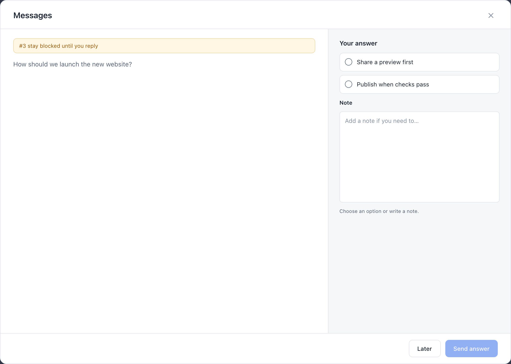
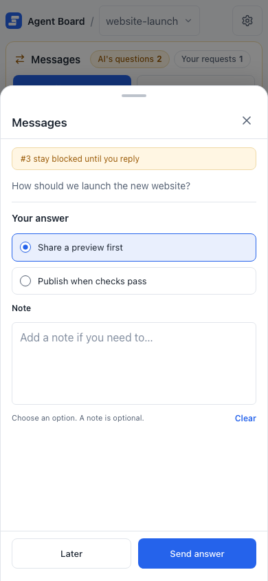
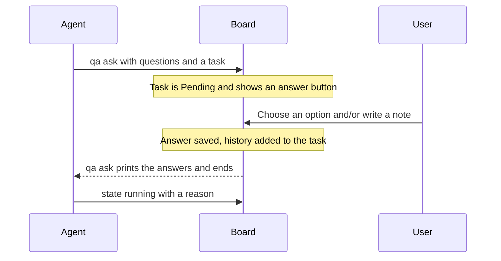

# Decisions

A decision is a question an agent asks when it cannot continue without you. This page shows how you answer on the PC and on your phone, and how an agent asks. For the idea in two sentences, see [Core concepts](../concepts#decisions).

## How you notice a question

A question belongs to the project, and a task refers to it. An AI-owned task that refers to an open question is **Pending**. In Todo or Doing, its card shows an **Answer the question** button. The button reads **Continue answering** when you have typed something and have not sent it yet. You can also see Pending tasks on the [mobile monitor](../operations/mobile-monitor).

## Answer in the browser

Select **Answer the question** on the card to open the answer dialog. The question is on the left, and your answer is on the right. Choose one of the offered options, write a note, or do both, then select **Send**. The answer is recorded, and the task stays in its current column. When the task refers to another open question, the card shows that one next; otherwise the agent state becomes Idle. The agent reads your response before it decides how to resume.

On a window narrower than 900 px, the question and the answer stack in one column.

{.screenshot}

The answer is saved to the history of every task that refers to the question. The question and each part of your answer appear as separate blocks there.

- **Close** the dialog at any time with the close button, Escape, or a click outside it. Closing never asks for confirmation, and your input stays. Select **Continue answering** on the card to return to it.
- Your input is kept while the page stays open. Reloading the page clears it.
- Moving the task to Done clears whatever you typed.
- A question has no expiry. It stays open until it is answered or the agent withdraws it. Moving or archiving the task does not withdraw it.

### If the question changes

If the question you are answering is answered somewhere else, for example in the chat, or the card moves on to another question while the dialog is open, the dialog shows **The question has changed. Review it and answer again.** The options you chose are cleared, so choose again. Your note stays.

### If the question is withdrawn

An agent can withdraw a question it no longer needs. The dialog then shows **This question was withdrawn. You can no longer answer it.** It keeps the question and your input so you can read them, but **Send** and **Clear** are hidden, and only **Close** remains.

### If sending fails

The dialog keeps your input and shows **Could not save. Try again.** Try again from the dialog.

## Answer on your phone

On the mobile monitor, a Pending task shows the same **Answer the question** button. Tap it to open the answer sheet, which slides up from the bottom. The question comes first, then your answer. **Send** stays at the bottom, so it is in reach as you scroll.

{.screenshot .screenshot--narrow}

Tapping the task itself opens its Body, Conditions, History, and Epic drawer. Swipe sideways to switch tabs. See [Mobile monitor](../operations/mobile-monitor) for connecting a phone.

If you close the sheet with an unsent answer, and the question is then withdrawn or the task leaves the board, the monitor lists that answer under **Unsent answers**. Nothing is sent from it. Select **Discard answer draft** to remove it.

## Answer in the chat

While you are talking with an agent, it shows the same question in the chat as well. Answer there in your own words, or choose an option in the agent's question tool. The agent records your answer on the board with `qa answer --via chat`, and the history notes that it came from the chat. Whichever answer is recorded first counts: if the board already has a different answer, the agent tells you and asks again. See [Questions](../automation/agents#questions) for how agents wait.

## Approve a plan

When an agent plans a request of several tasks, it first asks its questions about the plan and revises the plan. It then asks approval to start the revised plan with a question of the kind `start_approval`. Every task of the plan refers to both and stays Pending, from the first question until you choose an option that approves the plan. If you choose to change the plan, the tasks stay Pending while the agent revises it and asks again. See [Break a request into tasks](../automation/agents#break-a-request-into-tasks).

## How an agent asks

This section is for people who write or configure agents. The exchange looks like this:



An agent asks with `qa ask`. One command asks one set of questions, called a request, and waits until every question in it is answered. `--task` makes a task refer to every question in the set; repeat it for more tasks. The questions are written as JSON with `--request-json`, either inline or from standard input with `-`:

```json
{
  "questions": [
    {
      "question": "Which launch approach should we use?",
      "choices": [
        { "id": "preview", "label": "Publish a preview first" },
        { "id": "public", "label": "Launch publicly" }
      ],
      "recommendedChoiceId": "preview"
    }
  ]
}
```

```sh
cat question.json | agboard --project "My project" qa ask --actor ai --task 1 --request-json - --json
```

- `questions` takes 1 to 20 questions. Each question gets an ID such as `Q-12`, numbered in the project.
- `question` is Markdown, up to 5,000 characters. It is drawn like a task body, so headings, lists, code, links, and images attached to the same task appear as they do in the body. Images from `http` or `https` addresses are shown too.
- `choices` takes 2 to 10 options. Each `id` is 1 to 64 characters of letters, digits, `_`, or `-`, and each `label` is 1 to 200 characters.
- `recommendedChoiceId` is optional and names the option the agent recommends.
- `kind` is `task` unless given. `plan` marks a question asked while planning. `start_approval` asks approval to start and needs `approvingChoiceIds`, the options that count as approval. Until such a question is answered with one of them, the tasks that refer to it stay Pending. A task that refers to a `plan` question also stays Pending, even after that question is answered, until it refers to an approved `start_approval` question; a withdrawn `plan` question does not count.
- `tasks` in a question, such as `"tasks": [421, 422]`, links that question only to those tasks.

The answer note takes up to 2,000 characters.

The task must be AI-owned and in Todo or Doing. While it waits, it cannot be set to Running. Moving the task to another column or archiving it does not withdraw its questions.

### What the command prints

With `--json`, the command prints one JSON object per line. Without it, it prints the same events as short sentences.

| Event | Meaning | Exit code |
| --- | --- | --- |
| `registered` | The questions were saved. It holds the request ID and the question IDs. | — |
| `waiting` | Not every question is answered yet. It is printed every 60 seconds (`--heartbeat` sets 10 to 600). | — |
| `answered` | Every question is answered. It holds all the answers. | 0 |
| `timeout` | The wait ended. The questions stay open. | 5 |
| `withdrawn` | The request was withdrawn. | 6 |
| `error` | Waiting failed after the questions were saved, for example when the server stopped. The questions stay open. | 1 |

The command waits 600 seconds by default. `--timeout` takes 1 to 86,400 seconds, or `none` to wait without a limit. Waiting needs the server; the CLI checks it before saving anything and starts it in the background when none runs. If it cannot start the server, nothing is saved and the command fails with `board_unavailable`. `--no-wait` saves the questions, prints `registered`, and returns at once, without a server.

To wait again after a timeout or an error, pass the request ID. The questions are not asked a second time:

```sh
agboard --project "My project" qa wait "<request-id>" --json
```

### Read, withdraw, and link questions

```sh
agboard --project "My project" qa ls --json
agboard --project "My project" qa show Q-12 --json
agboard --project "My project" qa withdraw "<request-id>" --actor ai --reason "No longer needed"
agboard --project "My project" qa link Q-12 --task 3
agboard --project "My project" qa unlink Q-12 --task 3
```

- `qa ls` lists open questions; `--status answered`, `withdrawn`, or `all` lists others, and `--task` limits the list to one task's questions.
- `qa show` takes a question ID or a request ID and prints the full question, the options, the answer, and the tasks that refer to it.
- `qa withdraw` withdraws every unanswered question of a request. A waiting `qa ask` ends with `withdrawn`. A request whose questions are all answered cannot be withdrawn.
- `qa link` and `qa unlink` add questions to a task or remove them. They change the `questions` list in the task's `TASK.md`.

### Answer from the command line

A person can also answer from the CLI with the question ID:

```sh
agboard --project "My project" qa answer Q-12 --actor human --via cli --choice preview --text "Get feedback before the public launch"
```

Give a choice, a note with `--text` or `--text-file`, or both. `--answers-json` answers several questions at once; they are saved together, or not at all. When the user answers in the chat, the agent records the user's words with `--via chat`. The first recorded answer is final: answering an answered question fails with `question_answered` and prints the recorded answer.

After reading the answers and history, the agent resumes:

```sh
agboard --project "My project" state 1 running --actor ai --reason "Preparing the preview requested by the user"
```

## Next

- [Working with agents](../automation/agents): the full work loop, including waiting.
- [Troubleshooting](../operations/troubleshooting): an answer that is refused or a question that disappeared.
