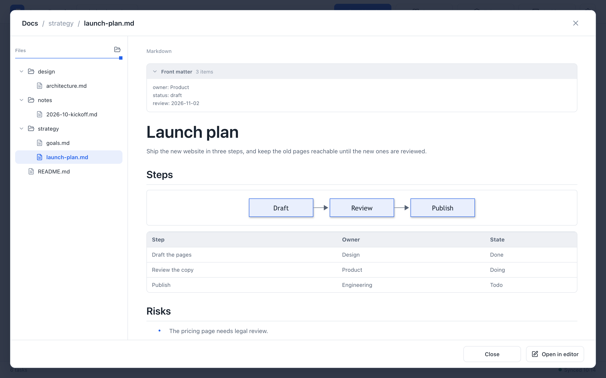
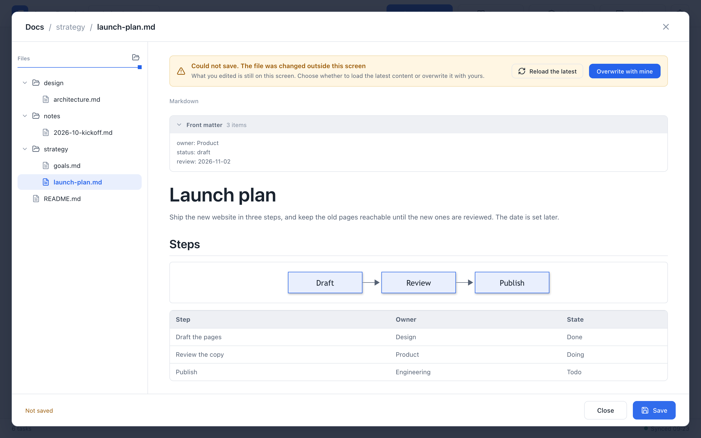

# Project docs

Each project has a `docs/` folder for its Markdown documents: strategy, specifications, designs, and notes. Open **Docs** in the board header to browse the folder, read a file, and edit and save it in place. The docs are separate from the board: saving a document never changes a task, an epic, or the board's history.

## Open the docs

Choose **Docs** in the board header. The dialog shows the files on the left and the open file in the middle.

{.screenshot}

- **Files.** The list shows the folders and all files in the project's `docs/` folder, folders first. Names that start with a dot and symbolic links are not listed. What a file does depends on its type: a Markdown (`.md`) file opens for reading and editing, an image (PNG, JPEG, WebP, GIF) is shown in the body and cannot be edited, and any other file, such as `.pen`, `.json`, or `.txt`, is listed but the body says **This file type cannot be shown here.** with the file's name. Save is off for images and other files. Drag the handle on the right edge of the list to change its width.
- **Body.** Until you choose a file, the middle says **Select a file**. Choose a file to show it. Tables, code blocks, Mermaid diagrams, and images are rendered.
- **Front matter.** A YAML block between `---` lines at the top of a file is shown in a separate **Front matter** panel above the body. You can fold it, but you cannot edit it here; it is saved exactly as it was.
- **Images.** An image written with a relative path, such as ``, is looked up from the file's own folder. PNG, JPEG, WebP, and GIF images inside `docs/` are shown. Images from `http` and `https` addresses load as they do on the board.

The list is read once when the dialog opens, and a file is read when you choose it. To see files you added while the dialog was open, close it and open **Docs** again. Switching to another project starts the dialog over.

If the project has no files, the dialog says **This project has no docs** and shows the folder's path, `shared/projects/<project-id>/docs/` in the data area, with a button to copy it.

On a phone-width screen, the file list fills the screen. Choose a file to show it in place of the list. To choose another file, close the dialog and open **Docs** again.

## Edit and save

The body is the same Markdown editor as tasks and epics, so you edit the rendered text directly. There is no separate edit mode.

1. Click into the body and make your change. The footer changes from **No changes** to **You have unsaved changes.**
2. Choose **Save**. **Save** is available only when something changed.
3. The dialog stays open after saving, so you can keep editing or open another file.

Opening a file and closing it again never writes it. If you choose another file, close the dialog, or reload a file while you have unsaved changes, Agent Board asks whether to discard them; **Keep editing** returns you to your text.

A file that the operating system marks as read-only says **This file is read-only. You cannot edit or save it.** If a save fails for another reason, the footer shows the reason, and your text stays in the editor so you can try again.

## When the file changed elsewhere

Another program, such as a text editor, `git`, or an agent, may change the file while you are editing it. When you save, Agent Board checks that the file is still the version you opened. If it is not, nothing is written and the dialog shows **Could not save. The file was changed outside this screen**. Your edits stay on screen.

{.screenshot}

- **Reload the latest** shows the file as it is now. Agent Board asks first, because your unsaved edits are lost.
- **Overwrite with mine** saves your text over the newer file. The other change is lost.

There is no side-by-side comparison. If you need both changes, copy your text somewhere first, reload, and merge by hand.

The check covers saves from this dialog. A program that writes the file at the very moment you save is not coordinated with Agent Board, so its write may be lost; avoid editing the same file in two places at once.

## Formatting that changes when you save

A file that you open and close without editing stays byte for byte as it was. Once you edit, the editor writes the whole body back in its own Markdown style. The content is the same, but some notation changes:

| Written as | Saved as |
| --- | --- |
| Setext headings (a line underlined with `===` or `---`) | `#` and `##` headings |
| A heading with closing `#` marks | The heading without them |
| List items starting with `*` or `+` | Items starting with `-` (a list right after another list may use `*`) |
| Numbered items written `1)` | Numbered items written `1.` |
| Nested lists indented by four spaces | Two spaces |
| `* * *` | `***` |
| A code block fenced with `~~~` | A code block fenced with three backquotes |
| A line break made with two trailing spaces | A backslash at the end of the line |
| A bare URL | The URL in angle brackets, `<https://…>` |
| A `*` in ordinary text | `\*` |
| A reference link with a separate `[ref]: …` line | An inline link; the reference line is removed |
| A table | Columns padded to line up, and the alignment row written as `:-`, `:-:`, `-:` |
| Windows line endings (CRLF) | LF line endings |

Front matter is never rewritten. If exact formatting matters for a file, edit it in a text editor instead.

## Add and organize files

The dialog edits files that already exist. It does not create, rename, move, or delete files or folders. Do that in the folder itself, with Finder, Explorer, a text editor, or an agent:

```sh
agboard --project "My project" workspace --json
```

The `folder` in the result is the project's folder; its documents are in `docs/` inside it. Put `.md` files there, in subfolders if you like, and open **Docs** again to see them.

- Agent Board creates `docs/` when the project is created, with a short `README.md` in the app's language. If an older project has no `docs/`, the server creates it at startup. A `README.md` you deleted is not put back.
- A file of up to 2 MiB can be opened and saved. It must be UTF-8 text with a name ending in `.md`.
- Deleting the project with `agboard project rm` also deletes its `docs/` folder. Copy anything you want to keep first.
- Docs are not shown on the [mobile monitor](../operations/mobile-monitor).

## Next

- [Editing and image attachments](./editing): the same editor for tasks and epics.
- [Data and backups](../operations/data): where the data area is and how to back it up.
