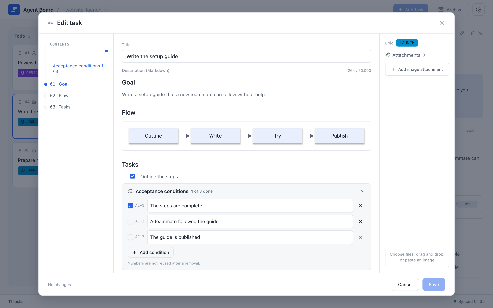

# Editing and evidence

Tasks and epics are written in a Markdown editor. A task's completion conditions sit in a panel below the text, and you can attach images and text evidence to a task. Agents edit the same content as plain files in the project's shared folder. This page covers the editor, images, and evidence; the file format is in [Markdown file format](../automation/file-format).

## Write tasks and plans in the editor

{.screenshot}

The editor shows the outline on the left, the Markdown body in the middle, and the epic and image attachments on the right.

- **Formatting.** The editor supports headings, task lists, tables, code blocks, Mermaid diagrams, and images. Click an image or a diagram to enlarge it.
- **Outline.** Use the outline to jump to a heading in the body or to open the conditions panel.
- **Saving.** Save or cancel the dialog's changes together. Record verification before you check off a completion condition.
- **Conditions.** When you create or edit a task, its acceptance conditions sit in a panel below the body, which starts folded. Expand it to edit them; a long list scrolls inside the panel. Conditions have stable IDs and cannot be reordered. To read conditions on an existing task, use its **Conditions** tab. An epic has no conditions panel: its reference conditions are ordinary Markdown in the plan.

For the epic dialog (name, color, plan, and task order), see [Epics and progress](./epics). For drafts, see [The board](./board#drafts).

## Add images

In the browser editor, select, drop, or paste an image, then insert it into the text. Images can be PNG, JPEG, WebP, or GIF, up to 10 MiB each, with at most 20 per task and 50 MiB in total.

From the command line:

```sh
agboard --project "My project" attachment add 1 --file diagram.png --actor ai
agboard --project "My project" attachment ls 1 --json
agboard --project "My project" attachment get 1 "<attachment-id>" --output diagram-copy.png
```

Images are referenced in the Markdown as `attachment:<attachment-id>`, and the image bytes stay in local files. Snapshots include the image metadata; the progress table and hooks leave it out. `attachment get` never overwrites an existing output file.

## Add evidence

Evidence is a UTF-8 log or other text that proves a result, such as test output. Add it, then use the returned evidence ID to read it:

```sh
agboard --project "My project" evidence add 1 test-output.log
agboard --project "My project" evidence show 1 "<evidence-id>"
```

Reference the evidence ID in the task's body so that a reader can find it.

## Edit the files directly

Agents, and you, can also edit a task's `TASK.md` and an epic's `PLAN.md` as plain files; the board notices the change. Find the project's folder instead of guessing its location:

```sh
agboard --project "My project" workspace --json
```

The result contains `folder` (the project's absolute path), `projectId`, `readme`, `tasks`, and `epics`. Read the project's `README.md` first. Write a temporary file in the same folder and rename it over the original, so that the board never reads a half-written file. Use the CLI for metadata and status changes; never edit `task.json`, `epic.json`, `project.json`, or the lock files, and never delete task or epic folders by hand. Keep personal absolute paths out of shared files.

The required structure of these files is in [Markdown file format](../automation/file-format).

## Next

- [Markdown file format](../automation/file-format): frontmatter, history, and automatic Done.
- [CLI reference](../automation/cli): every command.
