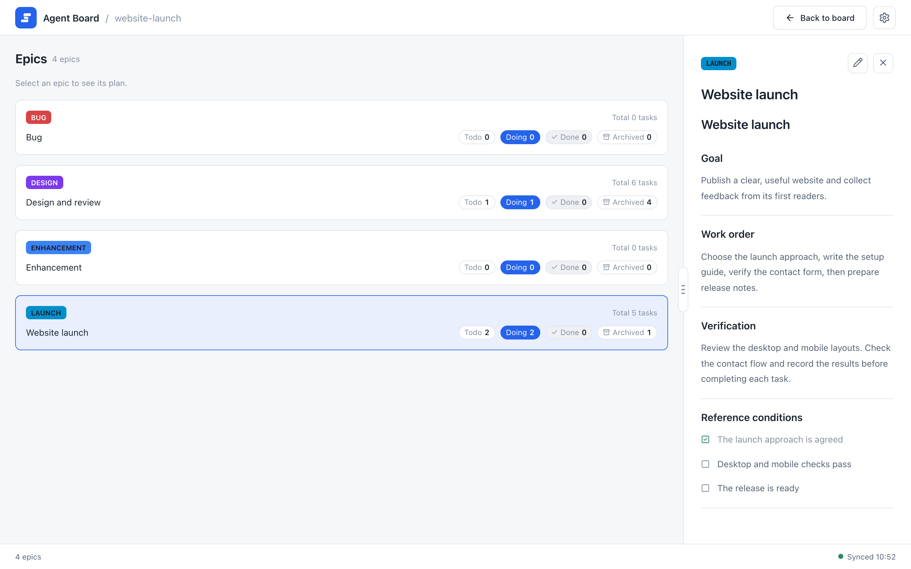
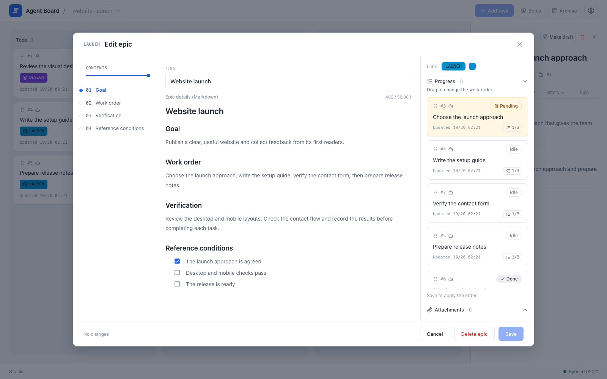

# Epics and progress

An epic is a management unit that groups tasks and gives them an order, so that agents know what to do next. Each epic has its own details in Markdown. This page shows how to create and order epics, edit one in the browser, and read the progress table that agents use.

## Group tasks in an epic

```sh
agboard --project "My project" epic add launch --name "Website launch" --actor ai
agboard --project "My project" epic ls --json
agboard --project "My project" epic show LAUNCH --json
agboard --project "My project" epic edit LAUNCH --document-file epic.md
agboard --project "My project" edit 1 --epic LAUNCH
agboard --project "My project" add "Prepare the preview" --assignee ai --actor ai --epic LAUNCH
agboard --project "My project" edit 1 --clear-epic
```

- Epic IDs use letters, digits, and hyphens; lowercase input is turned into uppercase.
- The details are free Markdown with optional `priority` frontmatter. Write reference completion conditions directly in the details; no heading is required.
- Use `--document-file` to set the whole `EPIC.md` text from a file, or `--document` to pass the text (use `-` to read standard input). The text includes frontmatter and can be up to 50,000 characters.
- Use `--name` or `--color '#7C3AED'` with `epic edit` to change the name or color.
- A task belongs to at most one epic.

## Default epics

Every project starts with two epics, `BUG` (named Bug) and `ENHANCEMENT` (named Enhancement), so that bug reports and improvements have a place to go. A project that already exists gets them the next time `agboard serve` starts. You can rename, recolor, and delete them. A deleted default epic is not created again.

The agent skill treats these two IDs as ongoing classification epics with fixed bodies. `BUG` collects defects in existing behavior; `ENHANCEMENT` collects requests for new capabilities and improvements. Empty details are initialized once from the skill’s fixed template in the board’s language. Per-task plans, decisions, and verification stay in task bodies and history. Agents do not append progress or completion summaries to these epic bodies. They preserve a non-empty body unless you explicitly request replacing or changing it, and keep useful existing records in relevant task bodies before a replacement. Task priority can still be changed. This is a skill workflow; the browser editor remains available.

## Browse all epics

Open **Epics** in the header to see every epic in the project, in ID order, including epics with no tasks and epics whose tasks are all done. Each row shows the number of tasks in each state: Todo, Doing, Done, and Archived. Archived tasks count only as archived, so the four numbers add up to the total at the top right of the row.

{.screenshot}

Select an epic to read its name, details, and images in the details column beside the list. The column stays in place, as it does in the archive, and reads "Select an epic to see its cards and details." until you select one. The edit button in the detail header (**Edit epic**) opens the same editor as the epic label. The trash button next to it (**Delete epic**) opens a confirmation in the details column, as the task details do, and then deletes the epic with its details and images. Nothing is deleted while a task still belongs to the epic, archived tasks included; the confirmation says so, and you move or clear those tasks first. The edit, delete, and close icons use the same style and spacing as task and archive details. Close the details or select the row again to return to the prompt. **Back to board** returns to the board.

## Order the work

Save an epic's task order from the command line:

```sh
agboard --project "My project" epic edit LAUNCH --priority "3,1,2"
```

This writes `priority: [3, 1, 2]` in the epic's `EPIC.md`. The entries must be distinct positive task IDs, and only current members of the epic are kept. Unlisted members follow in ascending ID order. Pass `--priority ""` to clear the explicit order. The order is independent of where tasks sit on the board.

## Edit an epic in the browser

Open an epic from its label to edit its name, color, details, and task order.

{.screenshot}

The epic editor shows the outline on the left, the name and the "Epic details (Markdown)" field in the middle, and the label, task progress list, and attachments on the right. Reference completion conditions are written directly in the details; there is no separate conditions panel.

- The right column starts with progress expanded and attachments folded. Opening either panel folds the other.
- The progress list scrolls on its own, so a long list stays inside the dialog and includes finished tasks for review.
- Drag a task by its handle (or use the handle's keyboard controls), then **Save** to apply the order.
- Selecting a task opens its details. Change membership in the task editor or on the command line, not in the epic dialog. The epic dialog has no Draft checkbox and keeps the epic's existing draft state.

## Read the progress table

```sh
agboard progress
agboard progress --json
agboard --project "My project" progress --json
```

The progress table is what agents read to choose their next task. It groups Todo and Doing tasks under their epics, with a separate group for work without an epic. Done, archived, and Pending tasks are left out; a Pending question stays on the board until it is answered, and `show` or `snapshot` shows it. User-owned tasks and drafts stay in the table for context, but agents skip them when choosing work.

Each entry lists the task ID, title, owner, column, agent state, acceptance counts, and the path of its `TASK.md`. Epic entries include the path of `EPIC.md` (`documentPath` in JSON). Bodies, history, and images are not included: the agent reads only the files it needs for the work it chose. Hooks give agents this same table.

By default the table leaves out tasks waiting for a decision and finished tasks. Add them when you need the whole picture:

```sh
agboard progress --include-pending --include-done 5
```

- `--include-pending` adds a "Waiting for a decision" section. Each task shows the start of its question (`question` in JSON).
- `--include-done COUNT` adds a "Recently done" section with the most recently completed tasks, newest first. Only tasks of epics that still have Todo or Doing work are included, so finished epics and tasks without an epic stay out. Archived tasks are never included.
- Without these options the output is the same as before. To give agents these sections, add the same options to the hook command, for example `agboard hook --agent claude --include-pending --include-done 5`.

Epics appear in ID order. Within an epic, the `priority` list decides the order of its tasks, and tasks not listed follow in ascending ID order. Work without an epic is also sorted by ID. Epics with no listed tasks are left out.

## Next

- [Working with agents](../automation/agents): how agents use the table.
- [Markdown file format](../automation/file-format): the `priority` list and the rest of `EPIC.md`.
