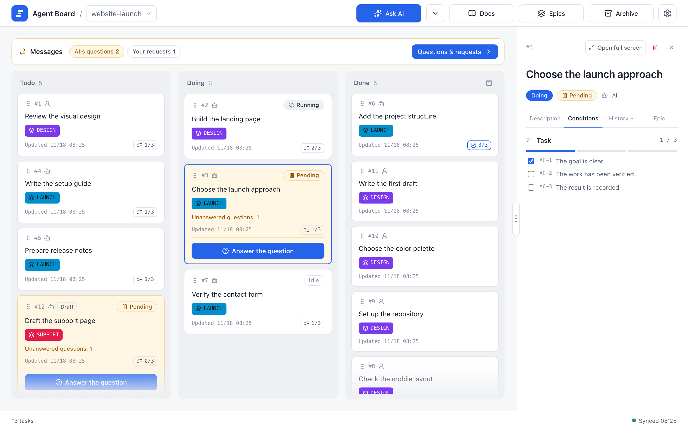
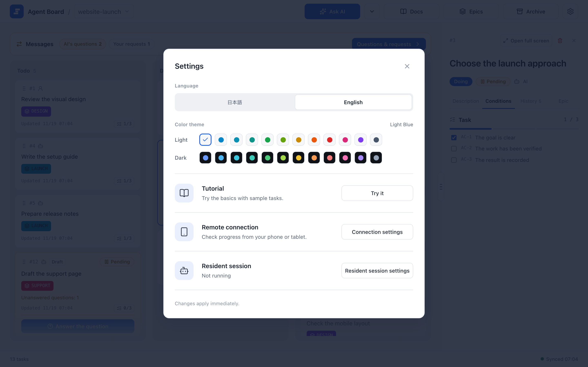
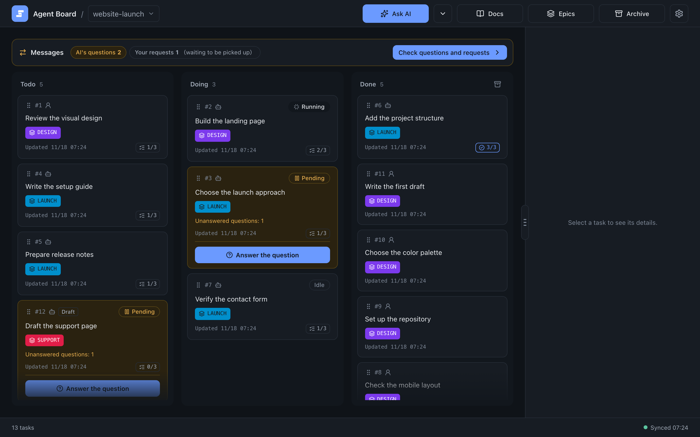

# The board

The board is where you watch the work and step in while the agent keeps going. You see what is moving and what is waiting, and you can move a card, check a condition, or rewrite a task without stopping the agent; it follows the change the next time it reads the board. This page covers the daily actions; the ideas behind them are in [The work model](../work-model). When the agent stops to ask you something, you answer in [Decisions](../delegate/decisions).

## Add work

1. Select a project in the header and choose **Ask AI**.
2. Write what you want done, attach images if they help, and choose **Send request**. The request is not a task: it goes to the agents as a message, and it counts under **Your requests** in the band above the lanes, where the list shows it as **Waiting to be picked up**, until an agent receives it.
3. When the request is sent, the Messages list opens on the **Your requests** tab, on the PC and on the phone, so you see the request at once. If sending fails, the form stays open with your text and images.

On a phone, choosing another item in the bottom bar while the request form is open closes the form and shows that item. If you have typed text or attached an image, the board asks before discarding them, and choosing to keep editing leaves you on the form.

The board has no form for adding a task by hand. Agents create tasks from your requests, and you can also add one with `agboard add` (see [CLI](../reference/cli)). A new task appears at the end of Todo. The owner cannot be changed after the task is created.

## Read a task {#read-a-task}

Select a task to open its details on the right. The tabs show:

| Tab | Shows |
| --- | --- |
| **Description** | The task's body. |
| **Conditions** | The task's own acceptance conditions and its progress. |
| **Results** | What an agent delivered for you to look at, newest first. See [Read a result](#read-a-result). |
| **History** | What happened, newest first, each entry with its time and reason. |
| **Epic** | The details of the epic the task belongs to, if any. |

{.screenshot}

The panel on the right shows the selected task. The Conditions tab lists the task's own acceptance conditions with a progress bar. Each condition is drawn as Markdown, like the task body, so it can hold links, code, and images. An epic's own reference conditions stay in its Markdown details.

You can check and uncheck a condition in the Conditions tab. The change shows at once and is saved right away; if it cannot be saved, the checkbox goes back and a message says so. Your choice is saved over the latest file, so it wins even if an agent changed the task after you opened it, and the rest of the file, including the agent's other changes, stays. The history records that a person checked or unchecked the condition.

- When you check the last condition of an AI-owned task in Todo or Doing, the task moves to Done by itself, the same as when an agent checks it.
- Unchecking a condition of a task in Done leaves it in Done. Move it yourself if work should continue.
- An archived task's conditions cannot be changed. To change a condition's text, restore the task and open its preview.

On a touch screen, swipe the panel sideways to move to the next or previous tab. The next tab follows your finger, as the tabs of a task do on a phone. A mouse does not drag the panel, so you can still select text with it. A swipe that starts on a button, a link, code, an image, or a table that scrolls sideways is left to that element.

Each tab loads its text when you open it. The number on the **History** tab appears after the history has loaded.

### Read a result {#read-a-result}

When an agent delivers a result with `agboard result add` (see [Deliver a result](../reference/cli.md#deliver-a-result)), it appears in the **Results** tab. Results are listed newest first. Each one shows:

- a badge, **In progress** or **Final**, with its version and the time it was delivered;
- the title, as the heading of the result: the title the agent gave, or the first sentence of the summary when it gave none;
- the summary;
- the images, if there are any. One image is shown large; several images are a row of thumbnails that scrolls sideways. Select one to see it larger. In the larger view, swipe sideways (or press the left and right arrow keys) to move through the others; the position, such as 2 / 4, is shown below the image. A tall image fits the width and scrolls up and down inside the viewer, which stays above the bottom bar on a phone;
- the link or storage location of the main artifact, if there is one. When it is an `http:` or `https:` URL, such as a pull request, it is a link: tap or select it to open it in a new tab (on an iPhone Home Screen app, in Safari). Any other value, such as a file path or a `file:` address, is shown as text only, because the artifact may exist only on the PC.

A result is also readable on its own from an address that names the project, the task, and the version: `https://<host>/?project=<ProjectId>&task=<id>&result=<version>`. Opening it shows that task's details with the Results tab selected, and scrolls to the result and highlights it. This works on the phone through [remote access](./remote-access.md#open-a-result-from-a-link) and on the PC board, and it works even if another project was on the screen. If the task has no such version, the tab says so and lists the results it does have.

## Move a task

On a touch screen, press the grip at the left of the card's header and move your finger to drag at once. Pressing elsewhere on the card and holding for a moment also drags it, and a quick swipe scrolls the column instead.

On a touch screen the buttons, tabs, and theme tiles are at least 44 px high, and a dialog opens without raising the on-screen keyboard. Tap a field to start typing. On a tablet, the dialog then moves into the space above the keyboard and makes room for the field you are typing in: its margins and buttons get smaller, and panels you are not typing in, such as the editor's outline and attachments or the question beside your answer, fold away until the keyboard closes. While the keyboard is open, a single tap on **Send request** or **Send answer** sends; the keyboard does not need to be closed first.

In a window narrower than 1024 px, **Docs**, **Epics**, and **Archive** in the header show only their icons, all at the same width, so the project name keeps its room.

Drag a task to another column to move it. The move is made at once, with no confirmation: the card is in its new column before the server answers, and the history records a reason generated from the move.

If an agent or another browser moved the task after the board last showed it, the move is not made. The card goes back to the column it was in (the one it is in now), and a short notice names that column. If the move fails for any other reason, the card also goes back and a notice says it stays where it was. Drag it again to move it from there.

The columns mean:

| Column | Meaning |
| --- | --- |
| Todo | Work that has not started. |
| Doing | Work in progress. AI-owned tasks also show an agent state. |
| Done | Completed work. |

AI-owned tasks in Doing show **Idle**, **Running**, or **Pending**. Todo tasks can also be Pending when an agent asks a question before starting. User-owned and Done tasks are always Idle. Running means the agent is working; Pending means it needs your answer, which you give from the card's **Answer the question** button or from the list of the **Messages** band above the lanes (see [Decisions](../delegate/decisions)). Moving a task to another column resets a Running task to Idle; an open question stays open, so a waiting task in Todo or Doing stays Pending. Every change and its reason stay in the history.

## Change a task

To edit a task or put it in an epic, choose **Open full screen** in the details toolbar. The preview uses the same editor, and opening it changes nothing. Your first change makes the task a draft, and **Save** finalizes it. See [Preview and save](./editing#preview-and-save) for the details.

## Drafts

A draft is a task that agents must leave alone while you write it. Agents cannot change a draft, including its `TASK.md` file.

- To change an existing task, open its preview. Your first change makes it a draft, and **Save** releases it, so agents can work on the task again. The editor has no Draft checkbox.
- To drop your changes, choose **Cancel** and then **Discard and close**. The text returns to the saved version, and the history records `Discarded draft changes.`
- A running task opens read-only and cannot become a draft.

A draft is marked with a **Draft** chip on its card. If you forget to finalize, the agent cannot move or update the task.

If a draft is left behind, for example because a save failed and you closed the browser, choose **Finalize** in the task's details to release it. The **Finalize** button appears only on a draft.

### Backlog plans {#backlog-plans}

When you ask an agent for a plan only, it puts the plan in the Backlog: settled plans that must not be started yet. The Backlog is the first lane of the board, before Todo. It means "do not start", and agents never start it. Its header shows its own count, and its cards have a dashed outline and a **Backlog** label in their details, so they are easy to tell from Todo. A card with an open question carries an **Open question** mark. You can open a plan, read it, answer the questions about it, and edit it like any other card; the Backlog has no editor of its own. The agent cannot move it or change its state.

Plans are corrected through chat or requests to the AI: send the agent a request with **Ask AI**. A request to carry out the work, instead of a plan, creates ordinary Todo cards.

Only you send a plan to Todo, and a card sent to Todo goes to the end of its lane. Moving one card and sending several are two separate flows.

**Move one card.** This works like a move between any other lanes: the card is in its new lane at once, with no extra step and no notice when it went. If the server refuses, the card goes back to the Backlog and a notice gives the reason.

- **On the board**, drag a card you have not selected onto Todo (or straight onto Doing or Done; the lane under the pointer gets a dashed outline), or choose **Send to Todo** in the plan's details.
- **On the phone**, hold the card and swipe it to the right, then choose the Todo button. Backlog cards go to Todo only on the phone.

**Send several cards.** Start the selection mode, pick the cards, and send them together:

- Choose the select button in the Backlog header. On the phone, choose **Select cards** at the bottom of the lane, hold a card, swipe it to the left, and choose its select button, or swipe the lane itself to the right past its start edge, the way you swipe left past the end of Done to archive everything. That swipe is a shortcut for **Select cards**, so you do not have to scroll to the bottom of the lane: it starts the selection mode with nothing picked, from wherever the lane is scrolled, and sends nothing. A circle appears at the left of each card, and you pick a card by choosing its circle or tapping the card.
- On the board, choose **Send to Todo (N)** in the bar under the lane. You can also grab one of the selected cards and drop it on Todo, Doing, or Done: all the selected cards move together, and a badge on the card shows how many.
- On the phone, a short drawer rises from the bottom of the screen with **Cancel** and **Send to Todo (N)**. It does not cover the cards or dim them: you can keep tapping cards to pick or drop them, and scroll the lane, while it is open. The drawer closes, and the selection ends and is cleared, when you choose **Cancel**, pull the drawer down by its handle, press Escape, leave the Backlog tab, or when the cards have been sent. The drawer is also the way to send with the keyboard or a screen reader.
- **A whole epic.** The details of an epic with cards in the Backlog have a button that sends all of them in one save (see [Epics and progress](./epics)).

If a card you send, alone or in a group, still has an open question, a window (on the phone, a sheet) names those cards and asks you to confirm that the questions stay open. It is the only extra step: the send waits for the check, and **Cancel** changes nothing. After the question is answered the card can start. A send that went through shows no notice. If a send fails, or only some of the picked cards went, a notice says so. Agents cannot move a card out of the Backlog to any lane.

You can also take a card back. Only you can do it, and only for a Todo card that has not been started: on the board, drag it onto the Backlog lane; on the phone, hold the card and swipe it to the right, then choose the Backlog button. The card becomes a Backlog plan again and agents stop treating it as work to pick up. A card that has been started, or one an agent tried to move, is refused, and the notice shows the reason the server gave.

You can also send a plan from the command line: `agboard send <id> --actor human` for a card, or `agboard epic send <EPIC-ID> --actor human` for an epic (see [CLI](../reference/cli)). With open questions, the command is refused until you confirm it with `--force`. `agboard mv <id> doing --actor human` (or `done`) moves a Backlog card straight to that lane; it is refused while the card has an open question.

## Archive

Archive finished tasks to clear the board without deleting anything.

- Archive one task from its details, or choose **Archive completed tasks** in Done to archive several at once.
- Open **Archive** in the header to review archived tasks, restore them to their original column, or delete them permanently. Permanent deletion is possible only from Archive.

{.screenshot}

The Archive screen lists archived tasks with their ID, title, owner, date, and the epic they belonged to, if any. The list is ordered by the time each task was archived, newest first; tasks archived at the same time appear with the higher ID first, and a task with no recorded archive time comes last. The phone's archive list uses the same order. The list loads 50 tasks at a time: when you scroll to the end of the rows, the next page loads, and a note under the last row says the list is complete. If a page cannot be loaded, the rows already shown stay and a **Retry** button appears under them. Select a task to see its details.

The details of an archived task use the same layout as an active task. **Restore** and the trash icon for permanent deletion sit at the top right, next to the close button. Permanent deletion asks for confirmation first.

## Narrow windows and phones {#narrow-windows-and-phones}

When the window is narrower than 768 pixels, and on a phone, the board shows the mobile layout instead of the lanes side by side: tabs for Backlog, Todo, Doing, and Done with their counts, one lane at a time under them (the board opens on Doing), and a bottom bar with **Board**, **Messages**, **Ask**, **Archive**, and **Settings**; **Messages** shows the number of questions that wait on you and opens the list. Tap a tab or swipe sideways to change lanes. Choose a task to read it in a drawer, check its conditions, and answer a decision. Hold a task and swipe it to move it to the next lane or to archive it (swiping a Todo task to the right shows a button that takes it back to the Backlog if nobody has started it; in the Backlog, swiping a plan to the right shows a button that moves it to Todo and swiping it to the left offers the select button for sending several plans, and swiping the lane to the right past its start starts the selection mode, see [Backlog plans](#backlog-plans)), swipe left past the end of the Done lane to archive every completed task, and use **Archive** in the bottom bar to review archived tasks and restore one by swiping it left. The project switcher stays in the header; settings are in the bottom bar. Adding and editing tasks are for a wider window.

The layout follows the window as you resize it. The project you chose stays, and an answer you have entered but not yet sent is kept when you switch between the two layouts. The mobile layout is described in [Remote access](./remote-access).

## Updates

The board updates itself when a change is saved, whether an agent made it or another browser on this PC did. There is no refresh button; reloading the page reads everything again.

The board follows changes while a details panel is open beside it. When an agent moves the task or checks a condition, the card and the panel show it at once, so you can read a task and watch its progress together.

While an editor or a dialog is open, automatic updates wait, so the text you are editing does not move. They are applied about three seconds after you close it.

A decision is the exception. When an agent asks for a decision, or a decision is answered or withdrawn, the board shows it at once, even while an editor or a dialog is open.

## Settings

Open **Settings** to choose the language (English or Japanese) and one of 24 themes (12 colors, each in light and dark).

The choice is saved on this PC, so every browser on this PC shows the same language and theme. Changes apply at once to the other open pages, including other browser windows and remote access, without a reload. The first start uses English and light blue; the board does not follow the browser or OS settings. Task text is not translated. CLI help, errors, and JSON values stay in English.

The width of the detail panel is not part of these settings. Each browser keeps its own width.

Below the themes, four rows open other features. Each has an icon, a title, one line of description, and a button:

- **Tutorial** with **Try it** closes the dialog and shows the [first-run guide](#the-first-run-guide) again, on the screen you are using.
- **Remote connection** with **Connection settings** opens the setup for checking the board from a phone with ngrok; see the [remote access guide](./remote-access).
- **Resident agent** with **Agent settings** opens the dialog that starts and stops an agent session kept attached to the board; see [Resident agent](../delegate/resident-session). While a session is launched, or auto-start is on, the footer also shows its tool and state just left of the sync state, and clicking it opens the same dialog.
- **Notifications** with **Notification settings** opens the dialog that chooses what the board may tell your phone about; see [Notifications](#phone-notifications).

{.screenshot}

The dialog has a language switch and a grid of themes: one row of 12 light colors and one row of 12 dark colors. On a narrow window the button of each row moves under its description.

### Notifications {#phone-notifications}

Choose which notifications the phone gets, turn them on or off, and read what each kind opens in [Notifications in the app](./remote-access.md#notifications).

{.screenshot}

The same board after choosing a dark theme.

## The first-run guide

The first-run guide runs in your browser, on the PC board and on the phone screen, and it works the same way through the ngrok address. The text is the same in both. On a phone, the welcome and finish messages are centered cards. Each explanation sits at the bottom of the screen, and the buttons are full width; two buttons in a row, such as **Skip** and **Start guide**, share the row evenly.

The guide has five steps. At each one, the cards are drawn in a frame at the top of the lane the step is about, over the dimmed board. On a phone, the screen switches to that lane for you. They are not part of your board: they are not saved, they do not change the counts, and agents never see them. While the guide is on screen the rest of the board is covered, so you cannot open or move cards until the guide ends.

1. **Ask AI.** The real **Ask AI** window (on a phone, its bottom sheet) opens with a sample request already written. Press **Send request**. The request is not sent anywhere. If you close the window, **Open Ask AI** brings it back.
2. **A plan.** The request becomes an epic and cards in To do. For a plan-only request the cards wait in the Backlog, and each shows how many acceptance conditions it has.
3. **A question.** Before it starts, the agent asks a question on the first card. Choose **Answer the question** on the card to open the same answer dialog (on a phone, the same bottom sheet) that real questions use, choose an option, and send it. The answer only moves the guide on; it is not sent to the server. While the answer sheet is open on a phone, the explanation shrinks to a slim strip at the top of the screen.
4. **The plan starts.** The plan is sent to Todo, and the first card moves to In progress with its acceptance conditions being checked.
5. **Done.** The cards reach Done by themselves once all their acceptance conditions are checked.

If the window width changes in the middle of the guide, it continues from the same step. Any number of browser tabs can show the guide at the same time. See [Before you start](../quickstart.md#before-you-start-the-first-run-guide).

## Next

- [Decisions](../delegate/decisions): answer an agent's question.
- [Epics and progress](./epics): group tasks and see what to do next.
