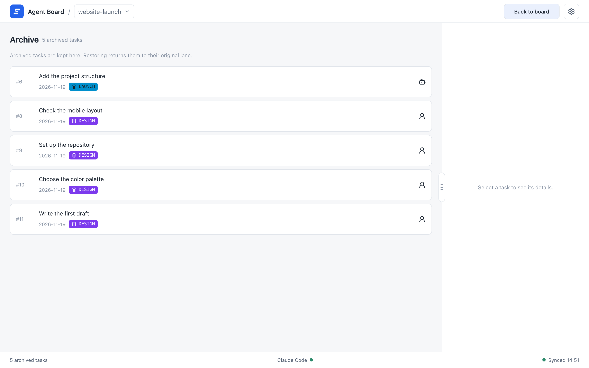

# The board

The board is where you watch the work and step in while the agent keeps going. You see what is moving and what is waiting, and you can move a card, check a condition, or rewrite a task without stopping the agent; it follows the change the next time it reads the board. This page covers the daily actions; the ideas behind them are in [The work model](../work-model). When the agent stops to ask you something, you answer in [Decisions](../delegate/decisions).

## Add work

1. Select a project in the header and choose **Ask AI**.
2. Write what you want done, attach images if they help, and choose **Send request**. The request is not a task: it goes to the agents as a message, and it counts under **Your requests** in the band above the lanes, where the list shows it as **Waiting to be picked up**, until an agent receives it.

The board has no form for adding a task by hand. Agents create tasks from your requests, and you can also add one with `agboard add` (see [CLI](../reference/cli)). A new task appears at the end of Todo. The owner cannot be changed after the task is created.

## Read a task {#read-a-task}

Select a task to open its details on the right. The tabs show:

| Tab | Shows |
| --- | --- |
| **Description** | The task's body. |
| **Conditions** | The task's own acceptance conditions and its progress. |
| **History** | What happened, newest first, each entry with its time and reason. |
| **Epic** | The details of the epic the task belongs to, if any. |

{.screenshot}

The panel on the right shows the selected task. The Conditions tab lists the task's own acceptance conditions with a progress bar. Each condition is drawn as Markdown, like the task body, so it can hold links, code, and images. An epic's own reference conditions stay in its Markdown details.

You can check and uncheck a condition in the Conditions tab. The change shows at once and is saved right away; if it cannot be saved, the checkbox goes back and a message says so. Your choice is saved over the latest file, so it wins even if an agent changed the task after you opened it, and the rest of the file, including the agent's other changes, stays. The history records that a person checked or unchecked the condition.

- When you check the last condition of an AI-owned task in Todo or Doing, the task moves to Done by itself, the same as when an agent checks it.
- Unchecking a condition of a task in Done leaves it in Done. Move it yourself if work should continue.
- An archived task's conditions cannot be changed. To change a condition's text, restore the task and open its preview.

On a touch screen, swipe the panel sideways to move to the next or previous tab. The next tab follows your finger, as the tabs of a task do on a phone. A mouse does not drag the panel, so you can still select text with it. A swipe that starts on a button, a link, code, an image, or a table that scrolls sideways is left to that element.

Each tab loads its text when you open it. The number on the **History** tab appears after the history has loaded.

## Move a task

On a touch screen, press the grip at the left of the card's header and move your finger to drag at once. Pressing elsewhere on the card and holding for a moment also drags it, and a quick swipe scrolls the column instead.

On a touch screen the buttons, tabs, and theme tiles are at least 44 px high, and a dialog opens without raising the on-screen keyboard. Tap a field to start typing. On a tablet, the dialog then moves into the space above the keyboard and makes room for the field you are typing in: its margins and buttons get smaller, and panels you are not typing in, such as the editor's outline and attachments or the question beside your answer, fold away until the keyboard closes.

In a window narrower than 1024 px, **Docs**, **Epics**, and **Archive** in the header show only their icons, all at the same width, so the project name keeps its room.

Drag a task to another column and confirm the move. The reason field is optional; if you leave it empty, a reason is generated from the move.

If an agent or another browser moves the task while the dialog is open, the move is not made. The dialog shows the column the task is in now and says so, and the reason you typed stays. Confirm again to move it from there.

The columns mean:

| Column | Meaning |
| --- | --- |
| Todo | Work that has not started. |
| Doing | Work in progress. AI-owned tasks also show an agent state. |
| Done | Completed work. |

AI-owned tasks in Doing show **Idle**, **Running**, or **Pending**. Todo tasks can also be Pending when an agent asks a question before starting. User-owned and Done tasks are always Idle. Running means the agent is working; Pending means it needs your answer, which you give from the card's **Answer the question** button or from the list of the **Messages** band above the lanes (see [Decisions](../delegate/decisions)). Moving a task to another column resets a Running task to Idle; an open question stays open, so a waiting task in Todo or Doing stays Pending. Every change and its reason stay in the history.

## Change a task

To edit a task or put it in an epic, choose **Open full screen** in the details toolbar. The preview uses the same editor, and opening it changes nothing. Your first change makes the task a draft, and **Save** finalizes it. See [Preview and save](./editing#preview-and-save) for the details.

## Drafts

A draft is a task that agents must leave alone while you write it. Agents cannot change a draft, including its `TASK.md` file.

- Tasks that agents create start as AI drafts.
- To change an existing task, open its preview. Your first change makes it a draft, and **Save** releases it, so agents can work on the task again. The editor has no Draft checkbox.
- To drop your changes, choose **Cancel** and then **Discard and close**. The text returns to the saved version, and the history records `Discarded draft changes.`
- A running task opens read-only and cannot become a draft.

A draft is marked with a **Draft** chip on its card. If you forget to finalize, the agent cannot move or update the task.

If a draft is left behind, for example because a save failed and you closed the browser, choose **Finalize** in the task's details to release it. The **Finalize** button appears only on a draft.

### AI drafts {#ai-drafts}

Everything an agent creates is an AI draft. It is an ordinary task or epic card in Todo, with a **Draft** badge, and the lane header counts it like any other task. You can open it, read the plan, and answer the questions about it. While it is a draft, the agent cannot move it or change its state.

There is no button to start an AI draft and nothing to approve. Once its questions are answered and the plan is written up, the agent starts the draft itself, the badge goes away, and the task is an ordinary task. A question about the task that is still open keeps it a draft. A person can also start it from the command line with `agboard start <id> --actor human`, or an epic with `agboard epic start <EPIC-ID> --actor human`. If you want something changed first, send the agent a request with **Ask AI**. A draft you write yourself is different: only you finalize it (see above).

## Archive

Archive finished tasks to clear the board without deleting anything.

- Archive one task from its details, or choose **Archive completed tasks** in Done to archive several at once.
- Open **Archive** in the header to review archived tasks, restore them to their original column, or delete them permanently. Permanent deletion is possible only from Archive.

{.screenshot}

The Archive screen lists archived tasks with their ID, title, owner, date, and the epic they belonged to, if any. Select a task to see its details.

The details of an archived task use the same layout as an active task. **Restore** and the trash icon for permanent deletion sit at the top right, next to the close button. Permanent deletion asks for confirmation first.

## Narrow windows and phones {#narrow-windows-and-phones}

When the window is narrower than 768 pixels, and on a phone, the board shows the mobile layout instead of the lanes side by side: tabs for Todo, Doing, and Done with their counts, one lane at a time under them, and the **Messages** band above the tabs, which shows what waits on you and opens the list. Tap a tab or swipe sideways to change lanes. Choose a task to read it in a drawer, check its conditions, and answer a decision. Hold a task and swipe it to move it to the next lane or to archive it, and use **Archive all** in the Done lane to archive every completed task. The project switcher and the settings button stay in the header. Adding and editing tasks are for a wider window.

The layout follows the window as you resize it. The project you chose stays, and an answer you have entered but not yet sent is kept when you switch between the two layouts. The mobile layout is described in [Remote access](./remote-access).

## Updates

The board updates itself when a change is saved, whether an agent made it or another browser on this PC did. There is no refresh button; reloading the page reads everything again.

The board follows changes while a details panel is open beside it. When an agent moves the task or checks a condition, the card and the panel show it at once, so you can read a task and watch its progress together.

While an editor or a dialog is open, automatic updates wait, so the text you are editing does not move. They are applied about three seconds after you close it.

A decision is the exception. When an agent asks for a decision, or a decision is answered or withdrawn, the board shows it at once, even while an editor or a dialog is open.

## Settings

Open **Settings** to choose the language (English or Japanese) and one of 24 themes (12 colors, each in light and dark).

The choice is saved on this PC, so every browser on this PC shows the same language and theme. Changes apply at once to the other open pages, including other browser windows and remote access, without a reload. The first start uses English and light blue; the board does not follow the browser or OS settings. Task text is not translated. CLI help, errors, and JSON values stay in English.

**Phone notifications** chooses which notifications the board may send to your phone, and the same section is in the phone layout. The choices are saved on this PC, like the language and theme, and apply once notifications are delivered to your phone; changing them sends nothing by itself.

- **Results**, **Questions that need my decision**, **Card state changes**, and **History additions** are switched one by one. Results and questions are on at first; the other two are off. All four can be off.
- With **Card state changes** on, pick which changes you want: **Started**, **Waiting for an answer**, and **Done**.
- **Periodic status notification** is separate from the four choices above and is off at first. When it is on, choose an interval of 30 minutes, 1 hour, 2 hours, or 4 hours.

The width of the detail panel is not part of these settings. Each browser keeps its own width.

Below the themes, three rows open other features. Each has an icon, a title, one line of description, and a button:

- **Tutorial** with **Try it** closes the dialog and shows the [first-run guide](#the-first-run-guide) again, on the screen you are using.
- **Remote connection** with **Connection settings** opens the setup for checking the board from a phone with ngrok; see the [remote access guide](./remote-access).
- **Resident session** with **Resident session settings** opens the dialog that starts and stops an agent session kept attached to the board; see [Resident session](../delegate/resident-session). While a session is launched, or auto-start is on, the footer also shows its tool and state, and clicking it opens the same dialog.

{.screenshot}

The dialog has a language switch and a grid of themes: one row of 12 light colors and one row of 12 dark colors. On a narrow window the button of each row moves under its description.

{.screenshot}

The same board after choosing a dark theme.

## The first-run guide

The first-run guide runs in your browser, on the PC board and on the phone screen, and it works the same way through the ngrok address. The text is the same in both. On a phone, the welcome and finish messages are centered cards. Each explanation sits at the bottom of the screen, and the buttons are full width; two buttons in a row, such as **Skip** and **Start guide**, share the row evenly.

The guide has five steps. At each one, the cards are drawn in a frame at the top of the lane the step is about, over the dimmed board. On a phone, the screen switches to that lane for you. They are not part of your board: they are not saved, they do not change the counts, and agents never see them. While the guide is on screen the rest of the board is covered, so you cannot open or move cards until the guide ends.

1. **Ask AI.** The real **Ask AI** window (on a phone, its bottom sheet) opens with a sample request already written. Press **Send request**. The request is not sent anywhere. If you close the window, **Open Ask AI** brings it back.
2. **A plan.** The request becomes an epic and cards in To do. The cards are AI drafts, marked **Draft**, and each shows how many acceptance conditions it has.
3. **A question.** Before it starts, the agent asks a question on the first card. Choose **Answer the question** on the card to open the same answer dialog (on a phone, the same bottom sheet) that real questions use, choose an option, and send it. The answer only moves the guide on; it is not sent to the server. While the answer sheet is open on a phone, the explanation shrinks to a slim strip at the top of the screen.
4. **The plan starts.** The drafts become ordinary cards, and the first one moves to In progress with its acceptance conditions being checked.
5. **Done.** The cards reach Done by themselves once all their acceptance conditions are checked.

If the window width changes in the middle of the guide, it continues from the same step. Any number of browser tabs can show the guide at the same time. See [Before you start](../quickstart.md#before-you-start-the-first-run-guide).

## Next

- [Decisions](../delegate/decisions): answer an agent's question.
- [Epics and progress](./epics): group tasks and see what to do next.
