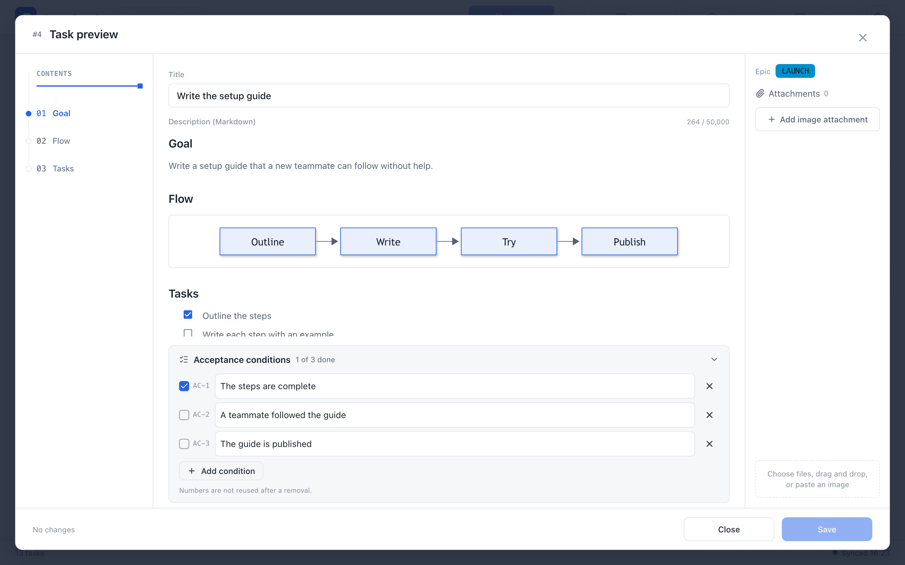
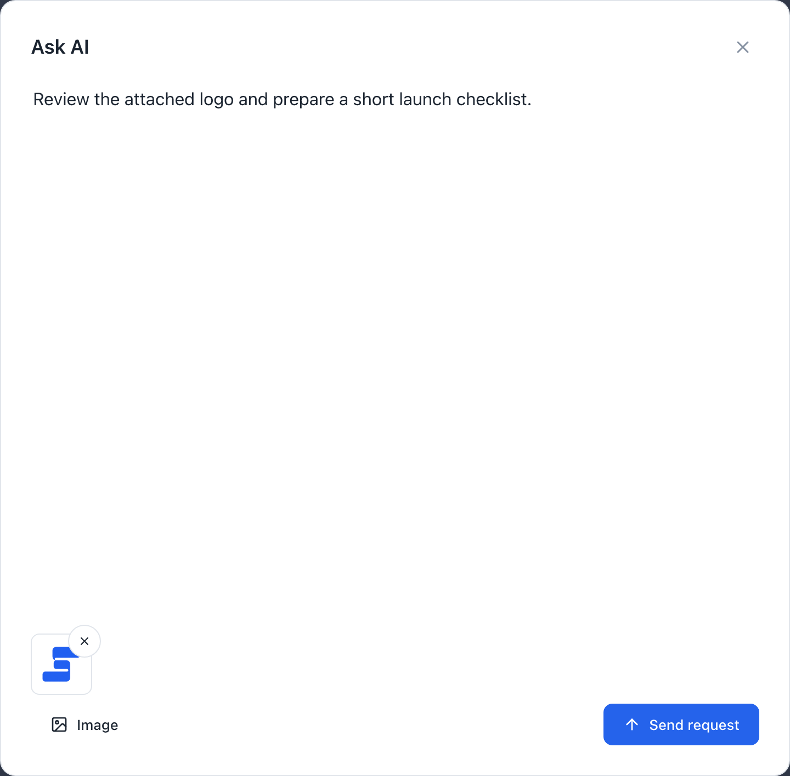

# Editing and image attachments

Tasks and epics are written in a Markdown editor. A task's completion conditions sit in a panel below the text, and tasks accept image attachments. Record verification results in the task body or history. Agents edit the same content as plain files in the project's shared folder. This page covers the editor and images; the file format is in [Markdown file format](../reference/file-format).

## Write tasks and epic details in the editor

{.screenshot}

The editor shows the outline on the left, the Markdown body in the middle, and the epic and image attachments on the right.

- **Formatting.** The editor supports headings, task lists, tables, code blocks, Mermaid diagrams, and images. Click an image or a diagram to enlarge it.
- **Outline.** Use the outline to jump to a heading in the body. Edit acceptance conditions in the panel below the body.
- **Saving.** **Save** writes all of the dialog's changes together. Record verification before you check off a completion condition.
- **Conditions.** When you create or edit a task, its acceptance conditions sit in a panel below the body, which starts folded. Expand it to edit them; a long list scrolls inside the panel. Conditions have stable IDs and cannot be reordered. To read conditions on an existing task, use its **Conditions** tab. An epic has no conditions panel: its reference conditions are ordinary Markdown in its details.

For the epic dialog (name, color, details, and task order), see [Epics and progress](./epics). For drafts, see [The board](./board#drafts).

## Preview and save {#preview-and-save}

Open a task's preview with **Open full screen** in the details toolbar. An epic's preview opens from **Open full screen** at the right of the epic label on the epic tab of a task, or from the pencil button (**Edit epic**) in an epic's details. Archived tasks open in the same preview, read-only, with the reason **Read-only because it is archived.**

The preview opens with the title shown as **Task preview** or **Epic preview**, and its **Close** button is enabled. Opening it changes nothing: the task or epic is not made a draft, and its history does not change. While you have made no change, the preview follows the latest content, including changes from agents and other browsers. The bottom left shows when it was last updated.

Your first change to a task's title, description, conditions, or images, or to an epic's name, color, details, images, or task order, does three things:

- The task or epic becomes a draft, and the **Draft** chip appears in the header.
- The bottom left says **You have unsaved changes.** and **Agents can't change this task until you save.** For an epic, the last sentence says **Agents can't change this epic until you save.**
- **Save** becomes enabled, and the preview stops following updates.

**Save** writes your changes and releases the draft in one step. If the item was already a draft before you opened the preview, it stays a draft. You can also save with Cmd+S on macOS or Ctrl+S; the keys do nothing while **Save** is disabled.

To drop your changes, choose **Cancel** and then **Discard and close**. The text returns to the saved version and the draft is released. A draft that was already there before you opened the preview stays. If you type the original text back, the item stays a draft until you close the preview.

The preview cannot save in these cases. Your text stays, and the bottom left says why:

- The task started running after your first change. The agent may now be working on it.
- The task or epic changed while the preview was open, so saving would overwrite the newer content. Choose **Cancel** and then **Discard and close**, and open the preview again to see the latest content.

A running task opens read-only, with a **Running** chip and the reason **Read-only while an agent is working.** Its fields and image attachments are disabled. When the agent stops, the preview becomes editable again. If a save fails because of a connection error, the dialog keeps your text and you can try again.

## Ask AI

Choose **Ask AI** in the board header to open the request form. On a phone, the **Ask AI** button in the messages band opens the same form as a bottom sheet. Write what you want done, attach images if they help, and choose **Send request**.

The form is laid out like a chat input. The only text on top is the title, with a close button at its right. Below it, a plain text field fills the form, and a toolbar sits at the bottom: **Image** on the left, and **Send request** with an up arrow on the right. **Send request** is disabled until you have typed text or attached an image. Attached images appear above the toolbar as small thumbnails, each with a small × to remove it. To leave without sending, use the close button at the top right. On a phone, the same form is a bottom sheet, and its toolbar stays above the on-screen keyboard while you type.

{.screenshot}

The request is a message to the agents, not a task. It is not linked to any task or epic, so the form has no epic picker. When an agent receives it, the agent decides how to turn it into a plan, and the plan appears in Todo for you to review and start. Until then, the band above the lanes lists the request as **Waiting to be picked up**. You can withdraw a request before an agent receives it.

The text field is plain text, without headings or lists to format. The text is required, up to 20,000 characters, so an image alone enables **Send request** but the form then asks for text. Images use the same PNG, JPEG, WebP, and GIF limits as task attachments. Choose **Image**, paste an image into the text, or drop one onto the form; the images are sent with the request. If sending fails, the form keeps your text and images so you can try again.

To create a task yourself instead, open the small menu beside **Ask AI** and choose **Add a task manually**. The full task editor lets you set the title, description, assignee, draft state, conditions, and images yourself. The usual task editor and its save behavior remain available.

## Add images

In the browser editor, select, drop, or paste an image, then insert it into the text. Images can be PNG, JPEG, WebP, or GIF, up to 10 MiB each, with at most 20 per task and 50 MiB in total.

From the command line:

```sh
agboard --project "My project" attachment add 1 --file diagram.png --actor ai
agboard --project "My project" attachment ls 1 --json
agboard --project "My project" attachment get 1 "<attachment-id>" --output diagram-copy.png
```

Images are referenced in the Markdown as `attachment:<attachment-id>`, and the image bytes stay in local files. Snapshots include the image metadata; the progress table and hooks leave it out. `attachment get` never overwrites an existing output file.

## Edit the files directly

Agents, and you, can also edit a task's `TASK.md` and an epic's `EPIC.md` as plain files; the board notices the change. Find the project's folder instead of guessing its location:

```sh
agboard --project "My project" workspace --json
```

The result contains `folder` (the project's absolute path), `projectId`, `readme`, `tasks`, and `epics`. Read the project's `README.md` first. Write a temporary file in the same folder and rename it over the original, so that the board never reads a half-written file. Use the CLI for metadata and status changes; never edit `task.json`, `epic.json`, `project.json`, or the lock files, and never delete task or epic folders by hand. Keep personal absolute paths out of shared files.

The required structure of these files is in [Markdown file format](../reference/file-format).

## Next

- [Markdown file format](../reference/file-format): frontmatter, history, and automatic Done.
- [CLI reference](../reference/cli): every command.
