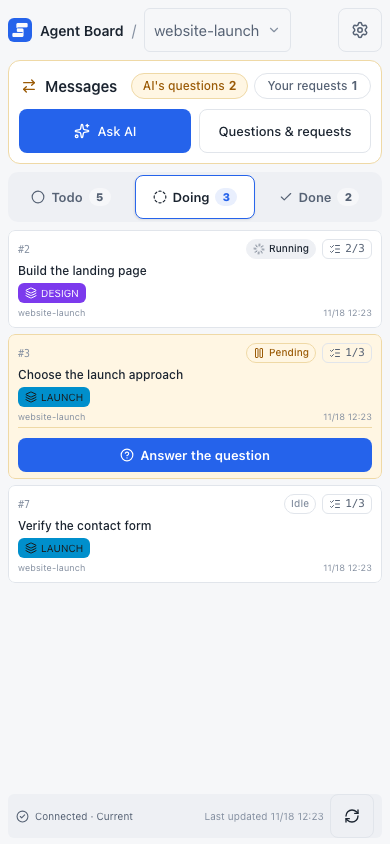
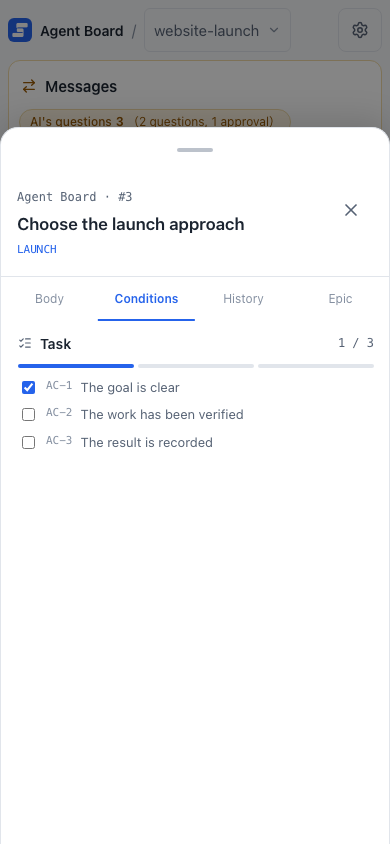

# Remote access

Remote access opens the board from another device when you are away from your desk, most often a phone. Use it to check progress and to answer an agent's question. This page explains what the phone screen shows, how to connect it with ngrok, and how to check that it works.

::: info Public preview
This feature is in public preview. Its behavior and specifications may change. See [Feature stages](../feature-stages#remote-access) for its current limitations.
:::

## What the monitor shows

The monitor shows one project at a time. The address names it (`?project=`), and the project switcher in the header lists every project, as on the PC. The screen shows one lane at a time, Todo, Doing, or Done, and you move between them as described in [Switch lanes](#switch-lanes). AI-owned tasks show their agent state inline; Pending questions in Todo or Doing show an **Answer the question** button on the task, which opens an answer sheet from the bottom.

The **Messages** band sits above the lane tabs. It shows how many questions wait on you and how many of your requests no agent has picked up. **Questions & requests** slides up a sheet with the open messages in two tabs; pick a question to answer it there, with **Back to list** (or **Later**) and **Send answer** pinned at the bottom (see [Decisions](../delegate/decisions#answer-on-your-phone)).

AI drafts show as ordinary cards in the Todo lane with a **Draft** badge, and the Todo tab counts them. The agent starts them itself once its questions are answered (see [Drafts](./board#drafts)).

{.screenshot--narrow}

### Switch lanes

The tabs under the header are named **Todo**, **Doing**, and **Done**, and each shows how many tasks its lane holds. Tap a tab to show that lane. You can also swipe sideways anywhere on the lane, including from a task you have not chosen, to move to the lane beside it. A swipe past Todo or Done stays where it is. Each lane scrolls on its own, and a vertical scroll never changes the lane.

### Move or archive a task

Moving and archiving start from a task you have chosen, so a stray swipe does not change anything.

1. Press and hold a task until it shows an outline. That chooses it.
2. Swipe the chosen task sideways. A swipe to the left shows a button for the next lane and the red **Archive** button with a trash can icon. A swipe to the right shows a button for the previous lane. The same press that chose the task can continue into the swipe. Each lane button shows the icon of its lane; a screen reader reads it as, for example, **Move #3 to Doing**.
3. Tap a button. A lane button opens **Move task**, where you can add a reason and choose **Move**. The archive button opens **Archive task**, where you choose **Archive**. Nothing changes until you confirm, and **Cancel** leaves the task where it was.

{.screenshot--narrow}

Swipe the task back, or tap anywhere outside it, to close the buttons without a change. A swipe never deletes a task. Archived tasks can be restored, and permanent deletion is only available from the archive screen of a wider window, as on the PC.

### Archive all done tasks

The Done lane has an **Archive all** button below its cards. It opens **Archive completed tasks**, which lists every task that would be archived; choose **Archive** with the count to confirm. The button is disabled while the lane is empty.

### Read a task

Tapping a task opens a bottom drawer with **Body**, **Conditions**, **History**, and **Epic** tabs. The drawer slides up from the bottom, follows a downward drag of its top area (the handle and header, not the close button), and closes when dismissed; each tab's content scrolls independently. The Conditions tab shows only the task's own conditions; epic reference conditions remain in the epic details. The Epic tab shows the epic details without repeating the label or title already shown in the drawer and body. The monitor can answer a pending question, check and uncheck a task's acceptance conditions in the Conditions tab (they work as on the board; see [The board](./board#read-a-task)), and change the language and color theme. Through the passcode you can also do what the PC board does, as described in [Use the whole board through the address](#use-the-whole-board-through-the-address). The connection settings stay on the PC.

{.screenshot--narrow}

Horizontal swipes move the tab content and underline together. Gestures inside the tab content stay within that area; drag the handle or header to dismiss the drawer. Opening a task reads its text, conditions, history, and epic once, so switching tabs does not wait for a read. If a read fails, use the retry button in that tab.

The monitor updates itself when the PC saves a change. To read the latest data at once, choose the **Refresh** button in the header. The page keeps the last data it has while it reads again.

The page and the data responses are never cached. The browser keeps the scripts and styles, so later visits download only the page and the data. The monitor has no offline snapshot cache or service worker.

After you install a new version and restart `agboard serve`, an open monitor reloads itself to show the new UI. If you have answers that are not sent or a task drawer open, it waits until you send or clear the answers, or close the drawer. When disconnected, the page reports the connection state.

## Before you start

You need an ngrok account and its authtoken. The **Remote connection** dialog has a button that opens the ngrok page where you copy the token. Agent Board opens the address without any of ngrok's Traffic Policy features, including its Google sign-in (OAuth), which a free ngrok account cannot use. A free account can therefore run the monitor; the other limits and terms of your ngrok plan still apply.

Agent Board uses ngrok to open a public HTTPS address that leads to the board, behind the passcode. The PC's own address of the board stays on `127.0.0.1`. Never expose the board to the public Internet and never use router port forwarding. ngrok ends the HTTPS connection, so ngrok can process the traffic; the connection is not end-to-end encrypted between your PC and your phone.

## How the passcode protects the monitor

The monitor is guarded by a 4-digit passcode. Agent Board does not use Google authentication or ngrok's sign-in, and it keeps no list of allowed accounts.

- Each time the connection starts, Agent Board makes a new passcode from the operating system's random source, from `0000` to `9999`. It is kept in memory only: it is not saved to a file, logged, or put in the monitor page.
- You see it on the PC only: in the **Remote connection** dialog, in step 2 **Enter the passcode**, and on the startup line of `agboard serve --monitor ngrok`.
- The phone opens the address, asks for the passcode, and shows nothing of the board until the passcode is right. The connection then lasts up to 12 hours, after which the phone asks for the passcode again.
- After 5 wrong passcodes in a row, the monitor stops accepting any passcode, even the right one. Stop the connection and connect again (or restart `serve`) to get a new passcode and a fresh count.

Whoever enters the passcode can use the whole board for up to 12 hours, as on the PC: read every project, and add, edit, move, archive, and delete tasks and epics. Only the connection settings stay on the PC. Giving someone the passcode gives them that access.

A 4-digit passcode has only 10,000 possibilities, so it is weaker than signing in with an account. The 5-attempt limit, the random address that ngrok chooses, and a new passcode at every start make guessing hard, but they are not a substitute for keeping the address private. Treat the address and the passcode like a password pair:

- Do not share the address or the QR code in public places.
- Stop the connection when you are not using it.
- The address is one that ngrok chooses at random. It is harder to find, though it is not a secret you can rely on.

Because ngrok adds nothing for Agent Board to check, the monitor checks two things itself: the request names exactly the public address, and the passcode. ngrok ends the HTTPS connection and can see the traffic, and anyone who manages your ngrok account can change how the address is served. The passcode does not protect against them.

A program that is already running on your PC can send requests straight to the monitor's local port without going through ngrok. It still needs the passcode to read anything, but it can use up the 5 tries, which closes the monitor to the phone until you stop and connect again. Agent Board trusts the person who uses the PC, so it adds no further protection against this. Run the connection only on a PC you trust.

## Connect from the PC

1. Open the board, then open **Settings**. In **Remote connection**, choose **Connection settings**. The settings dialog closes and the **Remote connection** dialog opens with **Not connected**.
2. In step 1, **Get a token**, choose **Open the token page**. Sign in to ngrok and copy the authtoken.
3. In step 2, **Paste and connect**, paste the token into **ngrok auth token**.
4. Decide whether to keep the token with **Save the token on this PC** (see [Where the token is kept](#where-the-token-is-kept)).
5. Choose **Save and connect**.

While it connects, the dialog shows **Connecting to ngrok…** in place of the two steps. When it is ready, the dialog shows **Accepting connections**. Step 1, **Scan the QR code**, has the QR code and **Copy URL**, which copies the address. The address includes the project selected on the PC. To monitor another project, select it on the PC, then scan the new QR code or copy its URL again. Step 2, **Enter the passcode**, shows the 4-digit passcode. The QR code only carries the address: the phone still has to enter the passcode, and the PC does not ask you to approve a device.

The passcode is shown only while the connection is running. It is new every time the connection starts, so a stopped or failed connection has none.

To give someone the address and passcode while the connection is up, run `agboard --project "<name>" remote`; it prints both on this PC only. See [Give the phone address and passcode](../reference/cli#give-the-phone-address-and-passcode). You can also ask your agent for the remote access URL; the plugin's `remote` skill (`/agent-board:remote` in Claude Code) runs the same command and replies with both, and it never starts the connection. Sharing the passcode in a chat gives everyone who reads that chat access to the board until you stop the connection.

If ngrok cannot be reached, the dialog says so and gives the reason. Check the token and the internet connection, then choose **Save and connect** again. The board on the PC keeps working.

## Where the token is kept

- A token you type is used only while Agent Board is running and is not saved.
- To keep it, select **Save the token on this PC** before you connect. The token is stored in this PC's secure storage, the one your operating system provides. It is never written to the data folder.
- If the `NGROK_AUTHTOKEN` environment variable is set, it takes priority over a saved token. The dialog then says it is using the environment variable, and you can leave the token field empty.
- A saved token is shown as saved in this PC's secure storage. Choose **Delete the saved token** to remove it.
- After Agent Board is updated or reinstalled, the operating system may ask whether Agent Board may use the saved token. The board keeps working while it asks. Once you answer, the dialog shows the saved token.
- If the PC has no usable secure storage, the dialog says **This PC cannot save the token. Enter it each time.** and the save option is unavailable. Enter the token each time you connect.

Whether the connection stays on is stored in Agent Board's internal area. You do not edit a file for it. The passcode is not stored anywhere.

## Open it on the phone

1. On the phone, open the URL or scan the QR code.
2. The page shows **Enter the passcode**. Type the 4-digit passcode shown on the PC and choose **Connect**.
3. The monitor opens. The connection lasts up to 12 hours; after that, or when the connection was stopped and started again on the PC, the page asks for the passcode again.

An address without a project opens the board, and you choose the project with the project switcher in the header. Links that ended in `/monitor/` in earlier versions are not served any more: they show a not-found answer. On the PC, open the remote connection settings and scan the current QR code again.

## Use the whole board through the address

The address from the QR code, for example `https://….ngrok.app/?project=…`, opens the board itself: the same board as on the PC, with the screen chosen by the window width (below 768px you get the monitor described above). It asks for the same 4-digit passcode, shows nothing of the board until the passcode is right, and then lets you do what you can do on the PC board, such as editing, moving, and deleting tasks, answering questions, and reading the project documents. The passcode lasts up to 12 hours and has the same limit of 5 wrong tries.

Two things stay on the PC even then: the **Remote connection** settings, and opening a project document in the PC's own application. Anyone who has the address and the passcode can change your tasks, so keep both private.

The monitor opens in the language and color theme saved on the PC. If you change them on the phone, from the settings in the monitor header, the new choice is saved on the PC too, so the board and every other browser or phone show it. A change made on the PC appears on an open monitor at once.

On ngrok's free plan, the first visit from a phone shows ngrok's warning page. Choose **Visit Site**, and the monitor opens. ngrok shows the warning to each visitor only once.

Knowing the address is not enough to read the board. A wrong passcode is refused without saying how many tries are left. After 5 wrong passcodes in a row the page says **Too many wrong passcodes** and takes no more; stop the connection on the PC and connect again to get a new passcode. If the page says the connection is stopped, check the PC.

## Stop and connect again

Choose **Stop connection** in the dialog to close the connection. The dialog shows **Stopped**, and the saved token stays on this PC. The phone can no longer read the board or send answers, and the connection stays off the next time Agent Board starts. To connect again with the saved token, choose **Reconnect**. To use another token, choose **Change settings**, paste the token, and choose **Save and connect**.

If the connection drops, for example because the PC slept or the network changed, stop it and connect again. To use another token while connected, choose **Reset token**, which shows the setup again, enter the new token, and choose **Save and connect**. This replaces the connection, so the phone has to enter the new passcode. Closing the dialog instead leaves the connection as it was.

When the connection was left on, it starts again the next time Agent Board starts, as long as a token is available from the environment or this PC's secure storage. Without one, the dialog asks for the token.

## Check that ngrok keeps no traffic content

ngrok's Traffic Inspector can keep request details if **Full Capture** is turned on for your account. Agent Board cannot turn it off for you. In the ngrok dashboard, open **Settings** → **Observability** and confirm that Full Capture is disabled. Do this before you use the monitor.

## Start it from the command line

To start the connection with the server, set the token in the environment:

```sh
export NGROK_AUTHTOKEN=<your authtoken>
agboard serve --monitor ngrok
```

The command prints the phone address and the passcode with the local address, for example `Serving at http://127.0.0.1:7420/; remote access at https://… with passcode 4821`, or in the `monitor` field with `--json`. The passcode changes each time the server starts. If the connection cannot start, `serve` stops with exit code 1. The other options are in the [CLI guide](../reference/cli).

When the computer sleeps or the server stops, the monitor is unavailable until the server and the connection run again. A server that an agent's command started keeps the saved connection and does not stop by itself while the phone is connected; stop the connection on the PC to let it stop.

## Check on a phone

On a tablet or phone, the page keeps the height it had before the software keyboard opened, so the lanes do not jump. While the keyboard is open, a dialog that is normally centered moves to the top of the visible area and shrinks to fit above the keyboard, in portrait and in landscape, so its title, the field you type in, and its buttons stay visible while the middle of the dialog scrolls; the answer sheet keeps its top on screen. Responsive browser tests cover narrow viewports; the software keyboard needs a real-device check. Open the monitor in the phone's browser and open the answer sheet of a Todo or Doing task with a Pending question. Confirm that the keyboard leaves the answer field and the Previous and Next buttons reachable, then send the answer with Send on its last question. Also check scrolling in long Body, Conditions, and Epic tabs, horizontal tab swipes, and downward dismissal from the handle and header. Browser emulation alone does not verify Safari's keyboard behavior.

## Next

- [Decisions](../delegate/decisions): answer a question from your phone.
- [Troubleshooting](../operations/troubleshooting): the page does not load or does not update.
