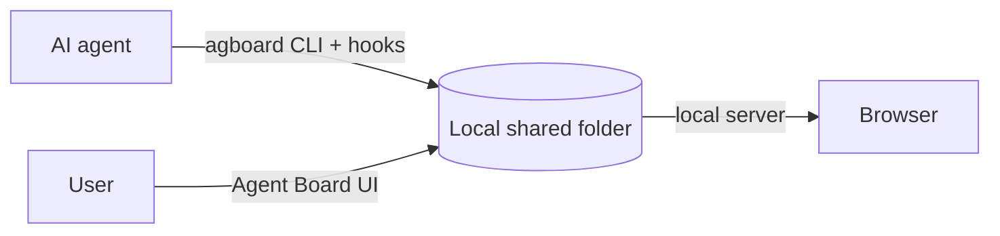

## See it in action

<video class="demo-video" :src="withBase('/videos/demo.mp4')" :poster="withBase('/videos/demo.jpg')" autoplay muted loop playsinline></video>

One card, start to finish: the agent starts the task and asks a question, you answer on the card, and the agent resumes. When every acceptance condition is checked, the card moves to Done on its own.

## The board

When an agent works for a long time, you need to see what is moving, what is waiting, and what response will unblock it. Agent Board gives users and agents one shared, history-backed board.

{.screenshot}

## Epics and progress

Epics order the tasks, and the progress table shows which work can advance next.

{.screenshot}

## On your phone

Answer decisions and check status from a bottom drawer with Body, Conditions, History, and Epic tabs.

{.screenshot .screenshot--narrow}

## How it fits together

